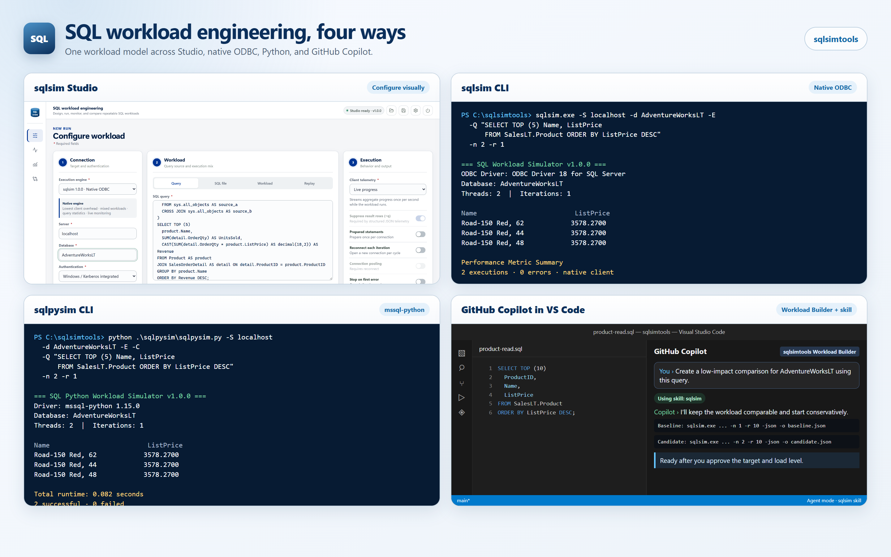

<!-- markdownlint-disable MD033 MD041 -->

<p align="center">
  
</p>

<h1 align="center">SQL Workload Engineering</h1>

<p align="center">
  Native and Python workload engines, a local browser studio, and agent guidance
  for repeatable SQL Server performance experiments.
</p>

<p align="center">
  <a href="INSTALL.md"><strong>Install</strong></a>
  &nbsp; | &nbsp;
  <a href="BUILDING.md">Build from source</a>
  &nbsp; | &nbsp;
  <a href="USING-WITH-AGENTS.md">Use with agents</a>
  &nbsp; | &nbsp;
  <a href="https://github.com/microsoft/sqlsimtools/releases">Releases</a>
</p>

<p align="center">
  <a href="https://github.com/microsoft/sqlsimtools/actions/workflows/sqlsim-ci.yml"></a>
  <a href="https://github.com/microsoft/sqlsimtools/actions/workflows/sqlpysim-ci.yml"></a>
  <a href="https://github.com/microsoft/sqlsimtools/actions/workflows/sqlsimstudio-ci.yml"></a>
  <a href="LICENSE"></a>
  <a href="https://agent-plugins.org/specification"></a>
</p>

<p align="center">
  
</p>

> [!NOTE]
> **Preview status.** sqlsim and sqlpysim are Public Preview on Windows and
> Ubuntu x64. Their macOS ARM64 paths are invitation-only Private Preview for
> customers and testers helping validate platform support. sqlsim Studio is
> Public Preview on Windows x64. sqlsim Studio on Ubuntu x64, Windows ARM64,
> and macOS ARM64 remains invitation-only Private Preview while platform
> testing continues. To ask for access, open a
> [Private Preview request](https://github.com/microsoft/sqlsimtools/issues/new?template=private-preview.yml).

## Four Ways to Work

| Configure visually | Native ODBC | mssql-python | Workload Builder + skill |
| --- | --- | --- | --- |
| **[sqlsim Studio](sqlsimstudio/)** configures, runs, monitors, replays, and compares workloads in a self-contained local browser app. | **[sqlsim](sqlsim/)** is a C++/ODBC workload engine for low-overhead query, script, replay, and concurrent load testing. | **[sqlpysim](sqlpysim/)** is a Public Preview Python port that shares sqlsim's core workload interface, with documented compatibility gaps. | **[GitHub Copilot and other agents](#agent-ready-by-design)** use the bundled skills and the sqlsimtools Workload Builder to design, run, and compare workloads from plain-language requests. |

All four target SQL Server 2019, 2022, and 2025, Azure SQL Database, Azure SQL
Managed Instance, and SQL database in Microsoft Fabric.

## Get Started

**1. Install the prerequisite.**
[Microsoft ODBC Driver 18 for SQL Server](https://learn.microsoft.com/sql/connect/odbc/download-odbc-driver-for-sql-server)
is required by sqlsim and sqlsim Studio. sqlpysim also needs Python 3.10 or
later.

**2. Download one package** from the **[latest release](https://github.com/microsoft/sqlsimtools/releases/latest)**, under **Assets**:

| You want | Download |
| --- | --- |
| Everything: sqlsim Studio plus both command-line engines, Windows x64 | `sqlsimtools-<version>-win-x64.zip` |
| The native command-line tool | `sqlsim-<version>-win-x64.zip`, `sqlsim-<version>-win-arm64.zip`, or `sqlsim-<version>-linux-x64.tar.gz` (Ubuntu) |
| The Python command-line tool, Windows or Ubuntu | `sqlpysim-<version>-src.zip` |

`<version>` is the release number, for example `1.0.0`. Older versions are on
the [Releases](https://github.com/microsoft/sqlsimtools/releases) page.

> [!TIP]
> **On Windows, unblock the ZIP before you extract it.** Windows marks
> downloaded files as coming from the internet, and the tools are not code
> signed, so a blocked download can trigger a SmartScreen warning for Studio and
> stop the PowerShell examples from running. If you trust the download,
> right-click the ZIP, choose **Properties**, select **Unblock**, and click
> **OK**, or run `Unblock-File .\sqlsimtools-<version>-win-x64.zip` in PowerShell. See
> [INSTALL.md](INSTALL.md) if you already extracted it.

**3. Run your first workload — choose one of these four paths.**

*sqlsim Studio:* extract the sqlsimtools ZIP and start Studio. It opens in your
browser; examples are in `sqlsimstudio\examples\`.

```powershell
.\sqlsimstudio\sqlsimstudio.exe
```

*sqlsim:*

```powershell
.\sqlsim\x64\sqlsim.exe -S localhost -E -Q "SELECT @@VERSION"
```

*sqlpysim:*

```powershell
python -m pip install -r .\sqlpysim\requirements.txt
python .\sqlpysim\sqlpysim.py -S localhost -E -C -Q "SELECT 1" -n 10 -r 100
```

*GitHub Copilot and other agents:* open the extracted folder in Visual Studio
Code. Copilot discovers the bundled skills and the **sqlsimtools Workload
Builder** agent; choose the agent in chat and describe the experiment, for
example *"Compare this query on localhost with and without an index."* For
Copilot CLI, Claude Code, Codex, Cursor, and other clients, see
[Agent-Ready by Design](#agent-ready-by-design).

Ubuntu, authentication (Microsoft Entra, access tokens, SQL logins), and
installing into an existing project are covered in
**[Install sqlsimtools](INSTALL.md)**. To compile the tools yourself, see
**[Build from source](BUILDING.md)**; everything else is in the
**[full project guide](PROJECT-GUIDE.md)**.

## Agent-Ready by Design

sqlsimtools ships portable skills for GitHub Copilot, Claude Code, Codex,
Cursor, Grok Build, and other Agent Skills clients. Install the guidance once,
then ask for a workload in ordinary language.

```powershell
copilot plugin marketplace add microsoft/sqlsimtools
copilot plugin install sqlsim@sqlsimtools
copilot plugin install sqlpysim@sqlsimtools
```

The plugin supplies guidance; the matching executable or Python runtime remains
a separate prerequisite. Release archives already include workspace skills,
portable `AGENTS.md` guidance, and the **sqlsimtools Workload Builder** custom
agent. See **[Using sqlsimtools with agents](USING-WITH-AGENTS.md)** to choose
between the release-overlay, marketplace plugin, and portable skill paths.

## Explore

| Destination | What you will find |
| --- | --- |
| **[Install](INSTALL.md)** | Release package chooser, prerequisites, extraction, verification, upgrades, and older versions |
| **[FAQ](FAQ.md)** | Support, privacy and data collection, security reporting, platform status, and how sqlsimtools compares with other tools |
| **[Driver compatibility](DRIVER-COMPATIBILITY.md)** | Validated ODBC Driver 18 and `mssql-python` versions, and what to expect from newer releases |
| **[Build from source](BUILDING.md)** | Supported build scripts, local release-shaped output, RC validation, and version publication |
| **[Use with agents](USING-WITH-AGENTS.md)** | Release-embedded skills, Agent Plugins, portable `AGENTS.md`, and the Workload Builder |
| **[Full project guide](PROJECT-GUIDE.md)** | Project overview: tools, futures, platform support, prerequisites, authentication, HTML reports, plugins, releases, repository layout, and contribution policy, with links to the detailed guides |
| **[sqlsim manual](sqlsim/sqlsim.md)** | Native CLI reference, workload formats, replay, metrics, JSON output, and examples |
| **[sqlpysim manual](sqlpysim/sqlpysim.md)** | Python CLI compatibility, driver behavior, setup, and examples |
| **[Studio guide](sqlsimstudio/README.md)** | Browser workflows, configuration profiles, platform status, and local builds |
| **[Future workloads](PROJECT-GUIDE.md#futures)** | Vector search plus independent TPC-inspired transactional and analytical workload ideas |
| **[Discussions](https://github.com/microsoft/sqlsimtools/discussions)** | Questions, design feedback, and new workload proposals |
| **[Security](SECURITY.md)** | Private vulnerability reporting through the Microsoft Security Response Center |

## Built in the Open

The code, scripts, tests, documentation, workload agent, and Studio experience
were developed with GitHub Copilot in Visual Studio Code and reviewed through
repeatable builds, security analysis, and live SQL validation.

During Public Preview, use
[Issues](https://github.com/microsoft/sqlsimtools/issues) for reproducible bugs
and scoped feature requests. Use
[Discussions](https://github.com/microsoft/sqlsimtools/discussions) for
questions and early ideas. External pull requests are not accepted yet; see
[CONTRIBUTING.md](CONTRIBUTING.md) for the current policy.

> [!IMPORTANT]
> **Support notice.** sqlsimtools is an open-source project, not an official
> Microsoft product. It is provided as-is under the MIT license and is not
> covered by Microsoft commercial support. Help is available only through the
> documentation, GitHub Issues, and Discussions in this repository. See
> [SUPPORT.md](SUPPORT.md).

---

<p align="center">
  <a href="PROJECT-GUIDE.md">Full guide</a>
  &nbsp; | &nbsp;
  <a href="https://github.com/microsoft/sqlsimtools/discussions/11">Welcome discussion</a>
  &nbsp; | &nbsp;
  <a href="LICENSE">MIT License</a>
</p>
