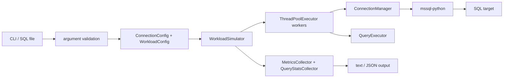

# Python SQL Workload Simulator (sqlpysim)

> [!IMPORTANT]
> **Public Preview.** sqlpysim is under active compatibility development and
> is not yet a drop-in replacement for sqlsim.

A Python-based SQL workload simulator using the mssql-python driver. It shares
sqlsim's core query and workload interface, with known advanced-feature and
output differences documented in [../RELEASE-NOTES.md](../RELEASE-NOTES.md).

**How This Tool Was Built:**
100% of the code, scripts, and documentation for sqlpysim was developed with GitHub Copilot in Visual Studio Code using various AI models, but 100% orchestrated by Bob Ward.

## Documentation

- **[sqlpysim.md](sqlpysim.md)** - **User manual** with complete usage guide, command reference, examples
- **[BUILD.md](BUILD.md)** - Installation and setup instructions
- **[SETUP.md](SETUP.md)** - Developer environment setup guide

## Quick Start for Users

See **[sqlpysim.md](sqlpysim.md)** for complete usage documentation.

> [!CAUTION]
> High thread counts (`-n`) can consume substantial CPU, memory, network
> bandwidth, and database connections on both the client and server. Start
> small, scale gradually, and monitor both machines. Use a dedicated client
> for significant load tests.

```powershell
# Install mssql-python driver
pip install mssql-python

# Simple query with Windows Authentication
python sqlpysim.py -S localhost -d testdb -E -Q "SELECT @@VERSION"

# Load test: 10 threads, 100 iterations each
python sqlpysim.py -S localhost -d testdb -E -i queries.sql -n 10 -r 100 -q

# Per-query server CPU, elapsed time, reads, rows, and execution counts
python sqlpysim.py -S localhost -d testdb -E -i queries.sql -querystats -json -q

# Azure SQL with Entra Interactive
python sqlpysim.py -S myserver.database.windows.net -d mydb -A -Q "SELECT @@VERSION"
```

## Quick Start for Developers

### Installation

See **[BUILD.md](BUILD.md)** for complete installation instructions.

```powershell
# Install dependencies
pip install -r requirements.txt

# Or install directly
pip install mssql-python

# Run tests
.\smoke-test.ps1
```

**Prerequisites:** Python 3.10+ and the mssql-python driver (tested pin `==1.15.0`)

Driver support policy and cadence are documented at [../DRIVER-COMPATIBILITY.md](../DRIVER-COMPATIBILITY.md).

### Development Environment

See **[SETUP.md](SETUP.md)** for complete development environment setup.

## Features

- **Generic SQL Execution**: Run any SQL queries or scripts
- **Multi-threaded**: Configurable number of concurrent threads (1 to 1000+)
- **Multiple Authentication**: Windows, Microsoft Entra (interactive, MSI, token), SQL Authentication
- **Broad Platform Support**: SQL Server, Azure SQL Database, Azure SQL MI, Microsoft Fabric
- **Zero Compilation**: Pure Python - no build step required
- **Cross-Platform**: Windows and Ubuntu Linux in Public Preview, with macOS ARM64 in Private Preview
- **Script Support**: Execute SQL files with GO batch separators
- **Performance Metrics**: Detailed connection, execution statistics with percentiles
- **Per-query Statistics**: sqlsim-compatible server CPU, elapsed, compile, read, row, execution, and failure aggregates with `-querystats`
- **JSON Output**: Machine-readable output for automation and monitoring
- **VS Code Workload Builder**: Release packages include `.github/agents/sqlsimtools-workload-builder.agent.md` for guided script authoring, approved execution, result analysis, and A/B comparisons

## Shared CLI with sqlsim

sqlpysim uses the following shared core parameters. It does not yet implement
the complete sqlsim CLI; see [Known issues and limitations](../RELEASE-NOTES.md#sqlpysim-does-not-yet-have-full-sqlsim-cli-or-output-compatibility).

| Parameter | Description |
|-----------|-------------|
| `-S` | Server name |
| `-d` | Database name |
| `-E` | Windows Authentication |
| `-A` | Microsoft Entra Authentication |
| `-T` | Access Token Authentication |
| `-U`/`-P` | SQL Authentication |
| `-Q` | Query string |
| `-i` | Input file |
| `-n` | Number of threads |
| `-r` | Iterations per thread |
| `-q` | Quiet mode |
| `-v` | Verbose mode |
| `-json` | JSON output |
| `-stream-json` | Live `started` / `progress` / `completed` events, one JSON object per line |
| `-querystats` | Per-query server statistics |
| `-querystats-interval` | Write a statistics snapshot every n seconds while running |
| `-C` | Trust server certificate |
| `-R` | Read-only intent |
| `-M` | Multi-subnet failover |

## Examples

Sample SQL scripts and test harnesses live in [examples/](examples/README.md).

### Community guides

- **[Using `sqlpysim` as a workload gate in GitHub Actions CI](examples/github-actions-ci/README.md)** — contributed by Aaryabrat Chhatkuli ([@chhateauuu](https://github.com/chhateauuu)). A copy-paste-ready guide to replaying a representative workload against a database on every pull request, capturing throughput and latency, and catching a performance regression before it merges. Covers authoring the workload file, wiring the job on Linux, parsing the JSON metrics, comparing against a baseline, and when to treat the result as advisory rather than a hard gate.

## Testing

### Smoke Test

```powershell
.\smoke-test.ps1

# Skip installation check
.\smoke-test.ps1 -SkipInstall
```

### Full Test Suite

```powershell
.\full-test-suite.ps1

# With Azure SQL
$token = (az account get-access-token --resource https://database.windows.net --query accessToken -o tsv)
.\full-test-suite.ps1 -ServerName "myserver.database.windows.net" -DatabaseName "mydb" -UseToken $token
```

The suites pass `-UseToken` and `-Password` values to sqlpysim on stdin
(`-T -` and `-P -`), so the secret never appears in a process list.

The full suite uses only portable T-SQL. It never changes the target database's
compatibility level or any other persistent setting.

On Linux or WSL, `smoke-test-linux.sh` and `full-test-suite-linux.sh` run the
same tests without PowerShell. Pass the secret with `--token-file` or
`--password-file`; see [BUILD.md](BUILD.md).

### Test Coverage Comparison

sqlsim's suites are larger. They include low-level ODBC API tests that don't
apply to Python:
- Cursor state management (SQLPrepare, SQLExecute, SQLFetch handles)
- Statement handle lifecycle and buffer allocation
- Direct ODBC driver behavior validation

For current counts, run either tool's Bash suite with `--list-tests`, or run
`scripts/check-suite-parity.ps1`, which reports the shared inventory of each
PowerShell and Bash pair.

The mssql-python driver abstracts some low-level details. The sqlpysim suite
covers its current core user-facing features, but it is not yet a parity suite:

| Feature Area | Coverage |
|--------------|----------|
| Connection/Authentication | ✅ Windows, Entra, Token, SQL Auth |
| Query Execution | ✅ Single, multi-batch, file input |
| Concurrency | ✅ 1-50+ threads, reconnect mode |
| Output Formats | ✅ Text, JSON, verbose, quiet |
| Query Statistics | ✅ sqlsim-compatible `-querystats` aggregates |
| Error Handling | ✅ SQL errors, connection failures |
| All CLI Parameters | Partial; advanced sqlsim modes are not yet covered or implemented |

## Project Structure

```
sqlpysim/
├── sqlpysim.py             # Main entry point (single-file implementation)
├── requirements.txt        # Python dependencies
├── setup.py               # Package installation
├── examples/              # Examples; each folder has a README
│   ├── powershell/        # Example and test-harness scripts
│   ├── sql/               # Sample SQL files (01-09, managed identity setup)
│   ├── workload/          # Workload JSON definitions
│   └── github-actions-ci/ # Community guide: CI workload gate
├── smoke-test.ps1         # Quick validation test suite
├── full-test-suite.ps1    # Comprehensive test suite
├── README.md              # This file
├── BUILD.md               # Installation instructions
├── SETUP.md               # Developer setup guide
├── sqlpysim.md            # Full user manual
└── LICENSE                # MIT License
```

## Architecture

sqlpysim is a single Python process and a single-file implementation. The main
function validates arguments and loads SQL batches, then `WorkloadSimulator`
uses a `ThreadPoolExecutor` to run worker threads. Each worker owns its
connection and reusable cursor state through `ConnectionManager` and
`QueryExecutor`. Thread-safe collectors aggregate measurements before the
selected text or JSON formatter writes the result.



- **ConnectionManager** - Builds driver settings, authenticates, retries, and owns a worker connection
- **QueryExecutor** - Splits `GO` batches, executes statements, consumes result sets, and captures messages
- **WorkloadSimulator** - Coordinates threads, iterations, reconnect behavior, cancellation, and stop-on-error behavior
- **MetricsCollector** - Aggregates connection and execution timing, errors, warnings, and per-thread verbose details
- **QueryStatsCollector** - Aggregates server statistics from `SET STATISTICS TIME/IO` diagnostics
- **TimestampOutput and formatters** - Serialize human-readable or JSON output

### Platform Architecture

The release is architecture-neutral Python source; runtime support depends on a
matching Python interpreter and `mssql-python` wheel.

| Operating system | CPU architecture | Preview status |
| --- | --- | --- |
| Windows | x64 | Public Preview |
| Windows | ARM64 | Public Preview; Python 3.11 or later required |
| Ubuntu 24.04/26.04 LTS | x64 | Public Preview |
| macOS | ARM64 | Private Preview for invited customers and testers; validation incomplete |

## Comparison with sqlsim

| Feature | sqlsim | sqlpysim |
|---------|--------|----------|
| **Language** | C++ | Python |
| **Driver** | ODBC Driver 18 (system-installed) | ODBC Driver 18 (bundled by mssql-python) |
| **Build** | Requires compilation | No build required |
| **Performance** | Highest | High (native driver) |
| **Cross-platform** | Windows and Linux; macOS ARM64 Private Preview | Windows and Linux; macOS ARM64 Private Preview |
| **CLI Parameters** | Full set | Shared core subset; see release limitations |
| **Output Format** | Reference text, JSON, and NDJSON formats | Similar text and JSON conventions with documented schema differences |

## License

MIT License - see [LICENSE](LICENSE) for details.
