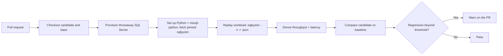

# Using `sqlpysim` as a workload gate in GitHub Actions CI

> **Contributed by** Aaryabrat Chhatkuli ([@chhateauuu](https://github.com/chhateauuu)).

A practical, copy-paste-ready guide to running `sqlpysim` as a **concurrent workload check** inside a GitHub Actions (Linux) pipeline: replay a representative SQL workload against a database on every pull request, capture throughput and latency, and surface a regression before the change merges.

> **From real-world use.** This recipe is distilled from a production-style database schema-change validation pipeline that runs `sqlpysim` as its workload gate on every pull request, provisioning a throwaway database, replaying the workload, and reporting the before/after delta on the PR. The project-specific wiring is intentionally left out; what follows is the reusable pattern, verified against a real Linux CI setup.

## Contents

- [Overview](#overview)
- [Why `sqlpysim` on Linux CI](#why-sqlpysim-on-linux-ci)
- [How it fits together](#how-it-fits-together)
- [Prerequisites](#prerequisites)
- [Step 1 — Author a workload file](#step-1--author-a-workload-file)
- [Step 2 — Invoke `sqlpysim`](#step-2--invoke-sqlpysim)
- [Step 3 — Wire it into GitHub Actions](#step-3--wire-it-into-github-actions)
- [Step 4 — Parse the metrics](#step-4--parse-the-metrics)
- [Step 5 — Compare against a baseline](#step-5--compare-against-a-baseline)
- [Signal fidelity: advisory vs. deterministic gating](#signal-fidelity-advisory-vs-deterministic-gating)
- [Tuning and best practices](#tuning-and-best-practices)
- [Troubleshooting](#troubleshooting)
- [Moving to native `sqlsim`](#moving-to-native-sqlsim)
- [References](#references)

## Overview

A schema or query change can quietly regress performance: a dropped index, a non-SARGable predicate, a plan flip. Catching that in review is hard because the cost only shows up under load. This example wires `sqlpysim` into CI so every pull request replays a workload under concurrency and reports how the candidate compares to a baseline.

The pipeline, at a glance:

1. Provision a **throwaway** database on the runner, so the workload never touches a real environment.
2. Install Python and the `mssql-python` driver, and fetch a pinned `sqlpysim`.
3. Replay the workload with `sqlpysim` under N threads by R iterations, emitting JSON.
4. Derive throughput and average latency, compare against a baseline run, and flag a regression on the PR.

## Why `sqlpysim` on Linux CI

`sqlsim` is a native executable, while `sqlpysim` is a Python port built on
Microsoft's cross-platform `mssql-python` driver. The core `-i`, `-n`, `-r`,
`-q`, and `-json` workflow used by this example is available on a stock
`ubuntu-latest` runner after a `pip install`. The tools are not fully CLI- or
JSON-schema-compatible, so pin the tool used by the pipeline and validate
parsers against its output. See the repository
[release limitations](https://github.com/microsoft/sqlsimtools/blob/main/RELEASE-NOTES.md#sqlpysim-does-not-yet-have-full-sqlsim-cli-or-output-compatibility).

## How it fits together



## Prerequisites

| Requirement | Notes |
|---|---|
| **Python 3.10+** | Provided by `actions/setup-python`. |
| **`mssql-python`** | `pip install mssql-python`; the cross-platform driver `sqlpysim` uses. |
| **A reachable SQL target** | A throwaway SQL Server on the runner (`mcr.microsoft.com/mssql/server:2022-latest`), Azure SQL, or any reachable instance. |
| **A pinned `sqlpysim`** | Fetch a fixed release of `sqlpysim.py` so runs are reproducible. |
| **A workload `.sql`** | The queries to replay under load (see Step 1). |

## Step 1 — Author a workload file

`sqlpysim` replays a `.sql` file: one or more batches (separated by `GO`) that represent the work you want to stress. Keep it representative and deterministic, favour the statements whose performance you care about, and avoid output that depends on wall-clock time or identity values.

```sql
-- workload.sql — a representative slice of your workload.
-- Replace these with the statements whose performance you care about.
SELECT TOP (100) *
FROM dbo.Orders
WHERE OrderDate >= DATEADD(DAY, -30, SYSUTCDATETIME())
ORDER BY OrderDate DESC;
GO

SELECT CustomerId, COUNT(*) AS Orders
FROM dbo.Orders
GROUP BY CustomerId;
GO
```

## Step 2 — Invoke `sqlpysim`

Point `sqlpysim` at the target database, set the concurrency, and capture the `-json` document. Run it a few times and take the **median** to damp run-to-run noise on a shared runner.

```bash
python sqlpysim.py \
  -c "$SQL_CONNECTION_STRING" \
  -i workload.sql \
  -n 8 \
  -r 100 \
  -json \
  -q > result.json
```

| Flag | Meaning |
|---|---|
| `-c` | Full connection string to the target database (a single value, ideal for a CI secret). |
| `-i` | Workload `.sql` replayed under load. |
| `-n` | Concurrent threads. |
| `-r` | Iterations per thread. |
| `-json` | Emit the aggregate metrics document to stdout. |
| `-q` | Quiet, so stdout contains only the JSON. |
| `-o <file>` | Optional: write the JSON to a file instead of stdout. |

> **Auth alternatives.** Instead of a connection string you can use discrete flags, shared with `sqlsim`: `-S <server> -d <db>` plus one of `-E` (Windows), `-A` (Entra interactive), `-T <token>` (access token), or `-U <user> -P <password>` (SQL auth), and `-C` to trust the server certificate for a container. Prefer `-c` with a single secret in CI.

## Step 3 — Wire it into GitHub Actions

A complete, opt-in job. It stands up SQL Server on the runner as a service container, installs the driver, fetches a pinned `sqlpysim`, replays the workload, and uploads the metrics as an artifact.

```yaml
name: Workload gate

on:
  pull_request:
    branches: [main]

jobs:
  workload:
    runs-on: ubuntu-latest
    services:
      sql:
        image: mcr.microsoft.com/mssql/server:2022-latest
        env:
          ACCEPT_EULA: "Y"
          MSSQL_SA_PASSWORD: ${{ secrets.MSSQL_SA_PASSWORD }}
        ports:
          - 1433:1433
    steps:
      - uses: actions/checkout@v4

      - name: Set up Python
        uses: actions/setup-python@v5
        with:
          python-version: "3.11"

      - name: Install the workload driver
        run: pip install mssql-python

      - name: Fetch a pinned sqlpysim
        run: curl -fsSL "${{ vars.SQLPYSIM_URL }}" -o sqlpysim.py

      - name: Prepare the database
        run: |
          # Apply your schema and seed here (sqlpackage, sqlcmd, migrations, ...).
          echo "provision + seed the throwaway database"

      - name: Replay the workload
        env:
          SQL_CONNECTION_STRING: ${{ secrets.SQL_CONNECTION_STRING }}
        run: |
          python sqlpysim.py -c "$SQL_CONNECTION_STRING" \
            -i workload.sql -n 8 -r 100 -json -q > result.json

      - name: Upload metrics
        uses: actions/upload-artifact@v4
        with:
          name: workload-metrics
          path: result.json
```

> **Reproducibility and secrets.** Pin `sqlpysim` to a fixed release URL in the `SQLPYSIM_URL` repository variable so the tool version never drifts, and pass the connection string and SA password through repository **secrets** so credentials stay out of the workflow file and the logs.

## Step 4 — Parse the metrics

`sqlpysim -json` emits an aggregate document. The fields a workload gate cares about:

```jsonc
{
  "success": true,
  "configuration": { "total_batches": 800 },
  "metrics": {
    "total_runtime_seconds": 12.42,
    "total_query_execution_time_seconds": 95.1,
    "errors": { "total": 0, "list": [] }
  }
}
```

Derive the two headline numbers with `jq`, and fail fast if the workload itself errored:

```bash
throughput=$(jq '.configuration.total_batches / .metrics.total_runtime_seconds' result.json)
avg_latency_ms=$(jq '(.metrics.total_query_execution_time_seconds / .configuration.total_batches) * 1000' result.json)
errors=$(jq '.metrics.errors.total' result.json)

echo "throughput=${throughput} batches/s  avg_latency=${avg_latency_ms} ms  errors=${errors}"
[ "$errors" -eq 0 ] || { echo "workload reported errors"; exit 1; }
```

## Step 5 — Compare against a baseline

A single number means little; a **delta** is the signal. Establish a baseline (the target branch) and compare the candidate against it:

1. Run the workload on the **base branch**, or download a stored baseline artifact, into `baseline.json`.
2. Run it on the **candidate** into `result.json`.
3. Compute the percentage change and compare to a threshold.

```bash
base=$(jq '.configuration.total_batches / .metrics.total_runtime_seconds' baseline.json)
cand=$(jq '.configuration.total_batches / .metrics.total_runtime_seconds' result.json)
delta=$(python -c "print(( $cand - $base ) / $base * 100)")

echo "throughput delta: ${delta}%"
python -c "import sys; sys.exit(1 if $delta < -25 else 0)" \
  || echo "::warning::workload throughput regressed by more than 25%"
```

Using `::warning::` keeps the gate **advisory** (see the next section). Swap it for a non-zero `exit` to make it blocking once you trust the signal.

## Signal fidelity: advisory vs. deterministic gating

`sqlpysim` reports **aggregate throughput and latency**, a timing-tier signal that is inherently noisy from run to run on a shared runner (noisy neighbours, cold caches, virtualization). Treat a regression here as **advisory**: warn on the PR, do not fail the build on wall-clock alone. Taking the median of several passes and comparing relative deltas, not absolute milliseconds, makes it far more stable.

For a more stable pass/fail signal, use per-query **logical reads** from
`-querystats`. Both sqlpysim and sqlsim emit the same query-statistics fields,
so a pipeline can compare read counts without relying only on shared-runner wall
clock time. Neither tool currently emits a query or plan hash.

| Signal | Source | Reproducible? | Use as |
|---|---|---|---|
| Throughput (batches/s) | `sqlpysim` / `sqlsim` | No (timing) | Advisory |
| Average latency (ms) | `sqlpysim` / `sqlsim` | No (timing) | Advisory |
| Logical reads | `sqlpysim -querystats` / `sqlsim -querystats` | Usually | Gate with tolerance |

## Tuning and best practices

- **Isolate the target.** Always run against a throwaway or purpose-provisioned database, never a shared or production instance. The workload is destructive to caches and plan state.
- **Median of N.** Run the workload three to five times and take the median; a single pass is easily skewed.
- **Right-size concurrency.** Set `-n` to a concurrency that resembles production and `-r` high enough that the run lasts several seconds; too-short runs are dominated by startup noise.
- **Warm up.** The first execution pays plan-compilation and cache-fill costs. A short discarded warm-up pass before the measured passes yields steadier numbers.
- **Compare relatively.** Gate on percentage delta versus a baseline, not absolute timings, so results survive moving to a different runner size.
- **Pin everything.** Pin the `sqlpysim` release, the Python version, and the SQL Server image tag, so a CI regression reflects your change and not a moving dependency.

## Troubleshooting

| Symptom | Likely cause / fix |
|---|---|
| `result.json` is empty or not valid JSON | Ensure `-q` is set and stdout is captured; without `-q`, progress lines interleave with the JSON. |
| `ModuleNotFoundError: mssql_python` | `pip install mssql-python` in the same job; Python 3.10+. |
| Connection or TLS failure against a container | Trust the server cert: `-C`, or `TrustServerCertificate=Yes` / `Encrypt=Optional` in the connection string. |
| Wildly varying throughput | Expected on shared runners; rely on median plus relative delta and keep the gate advisory. |
| `errors.total > 0` | Inspect `metrics.errors.list`; usually a workload query referencing objects the seed did not create. |

## Moving to native `sqlsim`

When a native `sqlsim` build exists for your runner OS, the switch is minimal:
sqlsim accepts the same core flags (`-i`, `-n`, `-r`, `-json`, and
`-querystats`) and emits the same query-statistics JSON fields. Point the
pipeline at the sqlsim binary instead of `python sqlpysim.py`; the parsing and
logical-read gate can stay the same.

## References

- [`sqlpysim` README](https://github.com/microsoft/sqlsimtools/blob/main/sqlpysim/README.md) and [user manual](../../sqlpysim.md)
- [`sqlsim` user manual](https://github.com/microsoft/sqlsimtools/blob/main/sqlsim/sqlsim.md) — for `-querystats` and deterministic signals
- [`mssql-python` driver](https://github.com/microsoft/mssql-python)
- [GitHub Actions: about service containers](https://docs.github.com/actions/using-containerized-services/about-service-containers)
