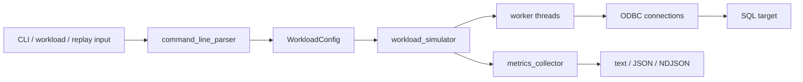

# SQL Workload Simulator (sqlsim)

A lightweight, generic SQL workload simulator for testing SQL Server and Azure SQL Database performance. Supports multi-threaded query execution with custom queries or SQL scripts.

**How This Tool Was Built:**
100% of the code, scripts, and documentation for sqlsim was developed with GitHub Copilot in Visual Studio Code using various AI models, but 100% orchestrated by Bob Ward.

## Documentation

- **[sqlsim.md](sqlsim.md)** - **User manual** with complete usage guide, command reference, examples, and troubleshooting
- **[BUILD.md](BUILD.md)** - Build instructions and prerequisites for compiling sqlsim
- **[SETUP.md](SETUP.md)** - Developer environment setup guide for VS Code and contributing to the project
- **[AGENTS.md](AGENTS.md)** - Instructions for coding agents (Copilot, Claude Code, Cursor, Aider, Codex CLI) that automatically tell them how to invoke sqlsim

## Quick Start for Users

See **[sqlsim.md](sqlsim.md)** for complete usage documentation.

> [!CAUTION]
> High thread counts (`-n`) can consume substantial CPU, memory, network
> bandwidth, and database connections on both the client and server. Start
> small, scale gradually, and monitor both machines. Use a dedicated client
> for significant load tests.

```powershell
# Simple query with Windows Authentication
.\sqlsim\x64\sqlsim.exe -S localhost -d testdb -E -Q "SELECT @@VERSION"

# Load test: 10 threads, 100 iterations each
.\sqlsim\x64\sqlsim.exe -S localhost -d testdb -E -i queries.sql -n 10 -r 100 -q
```

Ubuntu release packages use `x64/sqlsim` without the `.exe` extension:

```bash
printf '%s\n' "$token" | ./sqlsim/x64/sqlsim -S myserver.database.windows.net -d mydb -T - -Q "SELECT @@VERSION"
```

## Quick Start for Developers

### Building

See **[BUILD.md](BUILD.md)** for complete build instructions.

```powershell
# Build both x64 and ARM64 (default)
.\build.ps1

# Build only x64
.\build.ps1 -Architecture x64

# Build only ARM64 (Windows on ARM devices)
.\build.ps1 -Architecture ARM64

# Or build manually with CMake
cmake -S . -B build\x64 -G "Visual Studio 17 2022" -A x64
cmake --build build\x64 --config Release
```

```bash
# Ubuntu 24.04/26.04 LTS x64
bash ./check-prerequisites-linux.sh
bash ./build-linux.sh --clean
bash ./smoke-test-linux.sh --skip-build
```

**Prerequisites:** Windows uses Visual Studio 2022/2026 (or Build Tools). Ubuntu uses `build-essential`, CMake, and `unixodbc-dev`. Runtime connections require ODBC Driver 18 for SQL Server (validated on Ubuntu with 18.7.1.1).

**Private Preview macOS ARM64:** The `sqlsim macOS ARM64 Private Preview` GitHub Actions workflow, which runs on pushes to `main` and on demand, builds and smoke-tests a native Apple Silicon binary, then uploads it as an invitation-only workflow artifact. macOS is not included in public releases; see [BUILD.md](BUILD.md) and [MACOS-PRIVATE-PREVIEW.md](MACOS-PRIVATE-PREVIEW.md).

Driver support policy and cadence are documented at [../DRIVER-COMPATIBILITY.md](../DRIVER-COMPATIBILITY.md).

### Development Environment

See **[SETUP.md](SETUP.md)** for complete development environment setup.

**Key components:**
- VS Code with C/C++ extension
- IntelliSense configuration
- Debugging setup
- Git workflow

## Features

- **Generic SQL Execution**: Run any SQL queries or scripts (no TPC-E dependency)
- **Multi-threaded**: Configurable number of concurrent threads (1 to 1000+)
- **Multiple Authentication**: Windows SSPI, Linux Kerberos, Microsoft Entra (interactive on Windows, integrated, MSI, service principal, token), SQL Authentication
- **Broad Platform Support**: SQL Server (bare metal, VM, Linux, containers, Kubernetes), Azure SQL Database, Azure SQL Managed Instance, SQL Server in Azure VMs, Microsoft Fabric, Azure Synapse Analytics
- **Zero Installation**: Single native executable; runtime connections require ODBC Driver 18
- **Platform Builds**: Windows x64/ARM64 and Ubuntu 24.04/26.04 LTS x64 in Public Preview; macOS ARM64 in Private Preview
- **Script Support**: Execute SQL files with GO batch separators
- **Prepared Statements**: Optional prepared statement mode
- **Performance Metrics**: Detailed connection, execution, and fetch statistics, including live NDJSON streaming
- **XEvent Trace Replay**: Replay captured Extended Events traces in fast (per-session) or stress (flattened) mode with replay summary
- **Automated Testing**: Comprehensive smoke test and full test suite

## Testing

### Test Suites

Three test suites validate sqlsim functionality:

**Smoke Test** - Quick validation, typically under 30 seconds against a local server:
```powershell
.\smoke-test.ps1
```

**Linux Smoke Test** - Offline CLI checks, plus live tests that mirror `smoke-test.ps1` when a target is supplied:
```bash
bash ./smoke-test-linux.sh --skip-build
bash ./smoke-test-linux.sh --skip-build --server HOST --database DB --token-file FILE
```

**Full Test Suite** - Comprehensive validation, typically a few minutes against a local server:
Runs smoke-test.ps1 first, then extended tests.
```powershell
.\full-test-suite.ps1

# With parameters
.\full-test-suite.ps1 -Server "myserver.database.windows.net" -Database "mydb" -UseToken $token

# Azure SQL MI with extended login timeout for high concurrency tests
.\full-test-suite.ps1 -Server "myinstance.public.xxx.database.windows.net,3342" -Database "tempdb" -Username "user" -Password $password -LoginTimeout 60
```

Key parameters:
- `-UseToken $token` / `-Username` with `-Password` - Credentials, passed to sqlsim on stdin (`-T -`, `-P -`) so they never appear in a process list
- `-SkipBuild` - Use existing executable
- `-PerfTag "description"` - Tag perf measurements (saved to `measurements/` folder)
- `-SkipScale` - Skip high concurrency tests (1024 threads)
- `-Verbose 0` - Default, minimal output
- `-Verbose 1` - Show sqlsim verbose output for each test
- `-LoginTimeout` - Login timeout in seconds for 1024 thread tests (default: 60)
- `-UseToken` - Azure SQL automated testing with access token

**Example Validation** - Validates all examples work correctly:
```powershell
.\test-examples.ps1

# Skip AdventureWorksLT tests
.\test-examples.ps1 -SkipAdventureWorks
```

The test suites include comprehensive output format validation (non-verbose, verbose, and JSON), terminology consistency checks, example validation from help text, documentation, and example scripts, and **performance regression tests**. The smoke checks use machine-independent ratios; the full suite compares against a baseline saved on the same machine and SQL Server (±20% tolerance) when one exists, and otherwise uses fixed thresholds. See `BUILD.md` for full test coverage details.

## Project Structure

```
sqlsim/
├── src/                      # C++ source files
│   ├── main.cpp             # Entry point and command-line handling
│   ├── command_line_parser.cpp  # Parameter validation and config
│   ├── workload_simulator.cpp   # Multi-threaded workload and replay engine
│   ├── odbc_connection.cpp      # ODBC wrapper
│   └── metrics_collector.cpp    # Performance metrics
├── include/                  # Header files
├── build/                    # CMake build output (generated)
├── examples/                 # SQL scripts, PowerShell examples, workloads, reports, and example results
├── replay/                   # XEvent capture, conversion, trace comparison, and replay tests
├── testing/                  # Test fixtures; suites also write temporary output here
├── baseline/                 # Script that saves a local full-suite performance baseline
├── build.ps1, build-linux.sh, build-macos.sh                     # Builds
├── check-prerequisites.ps1, check-prerequisites-linux.sh, check-prerequisites-macos.sh
├── smoke-test.ps1, smoke-test-linux.sh, smoke-test-macos.sh      # Quick validation
├── full-test-suite.ps1, full-test-suite-linux.sh                 # Comprehensive validation
├── test-examples.ps1, test-replay.ps1, test-reports.ps1          # Example, replay, and report tests
├── test-azure-release-examples.ps1, test-nonazure-release-examples.ps1
├── publish.ps1, publish-linux.sh, publish-macos.sh               # Release-shaped staging
├── CMakeLists.txt            # CMake build configuration
├── README.md                 # This file - quick start and overview
├── BUILD.md                  # Complete build instructions
├── SETUP.md                  # Developer setup guide
├── AGENTS.md                 # Agent contract shipped in the release package
├── MACOS-PRIVATE-PREVIEW.md  # macOS ARM64 Private Preview guide
└── sqlsim.md                 # Full user manual and reference
```

## Architecture

sqlsim is a single native C++ process. It parses the command line into a
workload configuration, creates worker threads, gives each worker its own ODBC
connection and statement state, and combines thread-local measurements into
text, JSON, or streaming JSON output.



- **main.cpp** - Process entry point, input-file loading, replay/workload setup, output selection, and top-level error handling
- **command_line_parser** - Argument parsing, validation, and connection-string construction
- **workload_simulator** - Worker scheduling, query execution, mixed workloads, replay, cancellation, and result coordination
- **odbc_connection** - ODBC handles, authentication, execution, fetching, and diagnostic records
- **metrics_collector** - Thread-safe timing, errors, warnings, percentiles, replay summaries, and final/streaming output data
- **query_stats** - Per-query aggregation from SQL Server statistics messages and execution plans
- **xel_replay** - Converted XEvent trace parsing and replay event modeling
- **console_output** - Serialized console writes: each message is built in a private stream and written to stdout or stderr in one locked operation, so concurrent output never interleaves

### Platform Architecture

| Operating system | CPU architecture | Preview status |
| --- | --- | --- |
| Windows | x64 | Public Preview |
| Windows | ARM64 | Public Preview |
| Ubuntu 24.04/26.04 LTS | x64 | Public Preview |
| macOS | ARM64 | Private Preview for invited customers and testers; not a public release |

### Error, Warning, and Info Message Handling

sqlsim uses ODBC to communicate with SQL Server. Every ODBC API call returns a result code, and when the result is not pure success, diagnostic records are available via `SQLGetDiagRecW`. sqlsim categorizes all diagnostic records into three tiers based on their SQLSTATE:

**Three-Tier Diagnostic Classification:**

| Tier | SQLSTATE | What It Means | Examples |
|---|---|---|---|
| **Errors** | Non-`01xxx` (42S02, 42000, HYT00, 08S01, etc.) | Something failed | "Invalid object name", "Query timeout expired", "Communication link failure" |
| **Informational messages** | `01000` | Routine messages from T-SQL execution | PRINT output, RAISERROR sev ≤ 10, DBCC output, SET STATISTICS output |
| **ODBC warnings** | `01001`, `01003`, `01004`, etc. (01xxx but NOT 01000) | Real ODBC-level warnings | "String data right-truncated", "Cursor operation conflict" |

> **Note:** SQL Server ODBC Driver 18 sends virtually all informational and warning messages as SQLSTATE `01000`. The non-01000 warning states (01001, 01003, 01004) are defined in the ODBC spec but are rarely emitted by the SQL Server driver in practice.

**Routine Server Messages (Filtered Out):**

Certain `01000` messages are routine server housekeeping and are automatically filtered — they are never displayed:
- `Changed database context to '...'` (native error 5701) — sent on USE statements and initial connection
- `Changed language setting to ...` (native error 5703) — sent on SET LANGUAGE and initial connection

**How Errors Are Handled:**

| Error Source | Behavior | Format |
|---|---|---|
| **SQL Server query errors** | Displayed with SQLSTATE code; continues by default, or stops with `-stoponerror` | `SQLSTATE: [Driver][Provider]Error message` |
| **Connection failures** | ODBC driver prefix included; enhanced messages for missing driver (IM002) | Chained errors separated by ` \| ` |
| **Query timeouts (HYT00)** | Detected specially for timeout metrics; affected by `-t` parameter | `HYT00: Query timeout expired` |
| **Login timeouts (HYT00/HYT01)** | Affected by `-l` and `-retry` parameters | `HYT00: Login timeout expired` |
| **Missing ODBC driver (IM002)** | Pre-flight check before any connection; includes installation instructions | `sqlsim error: Microsoft ODBC Driver for SQL Server is not installed.` |
| **Parameter validation** | Checked before any connection attempt; immediate exit with code 1 | `sqlsim error: <message>` |
| **Fatal runtime errors** | Rare safety-net handlers for C++ exceptions | `sqlsim fatal error: <message>` |

**Multi-Statement Batch Error Detection:**

When a batch contains multiple statements (e.g., `PRINT 'x'; RAISERROR('err', 16, 1); SELECT 1`), errors from non-first statements are detected during result set processing via `SQLMoreResults`. These are counted as errors and affect exit code.

**ODBC API Surface:**

sqlsim uses the wide (Unicode) ODBC APIs throughout: `SQLExecDirectW`, `SQLGetDiagRecW`, `SQLPrepareW`, `SQLDescribeColW`, `SQLGetData` with `SQL_C_WCHAR`. All error messages and query text are converted between UTF-8 and UTF-16 for proper Unicode support.

**Security:**

All error messages are sanitized before display to prevent terminal control character injection. Messages are limited to 1000 characters. Connection string parameters reject metacharacters (`;`, `{`, `}`) to prevent injection.

For detailed error handling documentation with examples, see [sqlsim.md](sqlsim.md#error-handling).

## Publishing

To publish the release build and generate HTML documentation:

```powershell
.\publish.ps1
```

This script:
- Builds and copies `sqlsim/x64/sqlsim.exe` and `sqlsim/ARM64/sqlsim.exe`
- Copies `sqlsim/sqlsim.md` (user manual)
- Converts `sqlsim.md` to HTML using pandoc
- Copies the `sqlsim/examples\` folder (sample scripts, SQL files, workloads, and reports in subfolders)
- Copies `.github/skills/sqlsim/SKILL.md` for agent discovery
- Copies `.github/agents/sqlsimtools-workload-builder.agent.md` for guided workload authoring, execution approval, result analysis, and A/B comparisons

Default installation root: `<repo>\release\sqlsimtools\1.0` (relative to repo root)

**Requirement:** Pandoc must be installed for HTML generation. Install with `winget install pandoc` or from https://pandoc.org/installing.html

## Contributing

See **[SETUP.md](SETUP.md)** for complete development environment setup including:
- VS Code configuration
- Required extensions
- IntelliSense setup
- Debugging configuration
- Development workflow
- Git workflow

## License

Licensed under the MIT License. See [LICENSE](LICENSE) for the full license text.

```
Copyright (c) Microsoft Corporation. All rights reserved.

Licensed under the MIT License. See the LICENSE file in this project for full terms.
```
