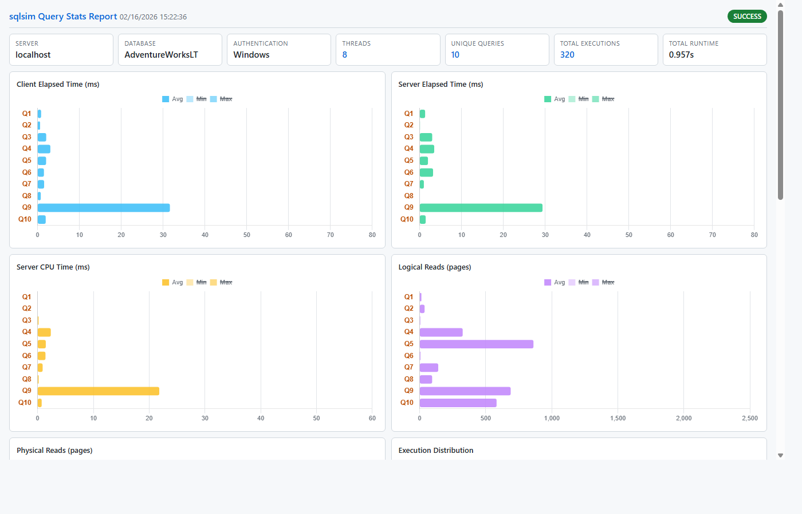

# SQL Workload Simulator (sqlsim) v1.0.0

User Manual for SQL Workload Simulator (sqlsim).

## Table of Contents
- [Overview](#overview)
- [Installation](#installation)
- [Linux Support](#linux-support)
- [Getting Started](#getting-started)
- [Command Reference](#command-reference)
- [Limits and Resource Considerations](#limits-and-resource-considerations)
- [Usage Examples](#usage-examples)
- [Workload File Mode](#workload-file-mode)
- [Query Stats](#query-stats)
- [HTML Reports](#html-reports)
- [Workload Replay](#workload-replay)
- [Understanding Output](#understanding-output)
- [SQL Script Files](#sql-script-files)
- [Unicode Support](#unicode-support)
- [Error Handling](#error-handling)
- [Using Microsoft Entra Authentication](#using-microsoft-entra-authentication)
- [Security and Best Practices](#security-and-best-practices)
- [sqlsim vs sqlcmd - What's Different?](#sqlsim-vs-sqlcmd---whats-different)
- [sqlsim vs ostress - What's Different?](#sqlsim-vs-ostress---whats-different)
- [Troubleshooting](#troubleshooting)
- [Using sqlsim with a Coding Agent](#using-sqlsim-with-a-coding-agent)
- [Getting Help](#getting-help)

## Overview

SQL Workload Simulator (sqlsim) is a command-line tool for testing SQL Server, Azure SQL, and other TDS compatible servers. It enables simulation of multi-threaded workloads, connection stress testing, and performance measurement for SQL queries. sqlsim is ideal for database administrators, developers, and performance engineers who need to evaluate database performance or behavior under various load conditions.

**⚠️ Important:** sqlsim is a **testing and workload simulation tool** designed for development, testing, and performance evaluation environments. It is **NOT intended for use against production systems**. Running sqlsim with high thread counts (`-n`) can consume substantial CPU, memory, network bandwidth, and database connections on the client and server. Excessive concurrency can make the client unresponsive, exhaust resources, and distort benchmark results before the database reaches its limit. Start with a small thread count, increase it gradually, and monitor both client and server resources. Use dedicated test environments and, for significant load tests, a dedicated client machine.

**How This Tool Was Built:**
100% of the code, scripts, and documentation for sqlsim was developed with GitHub Copilot in Visual Studio Code using various AI models, but 100% orchestrated by Bob Ward.

**Key Capabilities:**
- Single native application binary with no sqlsim installer or language runtime required
- Native builds for Windows x64/ARM64 and Ubuntu 24.04/26.04 LTS x64
- Platform ODBC dependencies: ODBC Driver 18 on Windows; unixODBC and ODBC Driver 18 on Linux
- Execute single queries or SQL script files
- Multi-threaded workload simulation
- Multiple authentication methods (Windows, Entra, SQL Auth, Access Token)
- Prepared statement support
- Detailed performance metrics (connection time, query execution, fetch time)
- Timeout controls for connections and queries
- TDS 8.0 encryption support
- Connection behavior controls (reconnect, connection pooling)
- Support for read replicas and Always On Availability Groups
- XEvent trace replay (capture supported query events and replay their session order or load shape)
- Mixed workload simulation from JSON definition files (`-workload`)
- Per-query server statistics with SET STATISTICS TIME/IO (`-querystats`)
- Full Unicode support (UTF-8 input and output for international characters)
- Support for local SQL Server, Azure SQL Database, Azure SQL Managed Instance, Azure Synapse Analytics, and SQL database in Fabric, SQL analytics endpoint in Fabric, and Fabric Warehouse.

**Top 10 Cool Things You Can Do with sqlsim:**

| # | Cool Thing | Why It's Unique |
|---|------------|-----------------|
| **1** | **Stress test any SQL workload with 1000+ concurrent users on x64 or Windows ARM64 devices — or test connections only** | Just add `-n 1000`, `-r` for iterations, and `-q` to suppress results for max throughput to any ad-hoc query (`-Q`), input file (`-i`), or JSON workload definition (`-workload`) with full batch support. Omit `-Q` to test auth overhead and connection limits |
| **2** | **Replay production workloads from XEvent traces** | Capture Extended Events, convert with `convert-xel.ps1`, replay with `-replay fast` (per-session fidelity) or `-replay stress` (max throughput). Includes replay summary comparing original vs replay outcomes |
| **3** | **No sqlsim installer required** | One native application binary per platform: `sqlsim.exe` on Windows or `sqlsim` on Linux; platform ODBC components must be installed |
| **4** | **Test Azure SQL with modern Entra authentication** | Full Entra support (interactive, MSI, tokens) |
| **5** | **Connect to any SQL — ground to cloud to Fabric** | SQL Server (bare metal, VM, Linux, containers), Azure SQL Database, Azure SQL Managed Instance, Azure Synapse Analytics, SQL database in Fabric, and Fabric Warehouse |
| **6** | **Run mixed workloads from a single JSON definition** | Define OLTP, reporting, and monitoring groups with different thread counts and iterations in one `-workload` file — all threads launch concurrently |
| **7** | **Export results as JSON for monitoring/automation pipelines** | Machine-readable output for Grafana, Prometheus, CI/CD |
| **8** | **Get detailed performance metrics and per-query server statistics including HTML performance reports** | Average timing metrics for connections and queries, plus `-querystats` for SET STATISTICS TIME/IO aggregated across all threads — server CPU, elapsed time, logical reads, physical reads per unique query. Generate interactive HTML reports with Chart.js bar charts and click-to-navigate query detail |
| **9** | **Test retry and timeout behavior under load** | Verify your app's resilience patterns with `-retry` and `-retrydelay` |
| **10** | **Test advanced connection scenarios** | TDS 8.0 encryption (`-N`), AG read replicas (`-R`), multi-subnet failover (`-M`), connection pooling (`-usepool`), reconnect patterns (`-reconnect`) |

[↑ Back to Table of Contents](#table-of-contents)

## Installation

### Prerequisites

sqlsim ships as one native application binary per platform and has no application installer. It does not require the source tree or a language runtime. It is not fully static: Windows runtime connections require Microsoft ODBC Driver 18; Linux runtime connections require unixODBC and Microsoft ODBC Driver 18. These platform ODBC components are installed separately and are not bundled in the release archive.

**Supported Platforms:**
- Windows x64 (Intel/AMD 64-bit processors)
- Windows ARM64 (Qualcomm Snapdragon, Microsoft SQ, Apple Silicon via Parallels)
- Ubuntu 24.04 and 26.04 LTS x64

Download the appropriate version for your platform:
- `sqlsim/x64/sqlsim.exe` - For standard Windows PCs and servers
- `sqlsim/ARM64/sqlsim.exe` - For Windows on ARM devices (Surface Pro X, Dev Kit 2023, etc.)
- `sqlsim/x64/sqlsim` - For Ubuntu x64

**Included Files:**
- `sqlsim/sqlsim.md` - Full documentation (this file)
- `sqlsim/sqlsim.html` - HTML version of documentation
- `sqlsim/AGENTS.md` - Instructions for coding agents (Copilot, Claude Code, Cursor, Aider, Codex CLI) that automatically tell them how to invoke sqlsim
- `sqlsim/LICENSE` - MIT license
- `.github/skills/sqlsim/SKILL.md` - VS Code Copilot skill descriptor (companion to `AGENTS.md`)
- `sqlsim/examples/` - Sample SQL scripts, PowerShell examples, workload definitions, and analysis scripts
- `sqlsim/replay/` - XEvent capture scripts, `convert-xel.ps1`, trace comparison, and the replay guide

> **Note for ARM64 users:** The x64 version will run on Windows ARM64 devices via emulation, but the native ARM64 build provides better performance and lower power consumption. Use the ARM64 version when available.

> **Coding Agent Integration:** `AGENTS.md` and `.github/skills/sqlsim/SKILL.md` ship at the right paths in the release ZIP. Drop the extracted tree into your project and your coding agent will pick them up automatically — no copy step required. See [Using sqlsim with a Coding Agent](#using-sqlsim-with-a-coding-agent).

> **Windows PowerShell examples:** If you trust the ZIP downloaded from the
> official sqlsim release, run
> `Unblock-File .\sqlsim-<version>-win-x64.zip` before extracting it. For
> Windows ARM64, substitute the `win-arm64` archive name. This removes Windows'
> Internet security mark so the included unsigned `.ps1` examples can run
> under the `RemoteSigned` execution policy. If the archive is already
> extracted, run
> `Get-ChildItem .\sqlsim -Recurse -File -Filter *.ps1 | Unblock-File`.

Before using sqlsim, you must install:

#### 1. ODBC Driver 18 for SQL Server (Required)

**Download:** https://learn.microsoft.com/en-us/sql/connect/odbc/download-odbc-driver-for-sql-server

This driver is required for sqlsim to connect to SQL Server or Azure SQL Database.

> **Important:** Download the correct ODBC driver for your platform:
> - **x64** - `msodbcsql18_x64.msi` for standard Windows PCs
> - **ARM64** - `msodbcsql18_arm64.msi` for Windows on ARM devices
> - **Ubuntu x64** - install the `msodbcsql18` package using Microsoft's Linux installation instructions

Ubuntu build and offline CLI validation have passed with GCC 15.2, CMake 4.2.3, unixODBC 2.3.14, and ODBC Driver 18.7.1.1. Live Ubuntu connection and authentication validation remains a release gate.

#### 2. Azure CLI (Required for Token Authentication)

**Download:** https://learn.microsoft.com/en-us/cli/azure/install-azure-cli

The Azure CLI is **only required if you plan to acquire a token with Azure CLI for token authentication** (`-T` option). It is not required by sqlsim itself for:
- Windows Authentication (localhost SQL Server)
- SQL Authentication (`-U` and `-P` options)
- Microsoft Entra interactive authentication (`-A` option, Windows only) - handled by ODBC Driver 18
- Managed identity authentication (`-A ActiveDirectoryMsi`) - for Azure resources

If using token authentication, you'll need the Azure CLI to acquire access tokens:
```powershell
az login  # One-time setup
$token = (az account get-access-token --resource https://database.windows.net/ --query accessToken -o tsv)
$token | sqlsim.exe -S myserver.database.windows.net -d mydb -T - -Q "SELECT @@VERSION"
```

**Installation Steps:**
1. Download the installer for your platform (Windows x64 or ARM64)
2. Run the installer
3. Accept the license agreement and complete installation
4. No configuration needed - sqlsim will automatically use the driver

**Note:** For ARM64 devices, download the ARM64 version of ODBC Driver 18 (`msodbcsql18_arm64.msi`) from the same download page.

**Verify Installation:**
```powershell
# Check if ODBC Driver 18 is installed
Get-OdbcDriver | Where-Object {$_.Name -like "*SQL Server*"}
```

You should see "ODBC Driver 18 for SQL Server" in the list.

**What if the driver is not installed?**

If you run sqlsim without the ODBC driver installed, you'll get a clear error message:
```
IM002: [Microsoft][ODBC Driver Manager] Data source name not found and no default driver specified

Microsoft ODBC Driver for SQL Server is not installed.
Please install ODBC Driver 17 or 18:
  Windows: https://learn.microsoft.com/en-us/sql/connect/odbc/download-odbc-driver-for-sql-server
```

This error comes from the Windows ODBC Driver Manager (error code **IM002**) before sqlsim attempts any network connection. Simply install the driver and try again.

**Supported SQL Server Versions:**

ODBC Driver 18 provides connectivity to:
- **SQL Server:** 2025, 2022, 2019, 2017, 2016, 2014, 2012 (and older versions with basic support)
- **SQL Server in Azure Virtual Machines**
- **Azure SQL Database:** All service tiers
- **Azure SQL Managed Instance**
- **Azure Synapse Analytics** (SQL Pools)
- **Microsoft Fabric:** SQL Database in Fabric, SQL Analytics Endpoint, Fabric Warehouse

The driver is forward and backward compatible, allowing sqlsim to connect to any SQL Server version from 2008 onwards, with full feature support for SQL Server 2012 and newer.

> **Note:** sqlsim can connect to any TDS-compatible SQL Server that the ODBC Driver supports, including SQL Server running in other public clouds such as AWS and GCP. However, those platforms have not been tested.

#### 2. SQL Server Access (Required)

You need access to one of the following SQL Server platforms. Choose the option that best fits your testing needs:

**Option A: Local SQL Server**

sqlsim supports all SQL Server versions and editions through ODBC Driver 18, including bare metal servers, virtual machines (Hyper-V, VMware), SQL Server on Linux, SQL Server in a container, and SQL Server containers running in a Kubernetes cluster:

**Supported Versions:**
- **SQL Server 2025** (all editions)
- **SQL Server 2022** (all editions)
- **SQL Server 2019** (all editions)
- **SQL Server 2017** (all editions)
- **SQL Server 2016** (all editions)
- **SQL Server 2014** (all editions)
- **SQL Server 2012** (all editions)
- **SQL Server 2008 R2** (all editions, basic support)
- **SQL Server 2008** (all editions, basic support)
- **SQL Server 2005 and earlier** (may work with limited functionality)

**Supported Editions:**
- **Developer Edition** (free, full-featured, for non-production use only)
  - Download: https://www.microsoft.com/en-us/sql-server/sql-server-downloads
  - Best for: Development, testing, learning
  - Features: All Enterprise features, cannot be used in production
  
- **Express Edition** (free, feature-limited, for production or non-production)
  - Download: https://www.microsoft.com/en-us/sql-server/sql-server-downloads
  - Best for: Small applications, learning, embedded apps
  - Limitations: 10 GB database size limit, 1 GB memory limit, 4 cores max
  
- **Standard Edition** (paid, mid-tier features)
  - Best for: Small to medium businesses, departmental applications
  - Features: Basic high availability, limited BI capabilities
  
- **Enterprise Edition** (paid, full features)
  - Best for: Mission-critical applications, large-scale systems
  - Features: Advanced high availability, security, performance, BI

**Option B: Azure SQL**
- **Azure SQL Database** (PaaS database service)
  - Create: Azure Portal → SQL databases → Create SQL Database
  - Guide: https://learn.microsoft.com/en-us/azure/azure-sql/database/single-database-create-quickstart
  - Authentication: Microsoft Entra (`-A`), SQL Authentication (`-U`/`-P`), Access Token (`-T`)
  - Server format: `yourserver.database.windows.net`

- **Azure SQL Managed Instance** (Fully managed SQL Server instance)
  - Create: Azure Portal → Azure SQL → Create SQL Managed Instance
  - Guide: https://learn.microsoft.com/en-us/azure/azure-sql/managed-instance/instance-create-quickstart
  - Authentication: Microsoft Entra (`-A`), SQL Authentication (`-U`/`-P`), Access Token (`-T`)
  - Public endpoint format: `yourinstance.public.xxx.database.windows.net,3342`
  - Private endpoint format: `yourinstance.xxx.database.windows.net`

- **SQL Server in Azure Virtual Machines** (IaaS SQL Server)
  - Create: Azure Portal → Virtual machines → Create → SQL Server image
  - Guide: https://learn.microsoft.com/en-us/azure/azure-sql/virtual-machines/windows/sql-vm-create-portal-quickstart
  - Authentication: Windows (`-E`), Microsoft Entra (`-A`), SQL Authentication (`-U`/`-P`)
  - Best for: Lift-and-shift migrations, full SQL Server feature compatibility

**Option C: Microsoft Fabric**
- **SQL Database in Fabric**
  - Create: Microsoft Fabric Portal → Create → SQL Database
  - Authentication: Microsoft Entra (`-A`), Access Token (`-T`)
  
- **SQL Analytics Endpoint** (for Lakehouse)
  - Create: Microsoft Fabric Portal → Lakehouse → SQL analytics endpoint
  - Authentication: Microsoft Entra (`-A`), Access Token (`-T`)
  
- **Fabric Warehouse**
  - Create: Microsoft Fabric Portal → Create → Warehouse
  - Authentication: Microsoft Entra (`-A`), Access Token (`-T`)
  - Server format: `xxx.datawarehouse.fabric.microsoft.com`

**Option D: Azure Synapse Analytics**
- **Dedicated SQL Pool** or **Serverless SQL Pool**
  - Create: Azure Portal → Azure Synapse Analytics → Create workspace
  - Guide: https://learn.microsoft.com/en-us/azure/synapse-analytics/get-started-create-workspace
  - Authentication: Microsoft Entra (`-A`), SQL Authentication (`-U`/`-P`), Access Token (`-T`)
  - Server format: `yourworkspace.sql.azuresynapse.net` (dedicated) or `yourworkspace-ondemand.sql.azuresynapse.net` (serverless)

**Required Permissions:**

Regardless of which option you choose, your account needs:
- **Database-level permissions**: At minimum, `db_datareader` role or `SELECT` permissions on tables you want to query
- **Connection permissions**: Ability to connect to the database (granted by default for database users)
- **Firewall access** (for Azure): Your client IP address must be allowed in firewall rules

[↑ Back to Table of Contents](#table-of-contents)

## Linux Support

Official Linux support is limited to **Ubuntu 24.04 LTS x64** and **Ubuntu 26.04 LTS x64**. Other Linux distributions may work when they provide compatible system libraries, unixODBC, and Microsoft ODBC Driver 18 packages, but they are currently untested and unsupported. Linux ARM64 is not currently supported.

The release archive contains the native Linux executable `x64/sqlsim`; Linux executables do not use the Windows `.exe` extension. The binary needs no sqlsim installation or language runtime, but it is dynamically linked rather than fully static. unixODBC and Microsoft ODBC Driver 18 for SQL Server must be installed on the target system and are not bundled in the archive. The Linux build uses the same workload engine and command-line implementation as Windows. macOS ARM64 is available only through an invitation-only Private Preview for customers and testers helping validate the platform.

### macOS ARM64 Private Preview

A native Apple Silicon build is available to Private Preview participants through the manually triggered `sqlsim macOS ARM64 Private Preview` GitHub Actions workflow. It builds on the `macos-15` ARM64 runner, verifies the Mach-O architecture, runs offline smoke checks, and uploads a `sqlsim-macos-arm64-private-preview` artifact. This artifact is not part of the public sqlsim release. Customer and tester feedback will help complete native live connection validation and inform the signing and notarization decision.

On an Apple Silicon Mac, the equivalent local commands are:

```bash
brew install cmake unixodbc
bash ./build-macos.sh --clean
bash ./smoke-test-macos.sh --skip-build
```

Live database connections also require Microsoft ODBC Driver 18 for SQL Server, installed separately through Microsoft's Homebrew tap.

### Build and Runtime

```bash
# Build prerequisites
sudo apt-get update
sudo apt-get install -y build-essential cmake unixodbc-dev

# Verify, build, and run offline tests
bash ./check-prerequisites-linux.sh
bash ./build-linux.sh --clean
bash ./smoke-test-linux.sh --skip-build

# Verify the runtime driver before a live test
bash ./check-prerequisites-linux.sh --require-driver
```

Install `msodbcsql18` from Microsoft's package repository before making a database connection. Source builds produce `build/linux-x64/sqlsim`; release archives contain `x64/sqlsim`.

### Feature Support

| Feature | Linux status | Notes |
|---------|--------------|-------|
| Queries, scripts, workload JSON, and replay | Supported | Uses the shared cross-platform workload engine. XEvent files must first be converted to replay XML. |
| Multithreading (`-n`, `-r`) | Supported | Uses C++ `std::thread` with pthreads on Linux. |
| Prepared statements, reconnect, retries, and timeouts | Supported | Implemented through portable C++ and ODBC APIs. |
| Text/JSON output, `-o`, and query stats | Supported | Uses portable file and JSON paths; Linux query-stats snapshot replacement is not atomic across the remove/rename interval. |
| TDS 8.0 encryption and certificate options | Supported | Requires a compatible ODBC Driver 18 release. |
| Ctrl+C / SIGTERM termination | Supported | Exits immediately with conventional signal-derived status (`130` for SIGINT), matching the Windows immediate-termination behavior. |
| Connection pooling (`-usepool`) | Driver-manager dependent | Available through unixODBC; validate performance and reuse behavior in the target environment. |
| Windows-only HTML/report helper scripts | Not native to Linux | The sqlsim binary still produces the underlying text and JSON data. Run PowerShell helpers with `pwsh` where applicable. |

### Authentication on Linux

| sqlsim option | Linux status | Requirements |
|---------------|--------------|--------------|
| `-U <user> -P <password>` | Supported | SQL Server authentication must be enabled on the target. |
| `-T <token>` | Supported | Obtain a database access token externally, for example with Azure CLI, then pass it to sqlsim. |
| `-E` | Supported with Kerberos | A valid Kerberos ticket must already exist (`kinit`/`klist`). Driver 18 on Linux does not fall back to NTLM. |
| `-A ActiveDirectoryIntegrated` | Supported with Kerberos | ODBC Driver 17.6+ supports this mode on Linux; sqlsim requires Driver 18. A suitable Kerberos ticket is required. |
| `-A ActiveDirectoryMsi` | Supported in compatible Azure hosts | System-assigned identity needs no `-U`; user-assigned identity uses `-U <identity-guid>`. Driver 18.3+ also supports Azure Arc and Cloud Shell. |
| `-A ActiveDirectoryServicePrincipal -U <client_id> -P <client_secret>` | Supported | ODBC Driver 17.7+ supports this mode; sqlsim requires Driver 18. The client secret is visible to local process inspection when supplied on the command line. |
| `-A` or `-A ActiveDirectoryInteractive` | **Not supported** | Microsoft ODBC Driver interactive authentication is Windows-only. sqlsim rejects this mode on Linux with a targeted error. Use `-T` for an interactive workstation login. |
| Conditional Access requiring Windows WAM | **Not supported** | WAM is Windows-only. Acquire a compliant token outside sqlsim and use `-T` when permitted by policy. |

Examples:

```bash
# Token authentication (recommended for an interactive Linux workstation)
token="$(az account get-access-token --resource https://database.windows.net/ --query accessToken -o tsv)"
printf '%s\n' "$token" | ./x64/sqlsim -S myserver.database.windows.net -d mydb -T - -Q "SELECT 1"

# Kerberos integrated authentication
kinit user@CONTOSO.COM
./x64/sqlsim -S sqlserver.contoso.com -E -Q "SELECT SUSER_SNAME()"

# Managed identity on a compatible Azure host
./x64/sqlsim -S myserver.database.windows.net -d mydb -A ActiveDirectoryMsi -Q "SELECT 1"

# Service principal: the client secret is read from stdin, not the command line
printf '%s\n' "$client_secret" | ./x64/sqlsim -S myserver.database.windows.net -d mydb \
  -A ActiveDirectoryServicePrincipal -U "$client_id" -P - -Q "SELECT 1"
```

The Linux smoke suite always runs offline CLI, authentication-validation, and signal tests. To add live tests, pass `--server`, `--database`, and either `--token-file` or `--username` plus `--password-file`. The suite reads only the first line of a secret file and passes the secret to sqlsim on stdin. CI can instead set `SQLSIM_SERVER`, `SQLSIM_DATABASE`, and either `SQLSIM_ACCESS_TOKEN` or `SQLSIM_USERNAME` plus `SQLSIM_PASSWORD`.

[↑ Back to Table of Contents](#table-of-contents)

## Getting Started

### Running sqlsim

**Note:** The examples in this documentation use `sqlsim.exe` assuming it's either in your PATH or you're running it from the sqlsim directory. 

**Options for running sqlsim:**
- **Add to PATH:** Add the sqlsim directory to your system PATH to run from anywhere
- **Run locally:** Navigate to the sqlsim directory and run `sqlsim.exe` (works in both PowerShell and Command Prompt)
- **Full path:** Use the full path like `C:\path\to\sqlsim.exe`

> **Platform Note:** All examples work in both PowerShell and Windows Command Prompt (cmd.exe).

### Minimum Required Parameters

**Note:** Parameters which support values can be specified with or without a space (e.g., `-n 10` or `-n10`). Both styles work identically, including in PowerShell with values containing dots.

To run sqlsim, you need to specify:

**1. Connection (choose one approach):**
   - **Option A:** `-S <server>` + authentication method (`-E`, `-A`, `-T`, or `-U/-P`)
   - **Option B:** `-c <connection_string>` (complete ODBC connection string)

**2. Query Source (optional):**
   - `-Q <query>` for a single query, OR
   - `-i <file>` for a SQL script file
   - If omitted, performs connection test only

**3. Database (optional):**
   - `-d <database>` (optional for SQL Server with default database, required for Azure SQL Database)

**Minimal Examples:**
```powershell
# Connection test only (minimal possible command)
sqlsim.exe -S localhost -E
sqlsim.exe -S myserver.database.windows.net -d mydb -A

# Connection test with database specified
sqlsim.exe -S localhost -d master -E

# Basic query without database specified
sqlsim.exe -S localhost -E -Q "SELECT @@VERSION"

# Recommended with database specified
sqlsim.exe -S localhost -d master -E -Q "SELECT 1"

# Azure SQL Database (database required)
sqlsim.exe -S myserver.database.windows.net -d mydb -A -Q "SELECT 1"

# TDS 8.0 encrypted connection (recommended for security)
sqlsim.exe -S localhost -E -N m -C -Q "SELECT @@VERSION"
```

### Quick Start Example

1. **Open PowerShell or Command Prompt**

2. **Navigate to sqlsim directory:**
   ```powershell
   cd C:\path\to\sqlsim
   ```

3. **Run your first query:**
   ```powershell
   # Windows Authentication (local SQL Server)
   sqlsim.exe -S localhost -d master -E -Q "SELECT @@VERSION"
   ```

4. **View help for all options:**
   ```powershell
   sqlsim.exe or sqlsim.exe -h or sqlsim.exe -?
   ```

### Basic Workflow

Build your sqlsim command step by step:

**1. Specify Server and Database:**
   - `-S` for server name or address
   - `-d` for database name
   
```powershell
# Start with server and database
sqlsim.exe -S localhost -d testdb
```

**2. Add Authentication Method:**
   - `-E` for Windows Authentication (local SQL Server)
   - `-A` for Microsoft Entra Authentication (Azure SQL)
   - `-U` and `-P` for SQL Authentication
   - `-T` for access token

```powershell
# Add Windows Authentication
sqlsim.exe -S localhost -d testdb -E
```

**3. Add Query Source (optional):**
   - `-Q` for a single query
   - `-i` for a SQL script file
   - `-workload` for a JSON workload definition with multiple query groups
   - Omit all three for connection testing only

```powershell
# Add a query to execute
sqlsim.exe -S localhost -d testdb -E -Q "SELECT COUNT(*) FROM Orders"

# Or use a SQL script file
sqlsim.exe -S localhost -d testdb -E -i queries.sql

# Or run a mixed workload from a JSON definition
sqlsim.exe -S localhost -d testdb -E -workload workload.json
```

**4. Configure Workload (optional):**
   - `-n` for number of threads
   - `-r` for iterations per thread

```powershell
# Add concurrency: 10 threads, 50 iterations each
sqlsim.exe -S localhost -d testdb -E -Q "SELECT COUNT(*) FROM Orders" -n 10 -r 50
```

**5. Add Output Control (optional):**
   - `-q` for quiet mode (suppresses query results, still fetches data)
   - `-v` for verbose mode (show detailed execution phases)
   - `-querystats` for per-query server statistics (SET STATISTICS TIME/IO)

```powershell
# Add quiet mode to suppress query results (reduces console I/O, still shows metrics)
sqlsim.exe -S localhost -d testdb -E -Q "SELECT COUNT(*) FROM Orders" -n 10 -r 50 -q

# Add query stats to see per-query server CPU, elapsed time, logical/physical reads
sqlsim.exe -S localhost -d testdb -E -i queries.sql -n 10 -r 50 -q -querystats
```

**6. Run and Analyze:**
   - Review performance metrics
   - Adjust parameters and re-test

### Exit Codes

sqlsim returns standard exit codes that can be used in scripts and automation:

- **0**: Success - all queries completed successfully
- **1**: Error - connection failed, invalid parameters, or execution errors

Use exit codes in scripts:
```powershell
sqlsim.exe -S localhost -E -Q "SELECT 1"
if ($LASTEXITCODE -eq 0) {
    Write-Host "Success!"
} else {
    Write-Host "Failed with exit code: $LASTEXITCODE"
}
```

[↑ Back to Table of Contents](#table-of-contents)

## Command Reference

### Connection Options (one method required)

**Method 1: Full Connection String**

| Parameter | Description | Example |
|-----------|-------------|---------|
| `-c <connection_string>` | Complete ODBC connection string | `-c "Driver={ODBC Driver 18 for SQL Server};Server=localhost;Database=master;Trusted_Connection=yes;"` |

**Method 2: Build Connection String**

| Parameter | Description | Example |
|-----------|-------------|---------|
| `-S <server>` | SQL Server name<br>Defaults to `localhost` if omitted | `-S localhost`<br>`-S .`<br>`-S server\instance`<br>`-S localhost,1433`<br>`-S myserver.database.windows.net` |
| `-d <database>` | Database name (optional, connects to default if omitted) | `-d testdb` |

**Authentication (choose one):**

| Parameter | Description | Example |
|-----------|-------------|---------|
| `-E` | Integrated authentication<br>Windows: SSPI; Linux: Kerberos | `-E` |
| `-A [mode]` | Microsoft Entra Authentication<br>Modes: `ActiveDirectoryInteractive` (Windows only; default), `ActiveDirectoryIntegrated`, `ActiveDirectoryMsi`, `ActiveDirectoryServicePrincipal` | `-A`<br>`-A ActiveDirectoryMsi` |
| `-T <access_token>` | Access token authentication; use `-T -` to read from redirected stdin | `$token \| sqlsim … -T -` |
| `-U <username>` | SQL username, identity GUID for user-assigned MI, or service-principal client ID | `-U myuser`<br>`-U <guid>` |
| `-P <password>` | SQL Server password or service-principal client secret; use `-P -` to read from redirected stdin | `-P mypass` |

**Connection Settings:**

| Parameter | Description | Default | Range | Example |
|-----------|-------------|---------|-------|---------|
| `-l <seconds>` | Login timeout | driver default | 0-86400 | `-l 30` |
| `-app <name>` | Application name for connection tracking | sqlsim | - | `-app "MyApp"` |
| `-retry <count>` | Connection retry attempts | 1 | 0-255 | `-retry 3` |
| `-retrydelay <seconds>` | Seconds between retries | 10 | 1-60 | `-retrydelay 5` |

### Query Options (optional - omit for connection test only)

| Parameter | Description | Example |
|-----------|-------------|---------|
| `-Q <query>` | Query or queries to execute (GO on its own line separates batches) | `-Q "SELECT * FROM Users"` |
| `-i <input_file>` | File containing SQL queries (GO on its own line separates batches) | `-i queries.sql` |
| `-t <seconds>` | Query timeout (default: driver default, range: 0-86400) | `-t 60` |

See [Limits and Resource Considerations](#limits-and-resource-considerations)
for query, script, workload, replay, result, and concurrency limits.

**Note:** `-Q`, `-i`, `-workload`, and `-replay` are mutually exclusive. If more than one is specified, sqlsim reports an error and exits. If neither `-Q`, `-i`, nor `-workload` is specified (and no replay), sqlsim performs a connection test only.

### Workload Options

| Parameter | Description | Default | Range |
|-----------|-------------|---------|-------|
| `-n <threads>` | Concurrent threads | 1 | 1-2147483647 |
| `-r <iterations>` | Iterations per thread | 1 | 1-2147483647 |
| `-p` | Use prepared statements | false | - |
| `-workload <jsonfile>` | Run mixed workload from JSON definition file (mutually exclusive with `-Q`, `-i`, `-replay`) | - | - |
| `-reconnect` | Disconnect/reconnect after each iteration | false | - |
| `-usepool` | Enable ODBC connection pooling (requires -reconnect) | false | - |

**About Prepared Statements (`-p` flag):**

The `-p` flag enables the ODBC prepared statement execution pattern using `SQLPrepare()` + `SQLExecute()`. This provides performance benefits for repeated queries through query plan caching and reduced parsing overhead on the server side.

**How it works:**
- **First execution**: Query is prepared once with `SQLPrepare()` and cached per connection
- **Subsequent executions**: Cached prepared statement is reused with `SQLExecute()`
- **With `-r` (iterations)**: Prepare once, execute many - ideal for performance testing
- **With `-reconnect`**: Statement cache is cleared on disconnect, requiring re-preparation after reconnect

**Important:** sqlsim's prepared statement mode does NOT use parameter binding with markers (e.g., `?` placeholders). Queries are still executed with their full text. The `-p` flag is useful for:
- **Performance testing**: Measure the impact of query plan caching with `-r` iterations
- **Repeated queries**: Reduce parsing overhead when executing the same query multiple times
- **Server-side optimization**: Leverage SQL Server's prepared statement handling

**What it does NOT provide:**
- Parameter value binding (no `SQLBindParameter()` usage)
- Parameter marker support (e.g., `?` placeholders in queries)

Note: SQL injection is not a concern for sqlsim since it executes user-provided query text directly without any input substitution.

For true parameterized queries with bound values, you would need to modify your queries to use parameter markers and extend sqlsim to support parameter binding.

### Security & Encryption Options

| Parameter | Description | Default | Example |
|-----------|-------------|---------|---------|
| `-N [level]` | TDS 8.0 encryption: o (optional), m (mandatory), s (strict) | m | `-N s` |
| `-C` | Trust server certificate (bypass validation) | off | `-C` |
| `-F <hostname>` | Expected certificate hostname for validation | - | `-F sql.company.com` |

#### Certificate validation

sqlsim follows the same negotiation rule as `sqlcmd` (Go):

| Options | Certificate validation |
|---------|------------------------|
| Neither `-N` nor `-C` | Not validated |
| `-N` without `-C` | Required |
| `-C` | Bypassed |

So a bare `sqlsim -S localhost -E` connects to a server with a self-signed
certificate, while `-N m` against the same server fails until you supply `-C`
or install a trusted certificate. `-F` overrides the name the certificate is
checked against, for a server reached by an IP address, a DNS alias, or an
availability-group listener; it cannot be combined with `-C`, which would make
the check meaningless.

This rule applies to every authentication mode, including `-T`, which matters
most on the Azure SQL path: Azure presents a certificate from a trusted
authority, and the connection crosses the internet. Use `-N s` or `-N m` with
`-T` to validate; `-T` alone connects without validating.

Note that `sqlcmd` (ODBC) 18 and later are stricter than this: they validate by
default, so a bare connection to a self-signed server fails there but succeeds
with sqlsim.

### High Availability Options

| Parameter | Description | Default | Example |
|-----------|-------------|---------|---------|
| `-R` | Read-only intent (route to AG secondary replica) | false | `-R` |
| `-M` | Multi-subnet failover (faster AG failover) | false | `-M` |

### Error Handling Options

| Parameter | Description | Default |
|-----------|-------------|---------|
| `-stoponerror` | Stop on first error | false (continue) |
| `-retry <count>` | Connection retry attempts (0-255) | 1 |
| `-retrydelay <seconds>` | Delay between retries (1-60 seconds) | 10 |

### Replay Options

| Parameter | Description | Default |
|-----------|-------------|---------|
| `-replay <mode>` | Replay mode: `fast` (session-ordered, as-fast-as-possible replay) or `stress` (flattened workload for max throughput) | - |
| `-replayfile <xmlfile>` | XML replay file generated by `convert-xel.ps1` from XEvent `.xel` traces | - |

**Notes:**
- `-replay` and `-replayfile` are mutually exclusive with `-Q`, `-i`, and `-workload`
- **Fast mode**: One thread per original session, with supported events replayed as fast as possible in captured order using the corresponding ODBC methods
- **Stress mode**: Flattened event list distributed across `-n` threads for maximum throughput testing
- Both modes output a **replay summary** comparing original trace outcomes (ok/error/abort) vs replay outcomes
- Database context switching is automatic — each event executes in its original database context

### Output Options

| Parameter | Description | Default |
|-----------|-------------|---------|
| `-o <outputfile>` | Write all output to file including errors (like sqlcmd -o) | - |
| `-q` | Quiet mode (suppress query results) | false |
| `-v` | Verbose mode (detailed phases, metrics, and command line echo) | false |
| `-querystats` | Show per-query server stats (SET STATISTICS TIME/IO aggregated across all threads) | false |
| `-querystats-interval <seconds>` | Write a query-statistics snapshot to a file every n seconds while the run is in progress (implies `-querystats`) | off |
| `-querystats-file <file>` | Snapshot path used by `-querystats-interval` | querystats-live.json |
| `-json` | Output canonical JSON; combine with `-stream-json -o <file>` to retain a final result while streaming | false |
| `-stream-json` | Stream newline-delimited JSON progress events once per second | false |
| `-h`, `-?`, `--help` | Show help message |
| `--version` | Show version information |

> **Note:** All output lines (except JSON mode) are automatically prefixed with timestamps in `YYYY-MM-DD HH:MM:SS.mmm | ` format for millisecond-precision timing.

`-querystats-interval` writes a first snapshot immediately, then one per
interval, then a final snapshot marked `complete` after the last thread
finishes. Each file is written to a temporary name in the same directory and
renamed over the target, so a reader polling the file never sees a partially
written document.

A snapshot write failure never interrupts the workload: the run continues and
the exit code is unchanged. The first failure is reported once on stderr so a
mistyped path does not leave the run looking healthy, and later failures stay
quiet so the interval timer cannot flood the output. The message is suppressed
in `-json` and `-stream-json` modes, where it would corrupt the channel a
supervising process is parsing; in those modes, check whether the file exists.
`sqlpysim` behaves identically.

See [Understanding Output](#understanding-output) section for detailed information on output modes, JSON structure, and data extraction.

### Parameter Format

Parameters can be specified in two ways:

**Space-separated (traditional):**
```powershell
sqlsim.exe -S localhost -d master -n 10 -r 100
```

> **Note on Parameter Quoting:** Unlike some SQL Server tools (like `ostress.exe`), sqlsim does NOT require quotes around parameter values unless they contain spaces or special characters. Simple values like server names, database names, and queries can be specified without quotes. For example: `-S localhost -d testdb -Q "SELECT 1"` is valid, and the quotes around `SELECT 1` are only needed because the query contains a space.

**Concatenated (no space):**
```powershell
sqlsim.exe -Slocalhost -dmaster -n10 -r100
```

Both styles work identically. You can mix both styles in the same command.

> **PowerShell Compatibility:** sqlsim automatically handles PowerShell's dot-splitting behavior. When PowerShell splits arguments like `-Sserver.domain.com` or `-ifile.sql` at the dot, sqlsim reassembles them correctly. Both concatenated and space-separated styles work reliably for all parameters.

### Platform & Version Requirements

Some parameters require specific SQL Server versions or Azure platforms:

| Parameter | Platform Requirements |
|-----------|----------------------|
| `-E` | SQL Server (Windows), SQL Server on Linux with AD integration |
| `-A` | Azure SQL Database, Azure SQL MI, Fabric SQL Database, SQL Server 2022+ with Entra auth |
| `-T` | Azure SQL Database, Azure SQL MI, Fabric SQL Database |
| `-N s` (strict) | SQL Server 2022+, Azure SQL (TDS 8.0 required) |
| `-N m` (mandatory) | SQL Server 2012+, Azure SQL |
| `-N o` (optional) | All SQL Server versions |
| `-R` | SQL Server AG with readable secondary, Azure SQL Business Critical/Premium |
| `-M` | SQL Server AG with multi-subnet configuration, Azure SQL |

**Notes:**
- All parameters work with Azure SQL Database, Azure SQL MI, and Fabric unless otherwise specified
- TDS 8.0 strict encryption (`-N s`) requires SQL Server 2022 or later, or any Azure SQL service
- Microsoft Entra authentication (`-A`) is available on Azure SQL Database, Managed Instance, SQL Server 2022+ (with Azure Arc), and SQL database in Fabric
- Windows Authentication (`-E`) is not supported on Azure SQL Database (use `-A`, `-T`, or SQL auth)

### Parameter Conflicts

Certain parameter combinations are mutually exclusive. sqlsim validates these at startup and reports clear error messages:

| Conflict | Error Message |
|----------|---------------|
| `-Q` with `-i` | "Cannot use -Q with -i (choose one query source)" |
| `-T` with `-E`, `-A`, or `-U/-P` | "Cannot use -T (access token) with -E, -A, or -U/-P options" |
| `-F` with `-C` | "Cannot use -F (certificate hostname) with -C (trust server certificate)" |
| `-usepool` without `-reconnect` | "-usepool requires -reconnect (connection pooling only applies when reconnecting)" |
| `-c` with `-S`, `-d`, `-E`, `-U`, `-P` | "Cannot use both -c and -S/-d/-E/-U/-P options" |
| No authentication specified | "Must specify either -E (Windows Auth), -A (Entra), -T (Access Token), or -U (SQL Auth)" |
| `-replay`/`-replayfile` with `-Q` or `-i` | "Cannot use -replay with -Q or -i (queries come from replay file)" |
| `-replay` with `-workload` | "Cannot use -replay with -workload (choose one mode)" |
| `-workload` with `-Q` or `-i` | "Cannot use -workload with -Q or -i (queries come from workload file)" |
| `-workload` with `-replay` | "Cannot use -workload with -replay (choose one mode)" |
| `-p` with `-replay` | "Cannot use -p with -replay (replay uses its own ODBC methods per event type)" |
| `-reconnect` with `-replay` | "Cannot use -reconnect with -replay (replay manages its own connections)" |
| `-usepool` with `-replay` | "Cannot use -usepool with -replay (replay manages its own connections)" |
| `-n` with `-replay fast` | Warning: thread count is ignored in fast mode (determined by session count) |

**Note:** `-Q`, `-i`, `-workload`, and `-replay` are mutually exclusive query sources. Specifying more than one is an error.

See [sqlsim Error Handling](#sqlsim-error-handling) in the Error Handling section for more details on error output format.

[↑ Back to Table of Contents](#table-of-contents)

## Limits and Resource Considerations

The limits below distinguish hard limits enforced by sqlsim from inputs whose
effective limit is available memory, disk space, the operating system, the
ODBC driver, or SQL Server. A parser maximum is not a recommended operating
size.

### Enforced Limits

| Item | Limit | Behavior |
|------|-------|----------|
| Command-line query (`-Q`) | 1,048,576 bytes (1 MiB) | sqlsim rejects a larger value. Use `-i` for large scripts. |
| Replay XML file (`-replayfile`) | 100 MiB | sqlsim rejects a larger file before parsing it. |
| Replay events | 100,000 events | sqlsim rejects replay XML containing more events. |
| Replay XML nesting | 64 levels | sqlsim rejects more deeply nested XML. |
| Input and replay file paths | 4,096 characters | The operating system may impose a lower practical path limit. |
| Command-line threads (`-n`) | 1 to 2,147,483,647 | This is a parser range, not a safe or practical thread count. |
| Command-line iterations (`-r`) | 1 to 2,147,483,647 | Total executions multiply by threads and batches. |
| Displayed column value | 1,048,576 wide characters | Larger values are truncated and marked with a warning in result output. |

Replay limits apply only to sqlsim; sqlpysim does not support replay.

### Memory-, Disk-, and Server-Dependent Limits

| Item | sqlsim limit | Resource consideration |
|------|--------------|------------------------|
| SQL script (`-i`) | No explicit file-size cap | The complete file is loaded into memory and split into batches before execution. |
| Workload JSON (`-workload`) | No explicit file-size cap | The complete JSON document is loaded into memory before parsing. |
| Script referenced by workload JSON | No explicit file-size cap | Each script is loaded into memory; workload expansion and high thread counts increase client memory use. |
| Inline query in workload JSON | No explicit per-query cap | Query text is held in memory and remains subject to SQL Server's batch limit. |
| Text, JSON, and statistics output files | No explicit file-size cap | Available disk space is the effective limit. Verbose output and large error collections can grow quickly. |
| SQL batch sent to the server | SQL Server limit | SQL Server allows 65,536 times the negotiated network packet size per batch; the default 4 KB packet size is approximately 256 MiB. |

Use `GO` separators to split large scripts into smaller batches. Keep individual
batches well below the server maximum; very large batches increase client
memory, network traffic, compilation cost, and server memory use.

### Concurrency Is Resource-Bound

The numeric range accepted by `-n` is not a tested concurrency ceiling. Each
worker consumes client memory, scheduling capacity, network resources, and a
database connection. Workload-file groups add their thread counts together.
Start with a small thread count, scale gradually, and monitor CPU, memory,
network, open connections, and errors on both client and server. Stop scaling
when the client becomes saturated, because results beyond that point measure
the load generator rather than the database. Use a dedicated client machine
for significant load tests.

[↑ Back to Table of Contents](#table-of-contents)

## Usage Examples

The following examples demonstrate common sqlsim scenarios organized by category.

### Basic Query Execution

**Simple query test:**
```powershell
# Execute a single query
sqlsim.exe -S localhost -d master -E -Q "SELECT @@VERSION"
```

**Default to localhost (matches sqlcmd behavior):**
```powershell
# -S defaults to localhost when authentication is provided
sqlsim.exe -E -Q "SELECT @@VERSION"

# Works with database specification
sqlsim.exe -d testdb -E -Q "SELECT @@SERVERNAME"
```

**Named instance connection:**
```powershell
# Connect to a named SQL Server instance
sqlsim.exe -S localhost\SQLEXPRESS -d testdb -E -Q "SELECT @@SERVERNAME"

# Connect to named instance with custom port
sqlsim.exe -S myserver\INSTANCE,1434 -d testdb -E -Q "SELECT @@VERSION"
```

**Query from file:**
```powershell
# Execute queries from a SQL script file
sqlsim.exe -S localhost -d testdb -E -i workload.sql
```

**Custom ODBC connection string:**
```powershell
# Full control over ODBC connection parameters
sqlsim.exe -c "Driver={ODBC Driver 18 for SQL Server};Server=localhost;Database=master;Trusted_Connection=yes;Encrypt=Mandatory;TrustServerCertificate=Yes;" -Q "SELECT @@VERSION"
```

**Prepared statements for better performance:**
```powershell
# Use prepared statements with repeated queries
sqlsim.exe -S localhost -d testdb -E -Q "SELECT * FROM Users WHERE ID = 1" -p -n 10 -r 1000
```

**Verbose mode for debugging:**
```powershell
# See detailed execution phases and metrics
sqlsim.exe -S localhost -d testdb -E -Q "SELECT 1" -v
```

**Quiet mode for load testing:**
```powershell
# Suppress result output, show only metrics
sqlsim.exe -S localhost -d testdb -E -i queries.sql -n 50 -r 100 -q
```

**Output file redirection:**
```powershell
# Write all output to file (like sqlcmd -o)
sqlsim.exe -S localhost -d testdb -E -Q "SELECT @@VERSION" -o output.txt

# Capture load test results to file
sqlsim.exe -S localhost -E -i queries.sql -n 10 -r 100 -o results.txt

# Run multiple instances without output collision
sqlsim.exe -S localhost -E -i workload1.sql -n 5 -r 50 -o test1.txt
sqlsim.exe -S localhost -E -i workload2.sql -n 5 -r 50 -o test2.txt
```

**JSON output for programmatic parsing:**
```powershell
# Output results in JSON format
sqlsim.exe -S localhost -d testdb -E -Q "SELECT @@VERSION" -json

# Save JSON results to file for parsing
sqlsim.exe -S localhost -E -Q "SELECT 1" -n 10 -r 100 -json -o results.json

# Parse JSON with PowerShell
sqlsim.exe -E -Q "SELECT 1" -n 5 -r 2 -json | ConvertFrom-Json | Select-Object version, success

# Extract specific metrics from verbose JSON (query_execution_operations requires -v)
$result = sqlsim.exe -E -Q "SELECT 1" -n 10 -json -v | ConvertFrom-Json
Write-Host "Total Queries: $($result.metrics.query_execution_operations.total)"
Write-Host "Avg Elapsed: $($result.metrics.query_execution_operations.avg_elapsed_ms) ms"
Write-Host "Success: $($result.success)"
```

**Stop on first error:**
```powershell
# Exit immediately on any SQL error
sqlsim.exe -S localhost -E -i script.sql -stoponerror
```

**Query and login timeouts:**
```powershell
# Set 30-second connection timeout and 60-second query timeout
sqlsim.exe -S myserver -d mydb -E -l 30 -t 60 -i workload.sql
```

**Timeout behavior:**

When a timeout occurs, sqlsim displays the ODBC error with timestamp:

**Login Timeout:**
```
2026-01-18 10:30:45.123 | HYT00: [Microsoft][ODBC Driver 18 for SQL Server]Login timeout expired
```
Indicates connection could not be established within the specified time (`-l` parameter). SQLSTATE `HYT00` or `HYT01` indicates a timeout condition.

**Query Timeout:**
```
2026-01-18 10:30:45.123 | HYT00: [Microsoft][ODBC Driver 18 for SQL Server]Query timeout expired
```
Indicates query execution was cancelled due to timeout (`-t` parameter).

### Running Multiple Concurrent Users

**Simulate concurrent users:**
```powershell
# 50 concurrent threads, each running 100 iterations (5000 total queries)
sqlsim.exe -S localhost -d testdb -E -i queries.sql -n 50 -r 100 -q
```

**High concurrency stress test:**
```powershell
# Test with 2000 concurrent connections
sqlsim.exe -S localhost -d testdb -E -Q "SELECT 1" -n 2000 -r 10 -q
```

**Application load simulation:**
```powershell
# Simulate realistic application workload
sqlsim.exe -S localhost -E -Q "SELECT * FROM Orders WHERE Status = 'Active'" -n 100 -r 50
```

**Gradual load testing:**
```powershell
# Start with 10 threads, monitor, then increase
sqlsim.exe -S localhost -d testdb -E -i workload.sql -n 10 -r 100 -q
sqlsim.exe -S localhost -d testdb -E -i workload.sql -n 50 -r 100 -q
sqlsim.exe -S localhost -d testdb -E -i workload.sql -n 100 -r 100 -q
```

**Connection-only load test:**
```powershell
# Test connection limits without queries (5 threads, 10 connect/disconnect cycles each)
sqlsim.exe -S localhost -E -n 5 -r 10
```

### Authentication Examples

**Windows Authentication (local SQL Server):**
```powershell
# Use Windows Authentication (default for local SQL Server)
sqlsim.exe -S localhost -d master -E -Q "SELECT SUSER_SNAME()"
```

**SQL Server Authentication:**
```powershell
# Use SQL Server username and password. The password is piped with -P - so it
# stays out of the process list; see Security and Best Practices for reading it.
$password | sqlsim.exe -S myserver -d mydb -U sqladmin -P - -Q "SELECT USER_NAME()"
```

**Microsoft Entra Interactive (browser-based):**
```powershell
# Opens browser for Azure authentication
sqlsim.exe -S myserver.database.windows.net -d mydb -A -Q "SELECT USER_NAME()"
```

**Microsoft Entra with explicit type:**
```powershell
# Explicit ActiveDirectoryInteractive authentication
sqlsim.exe -S myserver.database.windows.net -d mydb -A ActiveDirectoryInteractive -Q "SELECT @@VERSION"
```

**Microsoft Entra Managed Identity:**
```powershell
# Use Azure VM or App Service managed identity
sqlsim.exe -S myserver.database.windows.net -d mydb -A ActiveDirectoryMsi -Q "SELECT SUSER_SNAME()"
```

**Access Token authentication:**
```powershell
# First, sign in to Azure (one-time setup)
az login

# Acquire token and use it
$token = (az account get-access-token --resource https://database.windows.net/ --query accessToken -o tsv)
$token | sqlsim.exe -S myserver.database.windows.net -d mydb -T - -Q "SELECT @@VERSION"
```

### Using Azure SQL Database

**Basic Azure SQL Database connection:**
```powershell
# Connect to Azure SQL Database with Entra auth
sqlsim.exe -S myserver.database.windows.net -d mydb -A -Q "SELECT @@VERSION"
```

**Azure SQL Database with TDS 8.0:**
```powershell
# Azure SQL with mandatory encryption
sqlsim.exe -S myserver.database.windows.net -d mydb -A -N m -Q "SELECT DATABASEPROPERTYEX('mydb', 'Edition')"
```

**SQL Database in Fabric:**
```powershell
# Fabric SQL Database with interactive authentication (requires explicit database name)
sqlsim.exe -S fabricserver.datawarehouse.fabric.microsoft.com -d mydatabase -A -Q "SELECT @@VERSION"

# Fabric SQL Database with managed identity (system-assigned)
sqlsim.exe -S fabricserver.datawarehouse.fabric.microsoft.com -d mydatabase -A ActiveDirectoryMsi -Q "SELECT @@VERSION"

# Fabric SQL Database with managed identity (user-assigned)
sqlsim.exe -S fabricserver.datawarehouse.fabric.microsoft.com -d mydatabase -A ActiveDirectoryMsi -U <client_id> -Q "SELECT @@VERSION"
```

> **Note:** SQL Database in Fabric supports managed identity authentication (both system-assigned and user-assigned). According to Microsoft documentation, managed identity is the primary authentication method for Fabric SQL Database when connecting from Azure services.

**Azure SQL with read replica:**
```powershell
# Route to read replica (Business Critical/Premium tier)
sqlsim.exe -S myserver.database.windows.net -d mydb -A -R -M -Q "SELECT @@SERVERNAME"
```

**Azure SQL Managed Instance:**
```powershell
# Connect to Azure SQL Managed Instance
sqlsim.exe -S myinstance.xxx.database.windows.net -d mydb -A -Q "SELECT @@VERSION"
```

**Azure SQL performance testing:**
```powershell
# Test Azure SQL under concurrent load
sqlsim.exe -S myserver.database.windows.net -d mydb -A -i workload.sql -n 25 -r 100 -q
```

### Connection Behavior Examples

**Test connection establishment overhead:**
```powershell
# Reconnect after each iteration (disconnect/reconnect per iteration)
sqlsim.exe -S localhost -E -Q "SELECT @@VERSION" -r 10 -reconnect -v
```

**Test ODBC connection pooling effectiveness:**
```powershell
# Enable connection pooling with reconnect behavior
sqlsim.exe -S localhost -E -Q "SELECT 1" -r 20 -reconnect -usepool -v
```

**Compare persistent vs. reconnect performance:**
```powershell
# Persistent connection (default) - connection stays open
sqlsim.exe -S localhost -E -Q "SELECT GETDATE()" -r 100 -n 5 -v

# Reconnect per iteration - connection closes/reopens each time
sqlsim.exe -S localhost -E -Q "SELECT GETDATE()" -r 100 -n 5 -reconnect -v
```

**Connection-only testing (no queries):**
```powershell
# Test pure connection overhead with reconnects
sqlsim.exe -S localhost -E -r 50 -reconnect -v
```

**Connection retry behavior:**
```powershell
# Retry failed connections up to 3 times with 5-second delay
sqlsim.exe -S myserver.database.windows.net -d mydb -A -retry 3 -retrydelay 5 -Q "SELECT 1"
```

**Connection behavior parameters:**
- `-reconnect`: Disconnects and reconnects after each iteration
- `-usepool`: Enables ODBC connection pooling (requires `-reconnect`)
- `-retry <count>`: Connection retry attempts (0-255)
- `-retrydelay <seconds>`: Delay between retries (1-60 seconds)

**Use cases:**
- **Connection Overhead Analysis:** Measure time spent establishing connections vs. executing queries
- **Connection Pooling Validation:** Test if ODBC driver pooling improves reconnect performance  
- **Application Pattern Simulation:** Test apps that don't maintain persistent connections
- **Resource Testing:** Validate server behavior under connection churn scenarios

### Connection Encryption Examples (TDS 8.0)

**Basic TDS 8.0 with mandatory encryption:**
```powershell
# -N defaults to mandatory encryption
sqlsim.exe -S localhost -E -N -Q "SELECT @@VERSION"
```

**TDS 8.0 with certificate trust bypass (development/test):**
```powershell
# Use with self-signed certificates
sqlsim.exe -S localhost -E -N m -C -Q "SELECT @@VERSION"
```

**TDS 8.0 strict encryption (production):**
```powershell
# Requires valid CA-signed certificates
sqlsim.exe -S sql.company.com -E -N s -Q "SELECT @@VERSION"
```

**TDS 8.0 with certificate hostname validation:**
```powershell
# Verify certificate matches expected hostname
sqlsim.exe -S sql.company.com -E -N s -F sql.company.com -Q "SELECT @@VERSION"
```

**TDS 8.0 optional encryption:**
```powershell
# Use encryption if available, fallback to unencrypted
sqlsim.exe -S localhost -E -N o -Q "SELECT @@VERSION"
```

**TDS 8.0 parameters:**
- `-N [level]`: Encryption level
  - `o` = Optional (encrypts if available, falls back to unencrypted)
  - `m` = Mandatory (requires encryption, default if -N used without value)
  - `s` = Strict (requires encryption with valid CA-signed certificate)
- `-C`: Trust server certificate (bypasses certificate validation)
- `-F <hostname>`: Expected hostname in certificate for validation

### High Availability Scenarios

**SQL Server Always On Availability Groups:**
```powershell
# Connect to primary replica (read/write)
sqlsim.exe -S AGListener -d ProductionDB -E -Q "SELECT @@SERVERNAME, DATABASEPROPERTYEX('ProductionDB', 'Updateability')"

# Connect to secondary replica (read-only)
sqlsim.exe -S AGListener -d ProductionDB -E -R -Q "SELECT @@SERVERNAME, DATABASEPROPERTYEX('ProductionDB', 'Updateability')"

# Multi-subnet AG with faster failover
sqlsim.exe -S AGListener -d ProductionDB -E -M -i workload.sql -n 10 -r 100

# Offload reporting to secondary
sqlsim.exe -S AGListener -d ProductionDB -E -R -M -i reports.sql -n 5 -r 50 -q
```

**Azure SQL Database Read Replicas:**
```powershell
# Business Critical/Premium tier read replica
sqlsim.exe -S myserver.database.windows.net -d mydb -A -R -M -Q "SELECT @@SERVERNAME"

# Run analytics on read replica
sqlsim.exe -S myserver.database.windows.net -d ProductionDB -A -R -M -i analytics.sql -n 5 -r 100 -q
```

**High availability parameters:**
- `-R`: ApplicationIntent=ReadOnly (routes to secondary replica)
- `-M`: MultiSubnetFailover=Yes (faster failover detection)

**Best practices:**
- Always use `-M` with AG listeners
- Use `-R` to offload read workloads to secondaries
- Verify replica routing with `SELECT @@SERVERNAME`


The `examples/` directory contains example scripts and test files demonstrating sqlsim capabilities, organized into subdirectories:

```
examples/
    sql/           ← .sql files
    powershell/    ← .ps1 scripts
    workload/      ← .json workload files
    reports/       ← analysis/chart scripts
    results/       ← saved JSON results for comparisons
    README.md
```

> **Note:** All PowerShell scripts (`.ps1`) are compatible with Windows PowerShell 5.1 and later, including PowerShell 7.x.

### Example Files

**SQL Query Files (`examples/sql/`):**
- **01-simple-queries.sql** - Catalog view queries to verify connectivity (works on **any** database)
- **02-customer-queries-adventureworkslt.sql** - Customer table queries with various filters (requires AdventureWorksLT)
- **03-product-queries-adventureworkslt.sql** - Product catalog queries (requires AdventureWorksLT)
- **04-sales-queries-adventureworkslt.sql** - Sales order queries with joins (requires AdventureWorksLT)
- **05-aggregation-queries-adventureworkslt.sql** - Aggregation and GROUP BY operations (requires AdventureWorksLT)
- **06-complex-joins-adventureworkslt.sql** - Multi-table joins simulating real workloads (requires AdventureWorksLT)
- **07-insert-test-adventureworkslt.sql** - INSERT operations (creates temporary test data, requires AdventureWorksLT)
- **08-mixed-workload-adventureworkslt.sql** - Mixed read operations simulating OLTP workload (requires AdventureWorksLT)
- **09-reporting-queries-adventureworkslt.sql** - Analytical queries simulating reporting workload (requires AdventureWorksLT)
- **setup-managed-identity-access.sql** - SQL script to grant Managed Identity access to Azure SQL Database (run as Azure AD admin)

**Workload Definition Files (`examples/workload/`):**
- **workload-test.json** - Two-group workload using system catalog queries (works on **any** database)
- **workload-example-adventureworkslt.json** - Three-group mixed workload simulating OLTP, reporting, and monitoring (requires AdventureWorksLT)
- **mixed-workload-adventureworkslt.json** - Ten-group AdventureWorksLT workload used by the live query-statistics dashboard example
- **workload-think-time-iterations.json** - Two-group iteration workload with fixed think time (works on **any** database)
- **workload-think-time.json** - Three-group duration-mode workload with think time (works on **any** database)
- **workload-with-errors.json** - Two-group workload containing an intentional divide-by-zero error for error-handling tests

**Simple PowerShell Scripts (`examples/powershell/`, work on any database):**
- **localhost-simple-test.ps1** - Demonstrates localhost default behavior
- **sql-auth-simple.ps1** - SQL Server authentication example with optional parameters
- **azure-simple-interactive.ps1** - Azure SQL with interactive Entra authentication
- **json-output-examples.ps1** - Demonstrates JSON output format (`-json`) for programmatic consumption

**AdventureWorksLT Test Scripts (`examples/powershell/`):**
- **run-querystats-report-adventureworkslt.ps1** - Runs OLTP workload with `-querystats` and generates an interactive HTML performance report (requires AdventureWorksLT)
- **run-basic-tests-adventureworkslt.ps1** - Runs tests 01-04 on localhost with Windows authentication
- **run-basic-tests-verbose-adventureworkslt.ps1** - Same as above with verbose output
- **run-basic-tests-azure-adventureworkslt.ps1** - Runs tests 01-04 on Azure SQL with access token
- **run-all-tests-adventureworkslt.ps1** - Runs all tests 01-09 on localhost
- **run-all-tests-azure-adventureworkslt.ps1** - Runs all tests 01-09 on Azure SQL with access token
- **run-load-test-adventureworkslt.ps1** - Load tests with 1, 5, 10, 25, 50 threads on localhost
- **run-load-test-azure-adventureworkslt.ps1** - Load tests on Azure SQL with access token
- **basic-perf-benchmark-adventureworkslt.ps1** - Advanced parameterized performance testing script

**Analysis & Visualization Scripts (`examples/reports/`):**
- **querystats-chart.ps1** - Generates an interactive HTML report with Chart.js charts from `-querystats -json` output (see [HTML Reports](#html-reports))
- **execution-report.ps1** - Generates an HTML execution summary report from `-json` output (see [HTML Reports](#html-reports))
- **comparison-report.ps1** - Generates an HTML A/B comparison from two `-json` files or a sqlsim Studio comparison export (see [HTML Reports](#html-reports))
- **live-querystats-dashboard.ps1** - Live streaming dashboard with auto-refreshing charts (see [HTML Reports](#html-reports))
- **chart.umd.min.js** - Chart.js v4.4.7 library (embedded in generated reports for offline use)

**Saved Comparison Results (`examples/results/`):**
- **index-baseline.json** - AdventureWorksLT customer lookup before adding a covering index
- **index-candidate.json** - The same lookup after adding the index; import both into sqlsim Studio Compare or pass them to `comparison-report.ps1`
- **README.md** - Measured results, comparison steps, and reproduction commands

**Managed Identity Scripts (`examples/powershell/` and `examples/sql/`):**
- **setup-managed-identity-access.sql** (in `sql/`) - SQL script to grant Managed Identity access to Azure SQL Database (run as Azure AD admin)
- **test-managed-identity.ps1** (in `powershell/`) - Tests System and User-assigned Managed Identity authentication (`-A ActiveDirectoryMsi`)

### Using the Examples

**Prerequisites:**
- sqlsim.exe built and available
- ODBC Driver 18 for SQL Server installed
- **Optional:** AdventureWorksLT database (only needed for tests 02-09 and load testing)

**Quick Start with Examples:**

1. **Run simple examples (work on any database):**
   ```powershell
   cd examples
   
   # Localhost examples (Windows Authentication)
   .\powershell\localhost-simple-test.ps1
   
   # SQL Authentication
   .\powershell\sql-auth-simple.ps1 -ServerName localhost -Username myuser -Password mypass
   
   # Azure with interactive auth
   .\powershell\azure-simple-interactive.ps1
   ```

2. **Run catalog view queries (works on any database):**
   ```powershell
   # SQL Server with Windows Authentication
   cd examples
   sqlsim.exe -S localhost -d master -E -i sql\01-simple-queries.sql -v

   # Azure SQL Database with access token
   $token = (az account get-access-token --resource https://database.windows.net --query accessToken -o tsv)
   $token | sqlsim.exe -S myserver.database.windows.net -d master -T - -i sql\01-simple-queries.sql -v
   ```

3. **For AdventureWorksLT workload tests, deploy the sample database first**

4. **Run AdventureWorksLT test scripts:**
   ```powershell
   cd examples
   
   # Edit the server/database names in the script first
   notepad powershell\run-basic-tests-adventureworkslt.ps1
   
   # Then run the script
   .\powershell\run-basic-tests-adventureworkslt.ps1
   ```

5. **Run load testing (requires AdventureWorksLT):**
   ```powershell
   # 10 threads, 100 iterations each (1000 total queries)
   sqlsim.exe -S localhost -d AdventureWorksLT -E -i examples\sql\08-mixed-workload-adventureworkslt.sql -n 10 -r 100 -q

   # High concurrency: 50 threads
   sqlsim.exe -S localhost -d AdventureWorksLT -E -i examples\sql\08-mixed-workload-adventureworkslt.sql -n 50 -r 50 -q
   ```

6. **Use the advanced benchmark script (requires AdventureWorksLT):**
   ```powershell
   # Run with default settings (localhost, Windows auth)
   .\powershell\basic-perf-benchmark-adventureworkslt.ps1
   
   # Get detailed help
   Get-Help .\powershell\basic-perf-benchmark-adventureworkslt.ps1 -Full
   
   # Run on Azure SQL with access token
   $token = (az account get-access-token --resource https://database.windows.net --query accessToken -o tsv)
   .\powershell\basic-perf-benchmark-adventureworkslt.ps1 -ServerName "myserver.database.windows.net" -DatabaseName "AdventureWorksLT" -UseToken $token
   ```

### Example Test Scenarios

**Scenario 1: Connection Stress Testing**
```powershell
# Test database connection limits and behavior
sqlsim.exe -S localhost -d AdventureWorksLT -E -n 100 -r 10 -q
```

**Scenario 2: Query Performance Baseline**
```powershell
# Establish single-threaded query performance baseline
sqlsim.exe -S localhost -d AdventureWorksLT -E -i examples\sql\08-mixed-workload-adventureworkslt.sql -r 100 -q
```

**Scenario 3: Concurrency Impact Analysis**
```powershell
# Measure how performance changes with increasing threads
sqlsim.exe -S localhost -d AdventureWorksLT -E -i examples\sql\08-mixed-workload-adventureworkslt.sql -n 1 -r 100 -q
sqlsim.exe -S localhost -d AdventureWorksLT -E -i examples\sql\08-mixed-workload-adventureworkslt.sql -n 10 -r 100 -q
sqlsim.exe -S localhost -d AdventureWorksLT -E -i examples\sql\08-mixed-workload-adventureworkslt.sql -n 50 -r 100 -q
```

**Scenario 4: Prepared Statement Performance**
```powershell
# Compare prepared vs non-prepared statement performance
sqlsim.exe -S localhost -d AdventureWorksLT -E -i examples\sql\02-customer-queries-adventureworkslt.sql -n 10 -r 1000 -q
sqlsim.exe -S localhost -d AdventureWorksLT -E -i examples\sql\02-customer-queries-adventureworkslt.sql -n 10 -r 1000 -p -q
```

**Scenario 5: Azure SQL Performance Testing**
```powershell
# Test Azure SQL Database performance with Entra authentication
sqlsim.exe -S myserver.database.windows.net -d AdventureWorksLT -A -i examples\sql\08-mixed-workload-adventureworkslt.sql -n 25 -r 100 -q
```

### Notes on Example Files

- All queries are **read-only** except for `sql/07-insert-test-adventureworkslt.sql`
- The INSERT test creates a **temporary table** and cleans up after itself
- Adjust **thread counts** (`-n`) and **iterations** (`-r`) based on your system capabilities
- Use **`-q` flag** for load testing to reduce console output overhead
- Use **`-v` flag** for debugging to see detailed execution information
- Scripts assume `sqlsim.exe` is in your PATH or you provide the full path

For detailed information about the examples, see `examples/README.md`.

[↑ Back to Table of Contents](#table-of-contents)

## Workload File Mode

The `-workload` parameter enables mixed workload simulation where different query groups run concurrently with independent thread counts and iteration counts. This is ideal for simulating realistic database activity where OLTP queries, reporting queries, and monitoring queries all run simultaneously.

### Workload JSON Format

A workload definition is a JSON file with an array of workload groups and optional top-level settings:

```json
{
    "workloads": [
        {
            "file": "examples\\sql\\01-simple-queries.sql",
            "threads": 2,
            "iterations": 3
        },
        {
            "queries": [
                "SELECT DB_NAME() AS DatabaseName, GETDATE() AS CheckTime",
                "SELECT COUNT(*) AS SessionCount FROM sys.dm_exec_sessions WHERE is_user_process = 1"
            ],
            "threads": 1,
            "iterations": 5
        }
    ]
}
```

**Workload Group Fields:**

| Field | Type | Required | Description |
|-------|------|----------|-------------|
| `file` | string | One of `file` or `queries` | Path to a SQL script file (relative to current directory). GO separators create multiple batches. |
| `queries` | array | One of `file` or `queries` | Array of SQL query strings to execute as batches |
| `threads` | number | Yes | Number of concurrent threads for this group (≥ 1) |
| `iterations` | number | Yes (unless `duration_seconds` is set) | Number of iterations per thread for this group (≥ 1). Ignored when `duration_seconds` > 0. |
| `think_time_ms` | number | No | Delay in milliseconds between iterations (0 = tight loop, default). Simulates application-tier think time. |

**Top-Level Settings:**

| Field | Type | Required | Description |
|-------|------|----------|-------------|
| `workloads` | array | Yes | Array of workload group definitions (see above) |
| `duration_seconds` | number | No | Run each thread for this many seconds instead of a fixed iteration count. When set, `iterations` is ignored. |

**Rules:**
- Each group must specify either `file` or `queries` (not both)
- The `file` path is relative to the current working directory (not relative to the JSON file)
- Comments (`//`) are supported in the JSON file
- The total thread count is the sum of all group thread counts
- All threads from all groups launch concurrently

### Duration Mode

Instead of running a fixed number of iterations, you can run each workload for a fixed duration using the top-level `duration_seconds` setting. This is useful for capacity testing where you want to measure throughput (queries/sec, business transactions/sec) at a given concurrency level.

```json
{
    "duration_seconds": 60,
    "workloads": [
        {
            "file": "oltp_workload.sql",
            "threads": 100
        },
        {
            "queries": ["SELECT COUNT(*) FROM sys.dm_exec_sessions WHERE is_user_process = 1"],
            "threads": 1
        }
    ]
}
```

When `duration_seconds` is set:
- Each thread loops continuously until the deadline is reached
- The `iterations` field in each workload group is ignored
- All threads share the same deadline (they start and stop together)
- The configuration output shows "Duration: 60 seconds" instead of "Total batches to execute"
- Completed iteration count is reported per-thread in the metrics

**Clean shutdown behavior:** When the deadline is reached, the currently executing query and iteration complete fully — no queries are interrupted mid-flight. The thread simply does not start a new iteration. This means every counted iteration represents a complete unit of work (e.g., a full stored procedure execution / business transaction), which is important for accurate throughput measurement.

This enables demo scenarios like: "Run 100 OLTP users for 60 seconds at 128 vCores, then run 200 users for 60 seconds at 192 vCores" — comparing throughput between configurations.

### Think Time

Each workload group can specify a `think_time_ms` delay between iterations. This simulates the real-world pause between transactions — the time an application or user spends processing results, rendering UI, or waiting before issuing the next request.

```json
{
    "duration_seconds": 60,
    "workloads": [
        {
            "file": "website_eligibility.sql",
            "threads": 690,
            "think_time_ms": 10
        },
        {
            "file": "loan_application.sql",
            "threads": 153,
            "think_time_ms": 10
        },
        {
            "file": "internal_report.sql",
            "threads": 14,
            "think_time_ms": 50
        }
    ]
}
```

When `think_time_ms` is set:
- Each thread sleeps for the specified duration after completing an iteration, before starting the next one
- The sleep occurs **after** iteration metrics are recorded — think time is not included in query elapsed measurements
- Think time is per-workload-group, so website-facing queries can have short think times while batch/internal queries have longer ones
- With think time, more threads are needed to achieve the same instantaneous concurrency (threads × duty_cycle = effective concurrency)
- The configuration output shows `think=10ms` next to the group when non-zero

**Why use think time:** Without think time, every thread runs in a tight loop — all 600 threads are always executing simultaneously. In production, users pause between requests. Think time creates realistic staggering: with 10ms think time and 12ms query time, each thread is active ~55% of the time. To maintain the same load, increase thread counts proportionally (e.g., 600 threads × 1/0.55 ≈ 1100 threads). This reduces instantaneous contention on shared resources (log writer, latches) and produces more realistic scaling behavior.

### Workload Configuration Output

When using `-workload`, the configuration display shows group details:

```
Configuration:
Server: localhost
Database: master
Authentication: Windows
Threads: 3
Workload file: examples\workload\workload-test.json
Total batches to execute: 52
Workload groups: 2
  Group 1: 2 thread(s), 3 iteration(s), 7 batch(es) [examples\sql\01-simple-queries.sql]
  Group 2: 1 thread(s), 5 iteration(s), 2 batch(es)
```

In duration mode, the output changes to:
```
Configuration:
Server: myserver.database.windows.net
Database: ZavaLendingDB
Authentication: Entra
Threads: 101
Workload file: oltp-capacity-test.json
Duration: 60 seconds
Workload groups: 2
  Group 1: 100 thread(s), duration mode, 3 batch(es) [oltp_workload.sql]
  Group 2: 1 thread(s), duration mode, 1 batch(es)
```

With think time enabled:
```
  Group 1: 100 thread(s), duration mode, 3 batch(es), think=10ms [oltp_workload.sql]
  Group 2: 1 thread(s), duration mode, 1 batch(es)
```

### Example: Mixed Workload

```powershell
# Run a mixed workload with query stats
sqlsim.exe -S localhost -E -d testdb -workload workload.json -querystats -q

# Run with verbose output
sqlsim.exe -S localhost -E -workload examples\workload\workload-test.json -v
```

Create a workload file (`workload.json`):
```json
{
    // OLTP-style lightweight queries
    "workloads": [
        {
            "file": "examples\\sql\\01-simple-queries.sql",
            "threads": 4,
            "iterations": 100
        },
        {
            // Inline monitoring queries
            "queries": [
                "SELECT DB_NAME() AS DatabaseName, GETDATE() AS CheckTime",
                "SELECT COUNT(*) AS SessionCount FROM sys.dm_exec_sessions WHERE is_user_process = 1"
            ],
            "threads": 1,
            "iterations": 50
        }
    ]
}
```

**Included Example Files:**
- `examples/workload/workload-test.json` — Two-group workload using system catalog queries (works on any database)
- `examples/workload/workload-example-adventureworkslt.json` — Three-group mixed workload with OLTP, reporting, and monitoring (requires AdventureWorksLT)

### Thread Assignment

Threads are assigned sequentially from the workload groups. For a workload with Group 1 (2 threads) and Group 2 (1 thread):
- Thread 0: Group 1 queries
- Thread 1: Group 1 queries
- Thread 2: Group 2 queries

All threads launch concurrently — the order in the JSON file determines thread ID assignment, not execution order.

### Workload Mode Restrictions

- `-workload` is mutually exclusive with `-Q`, `-i`, and `-replay`
- `-n` and `-r` are ignored when `-workload` is used (thread counts and iterations come from the JSON file)
- When `duration_seconds` is set in the JSON file, `iterations` is ignored and each thread runs until the deadline
- `-workload` is compatible with `-querystats`, `-json`, `-q`, `-v`, and all connection/authentication options

[↑ Back to Table of Contents](#table-of-contents)

## Query Stats

The `-querystats` parameter enables per-query server statistics collection using SET STATISTICS TIME and SET STATISTICS IO. Statistics are aggregated across all threads and displayed after execution completes.

Use the included `querystats-chart.ps1` script (or `run-querystats-report-adventureworkslt.ps1` for a one-step workflow) to generate interactive HTML performance reports from `-querystats -json` output:



### How It Works

1. sqlsim enables `SET STATISTICS TIME ON` and `SET STATISTICS IO ON` on each connection
2. Server-side statistics messages (SQL Server informational messages) are captured per query execution
3. After all threads complete, statistics are aggregated by unique query text
4. Results show min/avg/max for each metric across all executions of each query

> **EXEC vs batch timing:** SQL Server emits one `Execution Times:` message per statement. For stored procedures invoked via EXEC, it also emits a proc-level total at the end that encompasses all statements. sqlsim tracks **both**:
> - `server_elapsed_ms` / `server_cpu_ms` — the **last** Execution Times message (proc-level total for EXEC, last statement for plain batches). This is the correct server-reported time and should match Query Store / `sys.dm_exec_query_stats`.
> - `server_elapsed_sum_ms` / `server_cpu_sum_ms` — the **sum** of all Execution Times messages. For EXEC procs this double-counts (per-statement + proc total); for plain batches it equals the true aggregate of all statements.

> **Note:** When using `-querystats`, raw SET STATISTICS TIME/IO messages are suppressed by default (only the aggregated summary is shown). Use `-v` (verbose) to display the raw messages for debugging. Do not include `SET STATISTICS TIME` or `SET STATISTICS IO` statements in your SQL when using `-querystats` — sqlsim manages these settings automatically and manual use may cause unpredictable results.

### Text Output

```
Query Stats (SET STATISTICS TIME/IO):
----------------------------------------------------------------------
Query 1: SELECT DB_NAME() AS current_database
  Total elapsed (ms):   avg=1.234  min=0.567  max=3.456
  Server elapsed (ms):  avg=0.100  min=0.050  max=0.200
  Server CPU (ms):      avg=0.050  min=0.000  max=0.100
  Server elapsed sum:   avg=0.100  min=0.050  max=0.200
  Server CPU sum:       avg=0.050  min=0.000  max=0.100
  Compile elapsed (ms): avg=0.010  min=0.005  max=0.020
  Logical reads:        avg=0.0  min=0  max=0
  Physical reads:       avg=0.0  min=0  max=0
  Row count:            avg=1.0  min=1  max=1
  Executions: 6

----------------------------------------------------------------------
Totals:
  Total elapsed: 45.678 ms
  Server elapsed: 12.345 ms
  Server CPU:     5.678 ms
  Server el. sum: 12.345 ms
  Server CPU sum: 5.678 ms
  Compile:        1.234 ms
  Logical reads:  100
  Physical reads: 5
  Total rows:     52
  Executions:     52
```

**Fields:**

| Field | Description |
|-------|-------------|
| Total elapsed | Wall-clock time measured by sqlsim for each query execution (includes network round-trip) |
| Server elapsed | Last Execution Times message from SET STATISTICS TIME — proc-level total for EXEC, last statement for plain batches. Matches Query Store / dm_exec_query_stats |
| Server CPU | Last Execution Times CPU from SET STATISTICS TIME — same semantics as Server elapsed |
| Server elapsed sum | Sum of all Execution Times messages. For EXEC procs this includes per-statement + proc total (double-counts). For plain batches this is the true per-statement aggregate |
| Server CPU sum | Sum of all Execution Times CPU messages — same semantics as Server elapsed sum |
| Compile elapsed | SQL Server compile/recompile time (from SET STATISTICS TIME) |
| Logical reads | Pages read from buffer pool (from SET STATISTICS IO) |
| Physical reads | Pages read from disk (from SET STATISTICS IO) |
| Row count | Rows returned (shown only when available) |
| Executions | Total number of times this query was executed across all threads |

### JSON Output

With `-json -querystats`, a `query_stats` section is included before `metrics`:

```json
{
  "configuration": { ... },
  "query_stats": {
    "queries": [
      {
        "query": "SELECT DB_NAME() AS current_database",
        "total_elapsed_ms": {"avg": 1.234, "min": 0.567, "max": 3.456},
        "server_elapsed_ms": {"avg": 0.100, "min": 0.050, "max": 0.200},
        "server_cpu_ms": {"avg": 0.050, "min": 0.000, "max": 0.100},
        "server_elapsed_sum_ms": {"avg": 0.100, "min": 0.050, "max": 0.200},
        "server_cpu_sum_ms": {"avg": 0.050, "min": 0.000, "max": 0.100},
        "compile_elapsed_ms": {"avg": 0.010, "min": 0.005, "max": 0.020},
        "logical_reads": {"avg": 0.0, "min": 0, "max": 0},
        "physical_reads": {"avg": 0.0, "min": 0, "max": 0},
        "read_ahead_reads": {"avg": 0.0, "min": 0, "max": 0},
        "row_count": {"avg": 1.0, "min": 1, "max": 1},
        "executions": 6,
        "failures": 0
      }
    ],
    "totals": {
      "total_elapsed_ms": 45.678,
      "server_elapsed_ms": 12.345,
      "server_cpu_ms": 5.678,
      "server_elapsed_sum_ms": 12.345,
      "server_cpu_sum_ms": 5.678,
      "compile_elapsed_ms": 1.234,
      "logical_reads": 100,
      "physical_reads": 5,
      "read_ahead_reads": 0,
      "total_rows": 52,
      "executions": 52,
      "failures": 0
    }
  },
  "execution_elapsed_seconds": 2.345,
  "peak_throughput": 22.1,
  "connection_stats": {
    "avg_ms": 47.250,
    "min_ms": 42.000,
    "max_ms": 63.000,
    "count": 4
  },
  "metrics": { ... },
  "success": true
}
```

### Usage Examples

```powershell
# Basic query stats for a single query
sqlsim.exe -S localhost -E -Q "SELECT * FROM sys.databases" -querystats

# Query stats with workload file
sqlsim.exe -S localhost -E -workload examples\workload\workload-test.json -querystats -q

# JSON query stats for programmatic consumption
sqlsim.exe -S localhost -E -i queries.sql -n 10 -r 100 -querystats -json -q

# Query stats with verbose mode
sqlsim.exe -S localhost -E -Q "SELECT @@VERSION" -querystats -v -n 5 -r 10
```

**Compatibility:** `-querystats` works with `-Q`, `-i`, `-workload`, `-replay`, `-q`, `-v`, `-json`, and all connection options. Replay statistics add diagnostic overhead and should be disabled for pure throughput measurements.

For Replay JSON, sqlsim also emits `replay_capture.queries` with the original
XEvent duration, CPU, reads, writes, rows, execution count, captured SPIDs,
databases, and outcomes aggregated by exact SQL text. Compare those values with
`query_stats.queries`. `replay_capture.connection_map` records each Replay
worker's SQL Server SPID. Session-order rows map the original captured SPID to
the new Replay SPID; load-stress rows leave `captured_spid` null because the
capture is flattened rather than reproduced session by session. Original
XEvent duration is converted from microseconds to milliseconds; CPU time is
milliseconds. Fields absent from the capture are `null`.

To keep high-session-count captures bounded, each query's `captured_spids`
array lists at most the first 10 SPIDs; its `sessions` field remains the total
distinct captured-session count. The top-level connection map retains one row
per Replay worker.

[↑ Back to Table of Contents](#table-of-contents)

## HTML Reports

sqlsim includes four PowerShell report generators in `examples/reports/` that create interactive HTML reports. All reports are fully self-contained (no internet required) and can be shared as standalone HTML files.

| Report | Purpose | Input |
|--------|---------|-------|
| `querystats-chart.ps1` | Per-query performance charts (elapsed, CPU, I/O) | `-querystats -json` output |
| `execution-report.ps1` | Overall execution summary (metrics, batches, time breakdown, errors) | `-json` output |
| `comparison-report.ps1` | A/B comparison of two runs with a configuration guardrail | Two `-json` files, or a sqlsim Studio comparison export |
| `live-querystats-dashboard.ps1` | Live streaming dashboard with auto-refresh | Runs sqlsim directly |

### Comparison Report (A/B Testing)

Compares a baseline run against a candidate run and reports the measured change in throughput, total duration, execution time, connection time, and errors. Use it for version upgrades, configuration changes, hardware comparison, index tuning validation, migration testing, and replay A/B testing.

**What it shows:**
- Delta cards per metric, coloured by improvement or regression
- A side-by-side metric table with a percentage change and verdict
- A tally of improved, unchanged, and regressed metrics
- A **configuration comparison** covering target, engine, workload mode, workload checksum, load shape, executions, query statistics, execution options, engine version, ODBC driver, SQL Server version, and SQL Server edition
- A **per-query comparison** when both results include `-querystats` data, matched by SQL text, with executions, average elapsed time, average CPU, average logical reads, and failures

The metrics match sqlsim Studio Compare. Throughput uses execution elapsed time, average execution uses total query execution time divided by executions, and Replay uses replayed events as its execution count. Average connection time is shown, but counts toward the verdict only when both runs use `-reconnect`.

**Why the configuration comparison matters:** a throughput or timing difference between two runs that used different targets, engines, workloads, load shapes, query-statistics settings, or execution options is not a result. When any of those differ, the report reports **Not comparable** and names the differing settings rather than presenting a misleading verdict. ODBC driver, SQL Server version, and SQL Server edition differences are shown as informational because they are often the change under test.

**Usage:**

```powershell
# Compare two runs
.\examples\reports\comparison-report.ps1 -BaselineFile before.json -CandidateFile after.json

# Label the runs and also emit CSV for a spreadsheet or CI
.\examples\reports\comparison-report.ps1 -BaselineFile sql2022.json -CandidateFile sql2025.json `
    -LabelA "SQL 2022" -LabelB "SQL 2025" -Csv upgrade.csv

# Render a comparison exported from the sqlsim Studio Compare view
.\examples\reports\comparison-report.ps1 -ComparisonFile sqlsim-comparison-20260925.json

# Widen the noise threshold for short runs where variance is high
.\examples\reports\comparison-report.ps1 -BaselineFile a.json -CandidateFile b.json -Threshold 10
```

**Replay A/B testing:** the same report compares two replay runs. Capture once, replay against each configuration, and compare the two JSON files. The configuration table surfaces the replay mode and replayable event count, so a `fast` run is never silently compared against a `stress` run.

```powershell
sqlsim -S serverA -d mydb -E -replay fast -replayfile capture.xml -json -o replay-a.json -q
sqlsim -S serverB -d mydb -E -replay fast -replayfile capture.xml -json -o replay-b.json -q
.\examples\reports\comparison-report.ps1 -BaselineFile replay-a.json -CandidateFile replay-b.json -LabelA "Server A" -LabelB "Server B"
```

`-Threshold` defaults to 2 percent. That is tight for short runs: two identical 100-execution runs can differ by 25 percent or more purely from cache warming. Use enough load that the effect you are measuring exceeds normal variance.

### Querystats Chart Report

Generates an interactive HTML report with bar charts showing per-query server performance from `-querystats` data.

**What it shows:**
- Per-query bar charts: total elapsed, server elapsed, server CPU, logical reads, physical reads
- Click any bar to jump to query detail
- Error/warning tables with timestamps and affected queries
- Start/end timestamps

```powershell
# From saved JSON file
sqlsim.exe -S localhost -E -i queries.sql -n 10 -r 100 -querystats -json -q -o results.json
.\examples\reports\querystats-chart.ps1 -JsonFile results.json

# Run sqlsim and generate chart in one step
.\examples\reports\querystats-chart.ps1 -SqlFile examples\sql\01-simple-queries.sql -Threads 4 -Iterations 50

# Workload file
.\examples\reports\querystats-chart.ps1 -WorkloadFile examples\workload\workload-test.json
```

### Execution Report

Generates an HTML report showing overall execution metrics without requiring `-querystats`. Works with any `-json` output; with `-v` it uses the per-operation averages, and without it derives them from the totals.

**What it shows:**
- Metric cards: total runtime, batches executed, throughput, peak throughput, errors/warnings
- Batches table showing each SQL statement (or workload groups with queries)
- Time breakdown pie chart: connection time vs. query execution time
- Error/warning detail tables
- Server edition and version, start/end timestamps

```powershell
# From saved JSON file
sqlsim.exe -S localhost -E -Q "SELECT @@VERSION" -n 4 -r 100 -json -q -o results.json
.\examples\reports\execution-report.ps1 -JsonFile results.json

# Workload file
.\examples\reports\execution-report.ps1 -WorkloadFile examples\workload\workload-test.json

# Save without opening browser
.\examples\reports\execution-report.ps1 -JsonFile results.json -OutputFile report.html -NoOpen
```

**Note:** For workload file runs, the execution report reads the original workload JSON to display the actual SQL queries under each group.

### Live Querystats Dashboard

Starts a sqlsim workload and serves a live HTML dashboard on a local HTTP server that auto-refreshes with real-time query performance data.

**What it shows:**
- Live-updating per-query bar charts (total elapsed, server elapsed, server CPU, I/O)
- Real-time counters: elapsed time, total executions, throughput
- Connection statistics
- Start/end timestamps (end time appears when workload completes)
- Saves a static report when the workload finishes

```powershell
# Live dashboard for a SQL file
.\examples\reports\live-querystats-dashboard.ps1 -SqlFile examples\sql\08-mixed-workload-adventureworkslt.sql -Threads 8 -Iterations 200

# Live dashboard for workload file
.\examples\reports\live-querystats-dashboard.ps1 -WorkloadFile examples\workload\workload-test.json

# AdventureWorks mixed workload with custom database
.\examples\reports\live-querystats-dashboard.ps1 -WorkloadFile examples\workload\mixed-workload-adventureworkslt.json -DatabaseName AdventureWorksLT

# Custom port and interval
.\examples\reports\live-querystats-dashboard.ps1 -Query "SELECT @@VERSION" -Threads 4 -Iterations 50 -Port 9090 -Interval 3
```

### Common Parameters

All three report scripts share these parameters:

| Parameter | Description |
|-----------|-------------|
| `-JsonFile` | Path to saved sqlsim JSON output |
| `-ServerName` | Server name for running sqlsim directly (default: localhost) |
| `-DatabaseName` | Database name |
| `-SqlFile` | SQL script file to run |
| `-WorkloadFile` | Workload JSON definition file |
| `-Query` | Ad-hoc query to run |
| `-Threads` | Number of threads (default varies by script) |
| `-Iterations` | Iterations per thread |
| `-OutputFile` | Path for HTML output |
| `-NoOpen` | Don't open the report in the browser |

Additional parameter for `live-querystats-dashboard.ps1`:

| Parameter | Description |
|-----------|-------------|
| `-Interval` | Snapshot refresh interval in seconds (default: 2) |
| `-Port` | HTTP server port (default: 8088) |
| `-DropCleanBuffers` | Run DBCC DROPCLEANBUFFERS before starting |

### Choosing a Report

| Scenario | Report to use |
|----------|---------------|
| Per-query performance analysis (which query is slowest?) | `querystats-chart.ps1` |
| Overall workload summary (how long, how many, any errors?) | `execution-report.ps1` |
| Did this change make things faster or slower? | `comparison-report.ps1` |
| Comparing two replay runs across servers or versions | `comparison-report.ps1` |
| Real-time monitoring during a running workload | `live-querystats-dashboard.ps1` |

[↑ Back to Table of Contents](#table-of-contents)

## Workload Replay

sqlsim can replay SQL Server Extended Events (XEvent) traces to simulate real-world workloads captured from production or test environments. This enables performance benchmarking, regression testing, and capacity planning using actual production query patterns.

### Overview

The replay workflow has three steps:

```
┌──────────────┐     ┌──────────────┐     ┌────────────┐
│ 1. Capture   │────▶│ 2. Convert   │────▶│ 3. Replay  │
│ XEvent trace │     │ .xel → .xml  │     │ with sqlsim│
└──────────────┘     └──────────────┘     └────────────┘
```

1. **Capture**: Set up an XEvent session to capture `sql_batch_completed` and `rpc_completed` events
2. **Convert**: Use `convert-xel.ps1` to convert `.xel` files to sqlsim's replay XML format
3. **Replay**: Run `sqlsim -replay fast|stress -replayfile trace.xml` to replay the workload

### Step 1: Capture XEvent Trace

Set up an XEvent session on your SQL Server to capture the workload:

```sql
-- Create XEvent session (example - adjust filters as needed)
CREATE EVENT SESSION [sqlsim_capture] ON SERVER
ADD EVENT sqlpackage.sql_batch_completed(
    ACTION(sqlserver.session_id, sqlserver.database_name)),
ADD EVENT sqlpackage.rpc_completed(
    ACTION(sqlserver.session_id, sqlserver.database_name))
WITH (MAX_MEMORY=4096 KB, EVENT_RETENTION_MODE=ALLOW_SINGLE_EVENT_LOSS,
      MAX_DISPATCH_LATENCY=30 SECONDS, TRACK_CAUSALITY=OFF);

ALTER EVENT SESSION [sqlsim_capture] ON SERVER STATE = START;
```

> **Tip:** The `replay/` directory includes helper scripts `setup-test-capture.sql` and `stop-test-capture.sql` for setting up test captures.

### Step 2: Convert .xel to Replay XML

After capturing, stop the XEvent session and convert the `.xel` files:

```powershell
# Convert captured XEvent trace to replay XML
.\replay\convert-xel.ps1 -XelFile "C:\temp\sqlsim_capture*.xel" -OutputFile trace.xml
```

The converter preserves all event data including SQL text, parameters, stored procedure names, database context, session IDs, and original outcomes (ok/error/abort).

### Step 3: Replay the Trace

**Fast mode** (session-ordered, as-fast-as-possible replay):

Each original session gets its own thread with its own connection. Supported events replay as fast as possible in the order they occurred within each session, using the corresponding ODBC methods (prepared statements, parameterized queries, stored procedures). Captured timestamp gaps are not reproduced:

```powershell
sqlsim -S localhost -E -replay fast -replayfile trace.xml
```

**Stress mode** (maximum throughput):

All events are flattened into a single sequence and distributed across `-n` threads for maximum load generation:

```powershell
sqlsim -S localhost -E -replay stress -replayfile trace.xml -n 8 -r 100
```

### Replay Summary

After replay completes, sqlsim displays a **replay summary** comparing the original trace event outcomes with the replay outcomes:

```
Replay Summary:
  Original trace: 8 events (7 ok, 1 error, 0 abort)
  Replay result:  8 events (8 ok, 0 error, 0 abort)
```

This shows at a glance:
- **Original trace**: How events completed when originally captured (ok, error, or abort/timeout)
- **Replay result**: How events completed during replay

This is valuable for identifying:
- Queries that failed in production but succeed in test (or vice versa)
- Timeout differences between environments
- Overall workload health comparison

**JSON replay summary** (`-json` flag):

```json
{
  "replay_summary": {
    "original": {
      "events": 8,
      "ok": 7,
      "error": 1,
      "abort": 0
    },
    "result": {
      "events": 8,
      "ok": 8,
      "error": 0,
      "abort": 0
    }
  }
}
```

### Replay Options Reference

#### Connection Requirements

XEvent traces capture SQL text, parameters, database context, and session IDs — but **not** connection credentials or server addresses. You must always supply connection information when replaying:

```powershell
# You must specify server + authentication (same as any sqlsim command)
sqlsim -S <server> -E -replay fast -replayfile trace.xml           # Windows Auth
sqlsim -S <server> -A -replay fast -replayfile trace.xml           # Entra Interactive
$password | sqlsim -S <server> -U user -P - -replay fast -replayfile trace.xml  # SQL Auth (password on stdin)
```

This is actually a powerful feature — you can **replay a production trace against a different server**:

```powershell
# Captured from production, replayed to test environment
sqlsim -S test-server.database.windows.net -d testdb -A -replay fast -replayfile prod-trace.xml
```

#### Compatible Parameters

The following parameters work with replay mode:

| Parameter | Behavior in Replay Mode |
|-----------|------------------------|
| `-S <server>` | **Required.** Target server for replay (can differ from original capture server) |
| `-d <database>` | Initial database. Each event auto-switches to its captured database context via `USE [database]`, so this is only used for the initial connection |
| `-E`, `-A`, `-T`, `-U`/`-P` | **Required.** Authentication for the target server (independent of how the original workload authenticated) |
| `-t <seconds>` | Query timeout applied to all replay events. Timeouts show as "abort" in the replay summary |
| `-n <threads>` | Thread count — **stress mode only**. In fast mode, thread count is determined by session count (specifying `-n` produces a warning) |
| `-r <iterations>` | Repeat the entire replay N times per thread |
| `-v` | Verbose — shows each event as it replays with event type and SQL preview |
| `-q` | Quiet — suppresses query result output during replay |
| `-json` | JSON output including `replay_summary` section |
| `-o <file>` | Write all output to file |
| `-stoponerror` | Stop on first replay error |
| `-app <name>` | Application name for the replay connections (default: "sqlsim") |
| `-l <seconds>` | Login timeout for replay connections |
| `-N`, `-C`, `-F` | Encryption settings for replay connections |
| `-R`, `-M` | High availability settings for replay connections |
| `-retry`, `-retrydelay` | Connection retry settings for replay connections |

#### Incompatible Parameters

The following parameters are **not supported** in replay mode and produce an error:

| Parameter | Reason |
|-----------|--------|
| `-Q <query>` | Queries come from the replay file, not the command line |
| `-i <file>` | Queries come from the replay file, not an input file |
| `-p` | Replay uses its own ODBC methods per event type (SQLExecDirect, SQLPrepare+SQLExecute, etc.) |
| `-reconnect` | Replay manages its own connections per session |
| `-usepool` | Replay manages its own connections (depends on `-reconnect`) |

> **Important:** When replaying to a different server or environment, be aware that:
> - Database names in the trace must exist on the target server
> - Stored procedures and tables referenced in the trace must exist
> - Permissions must be configured for the replay authentication method
> - Schema differences may cause errors that didn't occur in the original trace (these will show in the replay summary)

> **Note on SET Options:** Replay does not capture or replay session-level SET options (`ANSI_NULLS`, `QUOTED_IDENTIFIER`, `ARITHABORT`, etc.) from the original application connections. ODBC Driver 18 applies standard defaults that match the behavior of most applications using modern drivers (ODBC, ADO.NET, JDBC). This is only a concern if the original workload was captured from an application using a non-standard driver with different SET defaults. Session SET option replay is planned for a future release.

### Supported Event Types

sqlsim replays the following XEvent types with full ODBC method fidelity:

| Event | Replay Method | Description |
|-------|--------------|-------------|
| `sql_batch_completed` | `SQLExecDirect` | Ad-hoc SQL batches |
| `rpc_completed` (sp_executesql) | `SQLPrepare` + `SQLBindParameter` + `SQLExecute` | Parameterized queries |
| `rpc_completed` (sp_prepexec) | `SQLPrepare` + `SQLBindParameter` + `SQLExecute` | Prepared+executed queries |
| `rpc_completed` (sp_prepare) | `SQLPrepare` | Prepare-only operations |
| `rpc_completed` (sp_execute) | `SQLExecute` | Execute prepared handle |
| `rpc_completed` (sp_unprepare) | `SQLFreeStmt` | Release prepared handle |
| `rpc_completed` (user proc) | `SQLPrepare` + `SQLBindParameter` + `SQLExecute` | User stored procedures with parameters |

Events like `sp_cursor*` and `sp_reset_connection` are recognized but skipped (they are ODBC driver internal operations).

### Replay Examples

```powershell
# Basic fast replay with Windows Auth
sqlsim -S localhost -E -replay fast -replayfile trace.xml

# Stress test with 10 threads, 50 iterations each
sqlsim -S localhost -E -replay stress -replayfile trace.xml -n 10 -r 50 -q

# Verbose replay to see each event
sqlsim -S localhost -E -replay fast -replayfile trace.xml -v

# JSON output for automation
sqlsim -S localhost -E -replay fast -replayfile trace.xml -json -o replay-results.json

# Replay to Azure SQL with Entra auth
sqlsim -S myserver.database.windows.net -d mydb -A -replay fast -replayfile trace.xml
```

> **Note:** For detailed setup instructions including XEvent session configuration and trace conversion, see `replay/README.md`.

[↑ Back to Table of Contents](#table-of-contents)

## Understanding Output

sqlsim provides multiple output modes to suit different use cases: standard output with timestamps, quiet mode for performance testing, verbose mode for detailed metrics, and JSON mode for programmatic parsing.

### Timestamp Format

All output lines (except JSON mode) are automatically prefixed with timestamps in the format `YYYY-MM-DD HH:MM:SS.mmm | ` (e.g., `2026-01-11 21:06:01.234 | `). This provides millisecond-precision timing for all operations, including configuration, query results, errors, and metrics. The pipe separator (`|`) clearly delineates the timestamp from the message content.

**Example output:**
```
2026-01-19 10:16:12.986 | === SQL Workload Simulator v1.0.0 ===
2026-01-19 10:16:12.986 | ODBC Driver: ODBC Driver 18 for SQL Server
2026-01-19 10:16:12.987 | Configuration:
2026-01-19 10:16:12.987 | Server: localhost
2026-01-19 10:16:12.987 | Database: (default)
2026-01-19 10:16:12.987 | Authentication: Windows
2026-01-19 10:16:12.987 | Threads: 1
2026-01-19 10:16:12.987 | Iterations per thread: 1
2026-01-19 10:16:12.987 | Total batches to execute: 1
2026-01-19 10:16:12.987 | Batches in workload: 1
2026-01-19 10:16:12.987 | Application name: sqlsim
2026-01-19 10:16:12.987 |
2026-01-19 10:16:12.987 | Batches to execute:
2026-01-19 10:16:12.987 | [1] SELECT 1
2026-01-19 10:16:12.987 |
2026-01-19 10:16:12.987 | Connecting...
2026-01-19 10:16:13.045 | ODBC Driver Version: 18.03.0003
2026-01-19 10:16:13.045 | Starting execution (1 thread)
```

### Output File (`-o`)

Redirects all console output (stdout and stderr) to specified file:
- Captures query results, metrics, errors, and all other output
- Behavior matches sqlcmd `-o` parameter
- Useful for capturing results when running multiple instances
- File is created/overwritten when sqlsim starts
- Example: `sqlsim -E -Q "SELECT 1" -o results.txt`

### Quiet Mode (`-q`)

Suppresses console output of query results:
- No column headers or row data printed to console
- **Still fetches and processes all rows** from result sets (required for proper ODBC operation)
- Significantly improves performance by eliminating console I/O overhead
- Ideal for load testing and benchmarking where you only need metrics, not data
- All performance metrics remain accurate
- Example: `sqlsim -E -Q "SELECT * FROM LargeTable" -n 10 -r 100 -q`

### Verbose Mode (`-v`)

Shows detailed execution phases and metrics:
- **Echoes the exact command line** - Useful for support and troubleshooting
- Displays configuration summary before execution
- Shows per-thread connection status
- Prints detailed performance metrics after execution
- Useful for debugging and understanding execution flow
- Example: `sqlsim -E -Q "SELECT 1" -n 5 -v`

**Verbose Mode Phases:**
1. **PHASE 1: Configuration** - Shows threads, iterations, queries, connection settings
2. **PHASE 2: Initializing worker threads** - Thread launch confirmation
3. **PHASE 3: Connecting to database** - Per-thread connection messages, Server Edition and version
4. **PHASE 4: Executing workload** - Query execution begins
5. **PHASE 5: Workload execution completed** - Detailed metrics summary

### Informational Messages (PRINT, RAISERROR, etc.)

sqlsim displays SQL Server informational messages inline with query results. These messages are generated by various T-SQL constructs during query execution.

**Displayed message types:**

| Construct | Example | Message Displayed |
|-----------|---------|-------------------|
| **PRINT** | `PRINT 'Processing step 1'` | `Processing step 1` |
| **RAISERROR (severity 0-10)** | `RAISERROR('Info message', 0, 1)` | `Info message` |
| **DBCC commands** | `DBCC TRACESTATUS(...)` | `DBCC execution completed...` |
| **SET STATISTICS TIME ON** | Shows execution timing | `SQL Server Execution Times: CPU time = 0 ms...` |
| **SET STATISTICS IO ON** | Shows I/O statistics | `Table 'tablename'. Scan count 1, logical reads 5...` |

**Filtered (not displayed):**

Routine server housekeeping messages are automatically filtered and never shown:

| Message | When Sent | Why Filtered |
|---------|-----------|--------------|
| `Changed database context to '...'` | USE statements, initial connection | Routine — not useful diagnostic output |
| `Changed language setting to ...` | SET LANGUAGE, initial connection | Routine — not useful diagnostic output |

**Message behavior:**
- ✅ **Displayed by default** — Messages appear inline with query results
- ✅ **Suppressed with `-q`** — Quiet mode suppresses all messages (only metrics shown)
- ✅ **Suppressed with `-json`** — JSON mode suppresses all messages (only JSON metrics output)
- ✅ **Messages appear before results** — Like sqlcmd, messages from a batch appear before its result set

**Example with PRINT:**
```
sqlsim -S localhost -E -Q "PRINT 'Starting query'; SELECT 1 AS Result"
```

Output:
```
2026-01-24 10:30:15.123 | Starting query
2026-01-24 10:30:15.124 |
2026-01-24 10:30:15.124 | Result
2026-01-24 10:30:15.124 | ---------------------------------------------------------
2026-01-24 10:30:15.124 | 1
2026-01-24 10:30:15.124 |
2026-01-24 10:30:15.124 | (1 row(s) affected)
```

**Note:** RAISERROR with severity 11 or higher generates actual errors (not informational messages) and will cause batch failure unless handled with TRY/CATCH.

### Understanding Verbose Metrics

sqlsim reports average timing metrics for connection and query execution operations. In non-verbose mode, these appear in the compact Performance Metric Summary. In verbose mode (`-v`), they appear within detailed Connection Operations and Query Execution Operations sections:

| Metric | Meaning | Why It Matters |
|--------|---------|----------------|
| **Avg** | Average (mean) time | General performance indicator across all operations |

**For detailed per-query timing** (min, max, total elapsed), use `-querystats` which provides SET STATISTICS TIME/IO data aggregated across all threads.

**Example interpretation:**
```
Query Execution Operations:
Avg Elapsed: 0.47 ms    ← Average query elapsed time across all operations
```

**Note:** With only 1 operation (1 thread × 1 iteration), the average equals the single measured value. Run with more operations (`-n 10 -r 100`) to see meaningful averages.

### JSON Output Mode (`-json`)

Outputs results in structured JSON format for programmatic parsing:
- Provides complete configuration and metrics in machine-readable format
- **Automatically suppresses query result output** (query results are not included in JSON; only metrics)
- Suppresses all verbose/human-readable output (even if `-v` is specified together)
- Compatible with `-o` flag to write JSON to a file
- Designed for metrics collection, not query result retrieval
- Query results are executed but not displayed to keep JSON output clean and parseable
- Example: `sqlsim -E -Q "SELECT 1" -n 10 -json -o results.json`

### Streaming JSON Mode (`-stream-json`)

Streams one complete JSON object per line for live consumers such as sqlsim Studio. The stream emits `started`, periodic `progress`, and `completed` events. Progress is emitted once per second; short runs may contain only `started` and `completed`. Each line is flushed immediately.

Streaming mode suppresses query results and human-readable output. Progress
and completed events include the ODBC driver version and SQL Server version
and edition after the first successful connection, along with aggregate
counters and rates. Events do not include SQL text, connection strings,
credentials, access tokens, or error messages.

To retain the complete canonical result while monitoring the NDJSON stream,
combine `-stream-json` with `-json -o <file>`. The NDJSON events remain on
stdout and the final JSON document is written to the specified file after the
run completes. `-o` is required for the combined mode so the two JSON formats
never share one output channel:

```powershell
sqlsim -S localhost -E -Q "SELECT 1" -stream-json -json -o final-results.json -q
```

```json
{"type":"started","timestamp":"2026-09-19T10:00:00.000","version":"1.0.0","threads":4}
{"type":"progress","timestamp":"2026-09-19T10:00:01.001","elapsed_seconds":1.001,"successful_connections":4,"failed_connections":0,"successful_executions":120,"failed_executions":0,"errors":0,"throughput_per_second":119.880,"odbc_driver_version":"18.05.0001","server_version":"16.0.4215.2","server_edition":"Developer Edition (64-bit)"}
{"type":"completed","timestamp":"2026-09-19T10:00:02.025","elapsed_seconds":2.025,"successful_connections":4,"failed_connections":0,"successful_executions":250,"failed_executions":0,"errors":0,"throughput_per_second":123.457,"odbc_driver_version":"18.05.0001","server_version":"16.0.4215.2","server_edition":"Developer Edition (64-bit)","status":"success"}
```

### JSON Output Structure

The `-json` flag outputs structured JSON for programmatic parsing and integration with monitoring systems, automation pipelines, and data analysis tools.

#### Compact Mode (`-json`)

Basic JSON output includes core configuration and summary metrics. Detailed per-operation metrics (connection times, query elapsed times) require `-v` flag.

**Compact JSON Example (without `-v`):**
```json
{
  "version": "1.0.0",
  "start_time": "2026-01-16T10:30:15.123",
  "configuration": {
    "odbc_driver": "ODBC Driver 18 for SQL Server",
    "server": "localhost",
    "database": "testdb",
    "authentication": "Windows",
    "threads": 10,
    "iterations_per_thread": 100,
    "total_batches": 1000,
    "batch_count": 1,
    "batches": [
      "SELECT * FROM sys.databases WHERE state = 0"
    ],
    "application_name": "sqlsim",
    "query_timeout": 30
  },
  "metrics": {
    "odbc_driver_version": "18.03.0003",
    "total_runtime_seconds": 45.234,
    "total_connection_time_seconds": 0.250,
    "total_query_execution_time_seconds": 42.105,
    "end_time": "2026-01-16T10:31:00.357",
    "errors": {
      "total": 0,
      "list": []
    },
    "warnings": {
      "total": 0,
      "list": []
    }
  },
  "success": true
}
```

**Verbose JSON Example (`-json -v`):**

With the `-v` flag, detailed per-operation metrics are included:

```json
{
  "version": "1.0.0",
  "start_time": "2026-01-16T10:30:15.123",
  "configuration": { ... },
  "metrics": {
    "odbc_driver_version": "18.03.0003",
    "total_runtime_seconds": 45.234,
    "total_connection_time_seconds": 0.250,
    "total_query_execution_time_seconds": 42.105,
    "end_time": "2026-01-16T10:31:00.357",
    "connection_operations": {
      "total": 10,
      "successful": 10,
      "failed": 0,
      "avg_connect_time_ms": 25.234
    },
    "query_execution_operations": {
      "total": 1000,
      "successful": 1000,
      "failed": 0,
      "avg_elapsed_ms": 42.105
    },
    "fetch_operations": {
      "total": 0,
      "successful": 0,
      "failed": 0
    },
    "errors": {
      "total": 0,
      "list": []
    },
    "warnings": {
      "total": 0,
      "list": []
    }
  },
  "success": true
}
```

**JSON Field Descriptions:**

| Field | Type | Description |
|-------|------|-------------|
| `version` | string | sqlsim version (e.g., "1.0") |
| `start_time` | string | ISO 8601 timestamp with milliseconds when execution started |
| `configuration.odbc_driver` | string | ODBC driver name (always shown) |
| `configuration.server` | string | Server name (always shown) |
| `configuration.database` | string | Database name or "(default)" (always shown) |
| `configuration.authentication` | string | Authentication method (e.g., "Windows", "SQL", "Entra") (always shown) |
| `configuration.threads` | number | Number of concurrent threads (always shown) |
| `configuration.iterations_per_thread` | number | Iterations per thread (shown in non-workload mode) |
| `configuration.total_batches` | number | Total batches executed (threads × iterations × batches) (shown when queries present) |
| `configuration.batch_count` | number | Number of distinct batches in workload (shown in non-workload mode when queries present) |
| `configuration.batches` | array | Array of batch query strings that were executed (shown in non-workload mode when queries present) |
| `configuration.workload_file` | string | Path to workload JSON file (shown only when `-workload` used) |
| `configuration.workload_groups` | number | Number of workload groups in the JSON file (shown only when `-workload` used) |
| `configuration.workloads` | array | Array of workload group objects with `file`, `threads`, `iterations`, `batch_count`, `batches` fields (shown only when `-workload` used) |
| `configuration.query_stats` | boolean | Set to true when `-querystats` used (shown only when enabled) |
| `configuration.warnings` | array | Array of warning messages (shown only when warnings exist) |
| `configuration.connection_test_only` | boolean | Set to true when no queries provided (shown only for connection-only tests) |
| `configuration.input_file` | string | Input file path (shown only when `-i` used) |
| `configuration.prepared_statements` | boolean | Set to true when `-p` used (shown only when enabled) |
| `configuration.login_timeout` | number | Login timeout in seconds (shown only when `-l` used) |
| `configuration.query_timeout` | number | Query timeout in seconds (shown only when `-t` used) |
| `configuration.reconnect_per_iteration` | boolean | Set to true when `-reconnect` used (shown only when enabled) |
| `configuration.connection_pooling` | boolean | Set to true when `-usepool` used (shown only when enabled) |
| `configuration.stop_on_error` | boolean | Set to true when `-stoponerror` used (shown only when enabled) |
| `configuration.application_name` | string | Application name (default: "sqlsim", always shown) |
| `configuration.retry_count` | number | Connection retry count; 0 = no retries (shown when different from ODBC driver default of 1) |
| `configuration.retry_delay` | number | Connection retry delay in seconds (shown only when not default of 10) |
| `configuration.encryption` | string | Encryption level: "Mandatory", "Optional", or "Strict" (shown only when `-N` used) |
| `configuration.trust_server_certificate` | boolean | Set to true when `-C` used (shown only when enabled) |
| `configuration.certificate_hostname` | string | Certificate hostname (shown only when `-F` used) |
| `configuration.read_only_intent` | boolean | Set to true when `-R` used (shown only when enabled) |
| `configuration.multi_subnet_failover` | boolean | Set to true when `-M` used (shown only when enabled) |
| `configuration.output_file` | string | Output file path (shown only when `-o` used) |
| `configuration.quiet_mode` | boolean | Set to true when `-q` used (shown only when enabled) |
| `configuration.verbose_mode` | boolean | Set to true when `-v` used (shown only when enabled) |
| `configuration.stream_json` | boolean | Set to true when `-stream-json` used; identifies Live progress results (shown only when enabled) |
| `metrics.odbc_driver_version` | string | ODBC driver version string |
| `metrics.total_runtime_seconds` | number | Total execution time in seconds |
| `metrics.total_connection_time_seconds` | number | Total time spent on connections |
| `metrics.total_query_execution_time_seconds` | number | Total time spent executing queries |
| `metrics.end_time` | string | ISO 8601 timestamp when execution completed |
| `metrics.connection_operations.*` | object | Connection metrics with avg connect time (**verbose mode only: `-v`**) |
| `metrics.query_execution_operations.*` | object | Query execution metrics (**verbose mode only: `-v`**) |
| `metrics.fetch_operations.*` | object | Result set fetch metrics (**verbose mode only: `-v`**) |
| `metrics.errors.total` | number | Total number of errors encountered |
| `metrics.errors.list` | array | Array of error objects with `type`, `timestamp`, and `message` fields (up to 10 most recent) |
| `metrics.warnings.total` | number | Total number of ODBC warnings encountered |
| `metrics.warnings.list` | array | Array of warning objects with `type`, `timestamp`, and `message` fields (up to 10 most recent) |
| `replay_summary.original.events` | number | Total events in original trace (**replay mode only**) |
| `replay_summary.original.ok` | number | Events that completed successfully in original trace |
| `replay_summary.original.error` | number | Events that completed with error in original trace |
| `replay_summary.original.abort` | number | Events that were aborted/timed out in original trace |
| `replay_summary.result.events` | number | Total events replayed |
| `replay_summary.result.ok` | number | Events that completed successfully during replay |
| `replay_summary.result.error` | number | Events that failed during replay |
| `replay_summary.result.abort` | number | Events that timed out during replay |
| `replay_capture.captured_spids` | array | Distinct original SQL Server session IDs captured in the XEvent XML |
| `replay_capture.queries[].captured_spids` | array | Up to the first 10 original captured SPIDs that executed this exact SQL text; use `sessions` for the total |
| `replay_capture.connection_map[].worker` | number | One-based Replay worker number |
| `replay_capture.connection_map[].captured_spid` | number or null | Original SPID mapped to this worker in session-order mode; null for load stress |
| `replay_capture.connection_map[].replay_spid` | number or null | SQL Server SPID assigned to the Replay connection |
| `query_stats.queries` | array | Array of per-query statistics objects (**`-querystats` mode only**) |
| `query_stats.queries[].query` | string | The SQL query text |
| `query_stats.queries[].spids` | array | Up to the first 10 distinct SQL Server SPIDs that executed the query |
| `query_stats.queries[].spid_count` | number | Total distinct SPIDs that executed the query |
| `query_stats.queries[].total_elapsed_ms` | object | Total elapsed time: `avg`, `min`, `max` |
| `query_stats.queries[].server_elapsed_ms` | object | Last Execution Times elapsed (proc total for EXEC, last stmt for batch): `avg`, `min`, `max` |
| `query_stats.queries[].server_cpu_ms` | object | Last Execution Times CPU: `avg`, `min`, `max` |
| `query_stats.queries[].server_elapsed_sum_ms` | object | Sum of all Execution Times elapsed messages: `avg`, `min`, `max` |
| `query_stats.queries[].server_cpu_sum_ms` | object | Sum of all Execution Times CPU messages: `avg`, `min`, `max` |
| `query_stats.queries[].compile_elapsed_ms` | object | Server compile/recompile time: `avg`, `min`, `max` |
| `query_stats.queries[].logical_reads` | object | Buffer pool page reads: `avg`, `min`, `max` |
| `query_stats.queries[].physical_reads` | object | Disk page reads: `avg`, `min`, `max` |
| `query_stats.queries[].read_ahead_reads` | object | Read-ahead page reads: `avg`, `min`, `max` |
| `query_stats.queries[].row_count` | object | Row count: `avg`, `min`, `max` (shown only when available) |
| `query_stats.queries[].executions` | number | Successful executions of this query across all threads |
| `query_stats.queries[].failures` | number | Failed executions of this query across all threads |
| `query_stats.totals` | object | Aggregate totals across all queries (**`-querystats` mode only**) |
| `query_stats.totals.total_elapsed_ms` | number | Total elapsed time |
| `query_stats.totals.server_elapsed_ms` | number | Total server elapsed (last Execution Times per execution) |
| `query_stats.totals.server_cpu_ms` | number | Total server CPU (last Execution Times per execution) |
| `query_stats.totals.server_elapsed_sum_ms` | number | Total server elapsed (sum of all Execution Times messages) |
| `query_stats.totals.server_cpu_sum_ms` | number | Total server CPU (sum of all Execution Times messages) |
| `query_stats.totals.compile_elapsed_ms` | number | Total compile/recompile time |
| `query_stats.totals.logical_reads` | number | Total logical reads |
| `query_stats.totals.physical_reads` | number | Total physical reads |
| `query_stats.totals.read_ahead_reads` | number | Total read-ahead reads |
| `query_stats.totals.total_rows` | number | Total rows returned across all queries |
| `query_stats.totals.executions` | number | Total successful query executions |
| `query_stats.totals.failures` | number | Total failed query executions |
| `execution_elapsed_seconds` | number | Execution-only elapsed time in seconds, from first to last query execution, excluding connection phase (**`-querystats` mode only**) |
| `peak_throughput` | number | Maximum throughput (executions/sec) observed across querystats snapshots (**`-querystats` mode only**, shown only when > 0) |
| `connection_stats` | object | Per-connection time statistics (shown when connections were established) |
| `connection_stats.avg_ms` | number | Average connection time in milliseconds |
| `connection_stats.min_ms` | number | Minimum connection time in milliseconds |
| `connection_stats.max_ms` | number | Maximum connection time in milliseconds |
| `connection_stats.count` | number | Number of connections established |
| `server_edition` | string | SQL Server edition from `SERVERPROPERTY('Edition')` (shown when the server returns it) |
| `server_version` | string | SQL Server product version from `SERVERPROPERTY('ProductVersion')` (shown when the server returns it) |
| `success` | boolean | Overall success status (false if any errors occurred) |

#### Verbose Mode (`-json -v`)

When both `-json` and `-v` flags are used together, three additional top-level fields are added with detailed per-thread and per-iteration metrics:

**Additional Fields in Verbose Mode:**

```json
{
  "version": "1.0.0",
  "...": "...base fields from compact mode...",
  "connection_string": "Driver={ODBC Driver 18 for SQL Server};Server=localhost;UID=***;PWD=***",
  "thread_connections": [
    {
      "thread_id": 0,
      "connect_time_ms": 25.234,
      "status": "success"
    },
    {
      "thread_id": 1,
      "connect_time_ms": 23.145,
      "status": "failed",
      "error": "Login timeout expired"
    }
  ],
  "thread_iterations": [
    {
      "thread_id": 0,
      "iterations": [
        {
          "iteration": 1,
          "total_query_ms": 145.234,
          "queries_executed": 10,
          "queries_failed": 0
        },
        {
          "iteration": 2,
          "total_query_ms": 142.891,
          "queries_executed": 10,
          "queries_failed": 0
        }
      ]
    }
  ],
  "success": true
}
```

**Verbose Mode Field Descriptions:**

| Field | Type | Description |
|-------|------|-------------|
| `connection_string` | string | Masked connection string (credentials replaced with ***) |
| `thread_connections` | array | Per-thread connection metrics |
| `thread_connections[].thread_id` | number | Thread identifier (0-based) |
| `thread_connections[].connect_time_ms` | number | Connection time for this thread in milliseconds |
| `thread_connections[].status` | string | Connection status: "success" or "failed" |
| `thread_connections[].error` | string | Error message (only present if status is "failed") |
| `thread_iterations` | array | Per-thread iteration breakdown |
| `thread_iterations[].thread_id` | number | Thread identifier (0-based) |
| `thread_iterations[].iterations` | array | Array of iteration metrics for this thread |
| `thread_iterations[].iterations[].iteration` | number | Iteration number (1-based) |
| `thread_iterations[].iterations[].total_query_ms` | number | Total time for all queries in this iteration |
| `thread_iterations[].iterations[].queries_executed` | number | Number of queries executed in this iteration |
| `thread_iterations[].iterations[].queries_failed` | number | Number of queries that failed in this iteration |

### Extracting Data from JSON Output

**PowerShell Examples:**

```powershell
# Parse compact JSON (basic metrics)
$results = sqlsim.exe -E -Q "SELECT 1" -n 10 -r 100 -json | ConvertFrom-Json
Write-Host "Version: $($results.version)"
Write-Host "Success: $($results.success)"
Write-Host "Total Runtime: $($results.metrics.total_runtime_seconds) seconds"

# Check for errors
if ($results.metrics.errors.total -gt 0) {
    Write-Host "Errors encountered:"
    $results.metrics.errors.list | ForEach-Object { Write-Host "  - $($_.timestamp) [$($_.type)]: $($_.message)" }
}

# Parse verbose JSON (-v required for detailed operation metrics)
$results = sqlsim.exe -E -Q "SELECT 1" -n 10 -r 100 -json -v | ConvertFrom-Json

# Extract connection metrics (verbose mode only)
$conn = $results.metrics.connection_operations
Write-Host "Connections: $($conn.total) total, $($conn.successful) successful"
Write-Host "Avg Connection Time: $($conn.avg_connect_time_ms) ms"

# Extract query execution metrics (verbose mode only)
$query = $results.metrics.query_execution_operations
Write-Host "Queries: $($query.total) total, $($query.successful) successful, $($query.failed) failed"
Write-Host "Avg Query Elapsed: $($query.avg_elapsed_ms) ms"

# Access verbose fields (when using -v -json)
$resultsVerbose = sqlsim.exe -E -Q "SELECT 1" -n 5 -r 3 -v -json | ConvertFrom-Json
Write-Host "Connection String: $($resultsVerbose.connection_string)"

# Per-thread connection details
$resultsVerbose.thread_connections | ForEach-Object {
    Write-Host "Thread $($_.thread_id): $($_.status), $($_.connect_time_ms)ms"
}

# Per-thread iteration breakdown
$resultsVerbose.thread_iterations | ForEach-Object {
    $threadId = $_.thread_id
    Write-Host "Thread $threadId iterations:"
    $_.iterations | ForEach-Object {
        Write-Host "  Iter $($_.iteration): $($_.total_query_ms)ms, $($_.queries_executed) queries, $($_.queries_failed) failed"
    }
}

# Export verbose metrics to CSV for analysis (requires -v flag)
$results = sqlsim.exe -E -Q "SELECT 1" -n 10 -r 100 -json -v | ConvertFrom-Json
$query = $results.metrics.query_execution_operations
[PSCustomObject]@{
    TotalQueries = $query.total
    Successful = $query.successful
    Failed = $query.failed
    AvgElapsed = $query.avg_elapsed_ms
} | Export-Csv -Path metrics.csv -NoTypeInformation
```

**SQL Server OPENJSON Examples:**

> **Note:** The following examples require verbose JSON output (`-json -v`) to access `connection_operations` and `query_execution_operations` fields.

```sql
-- Store verbose JSON output in a variable (from: sqlsim -E -Q "SELECT 1" -json -v)
DECLARE @json NVARCHAR(MAX) = N'...json output from sqlsim -json -v...';

-- Extract top-level metrics
SELECT 
    JSON_VALUE(@json, '$.version') AS Version,
    JSON_VALUE(@json, '$.success') AS Success,
    CAST(JSON_VALUE(@json, '$.metrics.total_runtime_seconds') AS DECIMAL(10,3)) AS TotalRuntimeSeconds,
    CAST(JSON_VALUE(@json, '$.metrics.connection_operations.total') AS INT) AS TotalConnections,
    CAST(JSON_VALUE(@json, '$.metrics.query_execution_operations.total') AS INT) AS TotalQueries,
    CAST(JSON_VALUE(@json, '$.metrics.query_execution_operations.avg_elapsed_ms') AS DECIMAL(10,3)) AS AvgQueryElapsedMs;

-- Extract query execution metrics into a table
SELECT 
    CAST(JSON_VALUE(@json, '$.metrics.query_execution_operations.total') AS INT) AS Total,
    CAST(JSON_VALUE(@json, '$.metrics.query_execution_operations.successful') AS INT) AS Successful,
    CAST(JSON_VALUE(@json, '$.metrics.query_execution_operations.failed') AS INT) AS Failed,
    CAST(JSON_VALUE(@json, '$.metrics.query_execution_operations.avg_elapsed_ms') AS DECIMAL(10,3)) AS AvgElapsedMs;

-- Parse thread connections array (verbose mode)
SELECT 
    thread_id,
    connect_time_ms,
    status,
    error
FROM OPENJSON(@json, '$.thread_connections')
WITH (
    thread_id INT '$.thread_id',
    connect_time_ms DECIMAL(10,3) '$.connect_time_ms',
    status NVARCHAR(20) '$.status',
    error NVARCHAR(MAX) '$.error'
);

-- Parse thread iterations (verbose mode)
SELECT 
    thread_id,
    iteration,
    total_query_ms,
    queries_executed,
    queries_failed
FROM OPENJSON(@json, '$.thread_iterations') 
WITH (
    thread_id INT '$.thread_id',
    iterations NVARCHAR(MAX) AS JSON
) AS threads
CROSS APPLY OPENJSON(threads.iterations)
WITH (
    iteration INT '$.iteration',
    total_query_ms DECIMAL(10,3) '$.total_query_ms',
    queries_executed INT '$.queries_executed',
    queries_failed INT '$.queries_failed'
);

-- Extract errors if any occurred
SELECT 
    JSON_VALUE(value, '$.type') AS ErrorType,
    JSON_VALUE(value, '$.timestamp') AS ErrorTimestamp,
    JSON_VALUE(value, '$.message') AS ErrorMessage
FROM OPENJSON(@json, '$.metrics.errors.list');
```

### Use Cases for JSON Output

1. **Monitoring & Alerting:**
   - Parse JSON in PowerShell/Python/etc. to extract metrics
   - Send to monitoring systems (Prometheus, Grafana, Azure Monitor)
   - Trigger alerts based on error counts or latency thresholds

2. **Performance Analysis:**
   - Export JSON to CSV/Excel for trend analysis
   - Compare results across different configurations
   - Identify performance regressions

3. **CI/CD Integration:**
   - Validate database performance in automated pipelines
   - Fail builds if latency exceeds thresholds
   - Track performance metrics over time

4. **Load Testing Reports:**
   - Generate HTML/PDF reports from JSON data
   - Visualize timing distributions
   - Compare before/after optimization results

5. **Database Diagnostics:**
   - Use verbose mode (`-v -json`) to identify slow threads
   - Analyze per-iteration variance
   - Correlate connection issues with specific threads

[↑ Back to Table of Contents](#table-of-contents)

## SQL Script Files

### File Format

SQL script files use `GO` as batch separators (case-insensitive). Each batch is executed separately.

**Important:** `GO` must be on its own line to be recognized as a batch separator. If `GO` appears inline with SQL (e.g., `SELECT 1;GO`), it will be sent to SQL Server and cause a syntax error.

- In input files (`-i`): `GO` on its own line separates batches correctly
- In command-line queries (`-Q`): `GO` works when using multi-line strings with actual newlines (see examples below)

**Example: `queries.sql`**
```sql
-- This is a comment (ignored)
-- Query 1: Get database info
SELECT DB_NAME() AS DatabaseName, @@VERSION AS Version
GO

-- Query 2: Table count
SELECT COUNT(*) FROM Users
GO

-- Query 3: Join operation
SELECT u.UserName, o.OrderDate
FROM Users u
INNER JOIN Orders o ON u.UserID = o.UserID
WHERE o.OrderDate > '2024-01-01'
GO
```

### File Format Rules

1. **Batch Separator:** Use `GO` on its own line to separate batches
   - **Case Insensitive:** `GO`, `go`, `Go`, `gO` all work as batch separators
   - **Whitespace:** Leading/trailing spaces and tabs are automatically trimmed
2. **Comments:** Lines with `--` comments are passed to SQL Server (SQL Server ignores them)
3. **Empty Lines:** Preserved in the SQL batch
4. **Multiple Statements:** Multiple statements in one batch (before GO) are allowed
5. **Large Column Data:** Results up to 1MB per column are fully displayed; larger data is truncated with a warning

### Using GO with Command-Line Queries (-Q)

When using `-Q` with GO batch separators, GO must be on its own line within the string. Use PowerShell's multi-line string syntax:

```powershell
# PowerShell: Use @" "@ here-string for multi-line queries with GO
sqlsim.exe -E -Q @"
SELECT 1 AS FirstBatch
GO
SELECT 2 AS SecondBatch
GO
SELECT 3 AS ThirdBatch
"@

# Alternative: Use `n for newlines (note: actual newline after GO)
sqlsim.exe -E -Q "SELECT 1
GO
SELECT 2"
```

**Common mistakes to avoid:**
```powershell
# WRONG: GO inline with SQL - causes syntax error
sqlsim.exe -E -Q "SELECT 1;GO;SELECT 2"
# Error: Incorrect syntax near 'GO'

# WRONG: GO on same line as other SQL
sqlsim.exe -E -Q "SELECT 1; GO SELECT 2"
# Error: Incorrect syntax near 'GO'

# CORRECT: GO on its own line
sqlsim.exe -E -Q "SELECT 1
GO
SELECT 2"
```

### Using Script Files

```powershell
# Execute all batches in the file once
sqlsim.exe -S localhost -d testdb -E -i queries.sql

# Execute all batches 100 times with 10 threads
sqlsim.exe -S localhost -d testdb -E -i queries.sql -n 10 -r 100 -q
```

[↑ Back to Table of Contents](#table-of-contents)

## Unicode Support

sqlsim provides full Unicode (UTF-8) support for both query execution and result retrieval.

### What's Supported

| Scenario | Supported | Example |
|----------|-----------|---------|
| **Retrieving Unicode data from tables** | ✅ Yes | `SELECT name FROM Products` where `name` contains 日本語 |
| **Unicode literals in queries** | ✅ Yes | `SELECT N'日本語'` (via file input) |
| **Unicode column names** | ✅ Yes | Column headers with international characters |
| **Unicode in error messages** | ✅ Yes | SQL Server error messages in any language |
| **Unicode PRINT statements** | ✅ Yes | `PRINT N'処理完了'` |

### Using Unicode Queries

For Unicode literals in queries, use file input (`-i`) with UTF-8 encoded files (without BOM):

```powershell
# Create a UTF-8 encoded SQL file
$utf8NoBom = New-Object System.Text.UTF8Encoding $false
[System.IO.File]::WriteAllText("query.sql", "SELECT N'日本語' AS test", $utf8NoBom)

# Execute the file
sqlsim.exe -S localhost -E -i query.sql
```

### Console Display Considerations

The Windows console may not display all Unicode characters correctly, but the data is properly retrieved and stored. To verify Unicode output:

```powershell
# Output to file, then read as UTF-8
sqlsim.exe -S localhost -E -Q "SELECT NCHAR(26085) AS test" -o output.txt
Get-Content output.txt -Encoding UTF8
```

**Tip:** Use `NCHAR(codepoint)` to generate Unicode characters without needing Unicode in the query string itself:
- `NCHAR(26085)` = 日
- `NCHAR(26412)` = 本  
- `NCHAR(35486)` = 語

[↑ Back to Table of Contents](#table-of-contents)

## Error Handling

sqlsim handles two distinct categories of errors: **SQL Server errors** (from the database/ODBC driver) and **sqlsim errors** (from the tool itself).

### SQL Server Error Handling

SQL Server errors are returned by the ODBC driver during connection or query execution. These errors use standard SQLSTATE codes and are displayed exactly as received from the driver.

**Error format:** `SQLSTATE: [Driver][Provider]Error message`

**Chained errors:** When multiple diagnostic records are available (common with connection failures), they are displayed separated by ` | `:

```
SQLSTATE1: Error message 1 | SQLSTATE2: Error message 2 | SQLSTATE3: Error message 3
```

#### Default Behavior: Continue on Error

**By default, sqlsim continues execution when SQL Server errors occur.** This allows you to:
- Complete load tests even if some queries fail
- Collect metrics on partial failures
- Test resilience under degraded conditions
- See all errors that occur, not just the first one

**Example - Default behavior (continues on error):**
```powershell
# This will execute all queries, even if some fail
sqlsim.exe -S localhost -E -i workload.sql -n 10 -r 100 -q

# Output shows errors but execution continues:
# 2026-01-11 21:06:01.234 | 42S02: [Microsoft][ODBC Driver 18 for SQL Server][SQL Server]Invalid object name 'NonExistentTable'.
# 2026-01-11 21:06:06.468 | Total Runtime: 5.234 seconds
# 2026-01-11 21:06:06.468 | Start Time: 2026-01-11T21:06:01.234
# 2026-01-11 21:06:06.468 | End Time:   2026-01-11T21:06:06.468
# 2026-01-11 21:06:06.468 | Total Connection Time: 0.025 seconds (0.5% of work)
# 2026-01-11 21:06:06.468 | Total Query Execution Time: 5.209 seconds (99.5% of work)
```

**Important: Repeating Errors with Multiple Iterations**

When using `-r` (iterations per thread) with a value greater than 1, **the same error will repeat for each iteration** unless you use `-stoponerror`:

```powershell
# Without -stoponerror: Error repeats for each iteration
sqlsim.exe -S localhost -E -Q "SELECT * FROM NonExistentTable" -r 5

# Output shows the same error 5 times (once per iteration), each with its own timestamp:
# 2026-01-11 21:06:01.123 | 42S02: [Microsoft][ODBC Driver 18 for SQL Server][SQL Server]Invalid object name 'NonExistentTable'.
# 2026-01-11 21:06:01.145 | 42S02: [Microsoft][ODBC Driver 18 for SQL Server][SQL Server]Invalid object name 'NonExistentTable'.
# 2026-01-11 21:06:01.167 | 42S02: [Microsoft][ODBC Driver 18 for SQL Server][SQL Server]Invalid object name 'NonExistentTable'.
# 2026-01-11 21:06:01.189 | 42S02: [Microsoft][ODBC Driver 18 for SQL Server][SQL Server]Invalid object name 'NonExistentTable'.
# 2026-01-11 21:06:01.211 | 42S02: [Microsoft][ODBC Driver 18 for SQL Server][SQL Server]Invalid object name 'NonExistentTable'.
# 2026-01-11 21:06:01.234 | Total Runtime: 0.123 seconds
# 2026-01-11 21:06:01.234 | Start Time: 2026-01-11T21:06:01.111
# 2026-01-11 21:06:01.234 | End Time:   2026-01-11T21:06:01.234
# 2026-01-11 21:06:01.234 | Total Connection Time: 0.030 seconds (85.7% of work)
# 2026-01-11 21:06:01.234 | Total Query Execution Time: 0.005 seconds (14.3% of work)

# With -stoponerror: Stops after first error
sqlsim.exe -S localhost -E -Q "SELECT * FROM NonExistentTable" -r 5 -stoponerror

# Output shows error only once, then stops:
# 2026-01-11 21:06:01.123 | 42S02: [Microsoft][ODBC Driver 18 for SQL Server][SQL Server]Invalid object name 'NonExistentTable'.
# 2026-01-11 21:06:01.145 | STOP: Stopping execution due to error (-stoponerror flag is set)
# 2026-01-11 21:06:01.148 | Total Runtime: 0.025 seconds
# 2026-01-11 21:06:01.148 | Start Time: 2026-01-11T21:06:01.123
# 2026-01-11 21:06:01.148 | End Time:   2026-01-11T21:06:01.148
# 2026-01-11 21:06:01.148 | Total Connection Time: 0.022 seconds (95.7% of work)
# 2026-01-11 21:06:01.148 | Total Query Execution Time: 0.001 seconds (4.3% of work)
```

This behavior also applies to multiple threads (`-n`): each thread will continue through all its iterations, repeating errors, unless `-stoponerror` is used.

#### Stop on First Error: -stoponerror

Use the `-stoponerror` flag to stop execution immediately when any SQL Server error occurs:

**When to use `-stoponerror`:**
- Testing database migration scripts that must complete successfully
- Validating that all queries work before a load test
- CI/CD pipelines where any failure should halt the test
- Schema validation where any error indicates a problem
- **Preventing repetitive error output** when testing with multiple iterations (`-r`)

**Example - Stop on first error:**
```powershell
# This will stop immediately if any query fails
sqlsim.exe -S localhost -E -i schema.sql -stoponerror

# Output on error:
# 42S01: [Microsoft][ODBC Driver 18 for SQL Server][SQL Server]There is already an object named 'Users' in the database.
# STOP: Stopping execution due to error (-stoponerror flag is set)
```

**How `-stoponerror` works:**
1. When any error occurs (connection, query execution, or reconnection), sqlsim sets a stop flag
2. All threads check this flag and stop processing new work
3. Threads that are already executing a query will complete that query
4. The tool exits with non-zero exit code (1)

**Important notes:**
- In multi-threaded scenarios, some threads may complete their current operation before stopping
- With high concurrency (100+ threads), you may see multiple errors before all threads stop
- Connection errors during initial connection phase will stop all threads immediately

#### Connection Retry Behavior

sqlsim uses the **ODBC driver's built-in connection retry mechanism** to handle transient connection failures automatically.

**Default Retry Settings:**
- **Retry count: 1** (will attempt connection once, no retries)
- **Retry interval: 10 seconds** (delay between retry attempts)

**Connection retry parameters:**
```powershell
-retry <count>          # Number of retry attempts (0-255, default: 1)
-retrydelay <seconds>   # Delay between retries (1-60 seconds, default: 10)
```

**When retries happen:**
- Initial connection failures (TCP timeouts, transient network errors)
- Connection drops detected by the driver
- Specific transient errors (e.g., Azure SQL throttling, failover events)

**When retries DON'T happen:**
- Authentication failures (wrong username/password)
- Database doesn't exist
- Firewall blocks connection
- Invalid server name

**Example - Enable connection retries:**
```powershell
# Retry up to 3 times with 5-second delay between attempts
sqlsim.exe -S myserver.database.windows.net -d mydb -A -retry 3 -retrydelay 5 -Q "SELECT 1"

# Useful for:
# - Flaky network connections
# - Azure SQL transient errors
# - AG failover scenarios
```

**Connection retry with verbose output:**
```powershell
sqlsim.exe -S myserver -d mydb -E -retry 3 -retrydelay 5 -Q "SELECT 1" -v

# You'll see retry attempts in verbose output:
# [Connection attempt 1 failed]
# [Waiting 5 seconds before retry]
# [Connection attempt 2 succeeded]
```

**Retry best practices:**
- **Cloud environments**: Use `-retry 3 -retrydelay 5` for Azure SQL to handle transient errors
- **AG failover testing**: Use `-retry 5 -retrydelay 3` to test failover scenarios
- **Stable networks**: Use default `-retry 1` (no retries) for predictable behavior
- **Testing retry logic**: Set `-retry 0` to disable retries completely

#### SQL Server Error Types

**1. Connection Errors (Initial Connection)**

When initial connection fails:
- **Default behavior**: Error is displayed, thread stops, other threads continue
- **With `-stoponerror`**: All threads stop immediately
- **With `-retry`**: Driver retries connection before reporting failure

```powershell
# Connection error example (chained diagnostic records):
08001: [Microsoft][ODBC Driver 18 for SQL Server]Named Pipes Provider: Could not open a connection to SQL Server [53]. | HYT00: [Microsoft][ODBC Driver 18 for SQL Server]Login timeout expired | 08001: [Microsoft][ODBC Driver 18 for SQL Server]A network-related or instance-specific error has occurred while establishing a connection to SQL Server.
```

**2. Connection Errors (Reconnection)**

When using `-reconnect` and a reconnection fails:
- **Default behavior**: Error is displayed, that iteration skips, continues to next
- **With `-stoponerror`**: Stops all threads immediately
- **With `-retry`**: Driver retries reconnection automatically

```powershell
# Reconnection with retry
sqlsim.exe -S localhost -E -Q "SELECT 1" -r 10 -reconnect -retry 2 -retrydelay 3
```

**3. Query Execution Errors**

When a query fails to execute:
- **Default behavior**: Error is displayed, continues to next query/iteration
- **With `-stoponerror`**: Stops all threads immediately
- **Not affected by `-retry`**: Retry only applies to connections

```powershell
# Query error example:
42S02: [Microsoft][ODBC Driver 18 for SQL Server][SQL Server]Invalid object name 'NonExistentTable'.
```

**4. Query Timeout Errors**

When a query exceeds the specified timeout:
- **Default behavior**: Error is displayed, continues to next query/iteration
- **With `-stoponerror`**: Stops all threads immediately
- **Controlled by `-t` parameter** (query timeout in seconds)

```powershell
# Set 30-second query timeout
sqlsim.exe -S localhost -E -Q "SELECT * FROM HugeTable" -t 30 -q

# Timeout error example:
HYT00: [Microsoft][ODBC Driver 18 for SQL Server]Query timeout expired
```

**5. Login Timeout Errors**

When connection login exceeds the specified timeout:
- **Default behavior**: Error is displayed, thread stops, other threads continue
- **With `-stoponerror`**: All threads stop immediately
- **Controlled by `-l` parameter** (login timeout in seconds)
- **With `-retry`**: Driver retries after timeout

```powershell
# Set 15-second login timeout with retry
sqlsim.exe -S slowserver -d mydb -E -l 15 -retry 2 -Q "SELECT 1"

# Timeout error example:
HYT00: [Microsoft][ODBC Driver 18 for SQL Server]Login timeout expired
```

**6. Multi-Statement Batch Errors**

When a batch contains multiple statements separated by semicolons, errors from any statement in the batch are detected — not just the first. sqlsim processes all result sets via `SQLMoreResults` and checks for errors after each one.

```powershell
# Error in non-first statement is detected:
sqlsim.exe -S localhost -E -Q "PRINT 'Step 1'; RAISERROR('Something failed', 16, 1); SELECT 1"

# Output shows both the PRINT message and the error:
# 2026-02-13 10:30:15.123 | Step 1
# 2026-02-13 10:30:15.124 | 50000: [Microsoft][ODBC Driver 18 for SQL Server][SQL Server]Something failed
```

- The PRINT message is displayed (informational, severity 0)
- The RAISERROR severity 16 is detected as an error and counted
- Exit code is 1 (error occurred)

**Note:** Informational messages (PRINT, RAISERROR severity ≤ 10) and errors can coexist in the same batch. Informational messages are always displayed; errors are always counted and affect exit code.

### sqlsim Error Handling

sqlsim errors are generated by the tool itself, before or during execution. These errors are prefixed with `sqlsim error:`, `sqlsim warning:`, or `sqlsim fatal error:`.

#### Parameter Validation Errors

sqlsim validates all command-line parameters before connecting to the server. Validation errors cause immediate exit with code 1.

**Parameter Conflicts:**

| Conflict | Error Message |
|----------|---------------|
| `-Q` with `-i` | "Cannot use -Q with -i (choose one query source)" |
| `-T` with `-E`, `-A`, or `-U/-P` | "Cannot use -T (access token) with -E, -A, or -U/-P options" |
| `-F` with `-C` | "Cannot use -F (certificate hostname) with -C (trust server certificate)" |
| `-usepool` without `-reconnect` | "-usepool requires -reconnect (connection pooling only applies when reconnecting)" |
| `-c` with `-S`, `-d`, `-E`, `-U`, `-P` | "Cannot use both -c and -S/-d/-E/-U/-P options" |
| No authentication specified | "Must specify either -E (Windows Auth), -A (Entra), -T (Access Token), or -U (SQL Auth)" |
| `-workload` with `-Q` or `-i` | "Cannot use -workload with -Q or -i (queries come from workload file)" |
| `-workload` with `-replay` | "Cannot use -workload with -replay (choose one mode)" |

**Examples:**
```powershell
# Authentication conflict
sqlsim.exe -S localhost -T $token -E
# Output: sqlsim error: Cannot use -T (access token) with -E, -A, or -U/-P options

# Certificate conflict
sqlsim.exe -S localhost -E -F "myhost.com" -C
# Output: sqlsim error: Cannot use -F (certificate hostname) with -C (trust server certificate)

# Missing authentication
sqlsim.exe -S localhost
# Output: sqlsim error: Must specify either -E (Windows Auth), -A (Entra), -T (Access Token), or -U (SQL Auth)

# Query source conflict
sqlsim.exe -S localhost -E -Q "SELECT 1" -i queries.sql
# Output: sqlsim error: Cannot use -Q with -i (choose one query source)

# Workload conflict
sqlsim.exe -S localhost -E -workload workload.json -Q "SELECT 1"
# Output: sqlsim error: Cannot use -workload with -Q or -i (queries come from workload file)
```

**Missing or Empty Values:**

Parameters that require values will error if the value is missing:

```powershell
sqlsim.exe -S -E
# Output: sqlsim error: Server name cannot be empty (-S requires a value)

sqlsim.exe -S localhost -E -n
# Output: sqlsim error: Thread count cannot be empty (-n requires a value)
```

**Invalid or Out-of-Range Values:**

| Parameter | Valid Range |
|-----------|-------------|
| `-n` (threads) | 1 to 2,147,483,647 |
| `-r` (iterations) | 1 to 2,147,483,647 |
| `-t` (query timeout) | 0 to 86,400 seconds (24 hours) |
| `-l` (login timeout) | 0 to 86,400 seconds (24 hours) |
| `-retry` (retry count) | 0 to 255 |
| `-retrydelay` (retry delay) | 1 to 60 seconds |

```powershell
sqlsim.exe -S localhost -E -n abc
# Output: sqlsim error: Invalid thread count value

sqlsim.exe -S localhost -E -n 0
# Output: sqlsim error: Number of threads must be between 1 and 2147483647

sqlsim.exe -S localhost -E -t 100000
# Output: sqlsim error: Timeout must be between 0 and 86400 seconds
```

**Invalid Characters:**

Connection string parameters reject metacharacters (`;`, `{`, `}`) to prevent injection:

```powershell
sqlsim.exe -S "localhost;Database=hacked" -E
# Output: sqlsim error: Server name contains invalid characters (connection string metacharacters not allowed)
```

**Encryption Level:**

```powershell
sqlsim.exe -S localhost -E -N x
# Output: sqlsim error: Invalid encryption level 'x'. Use: o (optional), m (mandatory), or s (strict)
```

**Access Token Format:**

```powershell
sqlsim.exe -S localhost -T "not-a-valid-token"
# Output: sqlsim error: Invalid access token format
```

#### File Errors

```powershell
# Cannot open input file
sqlsim.exe -S localhost -E -i nonexistent.sql
# Output: Error: Cannot open input file: nonexistent.sql

# Empty file or no valid SQL
sqlsim.exe -S localhost -E -i empty.sql
# Output: Error: No batches found in input file: empty.sql

# Cannot open workload file
sqlsim.exe -S localhost -E -workload missing.json
# Output: sqlsim error: Cannot open workload file: missing.json

# Cannot create output file
sqlsim.exe -S localhost -E -Q "SELECT 1" -o "C:\InvalidPath\output.txt"
# Output: sqlsim error: Cannot open output file: C:\InvalidPath\output.txt
```

#### Query Validation Errors

```powershell
# Query with only comments/whitespace
sqlsim.exe -S localhost -E -Q "-- just a comment"
# Output: Error: Query contains no executable statements

# Query exceeds size limit (1 MB)
# Output: sqlsim error: Query exceeds maximum size
```

#### Runtime Errors (Fatal)

These errors occur during execution after parameter validation succeeds. They are rare and indicate unexpected conditions:

| Error | Cause |
|-------|-------|
| `sqlsim fatal error: Out of memory. Try reducing thread count (-n) or iterations (-r).` | Memory allocation failed (e.g., too many threads requested) |
| `sqlsim fatal error: Unexpected exception: <message>` | A C++ standard exception occurred; `<message>` contains details |
| `sqlsim fatal error: Unknown exception occurred.` | A non-standard exception was caught (very rare) |

These are safety-net handlers - in normal operation, they should never be triggered.

#### Warnings (Non-Fatal)

Warnings don't stop execution but indicate potential issues:

```powershell
# Thread count ignored in replay fast mode
sqlsim.exe -S localhost -E -replay fast -replayfile trace.xml -n 10
# Output includes: sqlsim warning: Thread count (-n 10) is ignored in fast mode
```

### Exit Codes

sqlsim returns standard exit codes for automation and scripting:

| Exit Code | Meaning |
|-----------|---------|
| **0** | Success - All operations completed without errors |
| **1** | Failure - One or more errors occurred (SQL Server or sqlsim errors) |
| **130** | Interrupted - Execution was stopped by Ctrl+C |

**Example - Using exit code in PowerShell:**
```powershell
sqlsim.exe -S localhost -E -Q "SELECT 1" -q
if ($LASTEXITCODE -eq 0) {
    Write-Host "SUCCESS: Database is accessible"
} else {
    Write-Host "FAILURE: Cannot connect to database"
    exit 1
}
```

**Example - CI/CD pipeline:**
```powershell
# Validation script that must pass all checks
sqlsim.exe -S localhost -E -i validation.sql -stoponerror
if ($LASTEXITCODE -ne 0) {
    Write-Error "Database validation failed"
    exit 1
}
Write-Host "Database validation passed"
```

[↑ Back to Table of Contents](#table-of-contents)

## Using Microsoft Entra Authentication

Microsoft Entra (formerly Azure Active Directory) authentication is used for connecting to Azure SQL Database, Azure SQL Managed Instance, and other Azure SQL resources. Platform availability differs by ODBC Driver authentication mode; see [Linux Support](#linux-support) for the Linux matrix.

### Method 1: Interactive Authentication (-A)

Opens the ODBC Driver authentication UI for you to sign in with your Microsoft account. This mode is supported by the Windows ODBC driver only. On Linux, acquire a token externally and use `-T`.

**Basic syntax:**
```powershell
sqlsim.exe -S myserver.database.windows.net -d mydb -A -Q "SELECT @@VERSION"
```

**With explicit type:**
```powershell
sqlsim.exe -S myserver.database.windows.net -d mydb -A ActiveDirectoryInteractive -Q "SELECT @@VERSION"
```

**Use cases:**
- Development and testing from your workstation
- One-time or infrequent queries
- When you have a user account with appropriate permissions

> **Do not use interactive authentication for a multi-connection workload.** Every connection performs its own sign-in round trip. Measured against Azure SQL Database, one interactive connection took **about 12 seconds** to establish, versus roughly 1 second for the same target using `-T`. At `-n 100` that is 100 separate sign-in attempts: connection time dominates the measurement, Microsoft Entra may throttle the repeated requests, and you may be prompted more than once.
>
> Use `-A` for a connection check or a single-connection query. For any load test, acquire a token once and pass it with `-T`, so every connection reuses it:
>
> ```powershell
> $token = az account get-access-token --resource https://database.windows.net --query accessToken -o tsv
> $token | sqlsim.exe -S myserver.database.windows.net -d mydb -T - -Q "SELECT 1" -n 100 -r 100 -q
> ```

### Method 2: Managed Identity Authentication (-A ActiveDirectoryMsi)

Uses Azure Managed Identity for authentication. No credentials needed - the Azure resource's identity is used automatically.

> **You must run sqlsim on the Azure resource that owns the identity.** The driver retrieves the token from the Azure Instance Metadata Service at `169.254.169.254`, a link-local address that exists only inside Azure compute. A developer workstation, an on-premises server, or a non-Azure cloud host has nothing listening there, so this mode cannot work from those machines no matter what permissions you hold. Use `-T <token>` from a workstation instead.
>
> **Granting the identity an Azure RBAC role is not enough.** Microsoft Entra authentication for Azure SQL does not integrate with Azure RBAC. Roles such as *SQL DB Contributor* control management operations, not the ability to connect and query. The identity must also be created as a principal inside the target database, as shown in Step 2 below. See [Microsoft Entra authentication for Azure SQL](https://learn.microsoft.com/azure/azure-sql/database/authentication-aad-overview).

**Basic syntax:**
```powershell
# System-assigned managed identity
sqlsim.exe -S myserver.database.windows.net -d mydb -A ActiveDirectoryMsi -Q "SELECT @@VERSION"

# User-assigned managed identity (use Object ID for VMs, Client ID for App Service)
sqlsim.exe -S myserver.database.windows.net -d mydb -A ActiveDirectoryMsi -U <identity-guid> -Q "SELECT @@VERSION"
```

> **Note:** For user-assigned managed identity, the `-U` parameter requires a GUID, but which GUID depends on where you're running:
> - **Azure VMs**: Use the **Object ID** (also called Principal ID)
> - **Azure App Service / Container Instance**: Use the **Client ID**
> 
> You can find both IDs in Azure Portal under Managed Identity → Overview, or via Azure CLI:
> - Object ID: `az identity show --name <identity-name> --resource-group <rg> --query principalId -o tsv`
> - Client ID: `az identity show --name <identity-name> --resource-group <rg> --query clientId -o tsv`

**Use cases:**
- Running from Azure VMs with managed identity enabled
- Azure Functions or App Service with managed identity
- Automated scripts running in Azure
- Production workloads requiring credential-less authentication

#### Setting Up Managed Identity (One-Time Setup)

**Step 1: Enable Managed Identity on Your Azure Resource**

For Azure VM using Azure Portal:
1. Navigate to your VM in Azure Portal
2. Go to **Identity** under Settings
3. Under **System assigned** tab, toggle **Status** to **On**
4. Click **Save**
5. Note the **Object (principal) ID** that appears

Using Azure CLI:
```bash
# Enable system-assigned identity
az vm identity assign --resource-group <resource-group> --name <vm-name>

# Get the principal ID
az vm identity show --resource-group <resource-group> --name <vm-name> --query principalId -o tsv
```

Using PowerShell:
```powershell
# Enable system-assigned identity
Update-AzVM -ResourceGroupName <rg> -VM (Get-AzVM -ResourceGroupName <rg> -Name <vm-name>) -IdentityType SystemAssigned

# Get the principal ID
(Get-AzVM -ResourceGroupName <rg> -Name <vm-name>).Identity.PrincipalId
```

**Step 2: Grant SQL Database Permissions**

Connect to your Azure SQL Database using SSMS or sqlcmd with admin credentials, then run:

```sql
-- Create a user for the managed identity (use the VM/resource name)
CREATE USER [<vm-name>] FROM EXTERNAL PROVIDER;

-- Grant necessary permissions (adjust as needed)
ALTER ROLE db_datareader ADD MEMBER [<vm-name>];
ALTER ROLE db_datawriter ADD MEMBER [<vm-name>];

-- Or grant specific permissions
-- GRANT SELECT, INSERT, UPDATE, DELETE ON SCHEMA::dbo TO [<vm-name>];

-- Verify the user was created
SELECT name, type_desc, authentication_type_desc 
FROM sys.database_principals 
WHERE name = '<vm-name>';
```

**Important:** The username in `CREATE USER` must match your VM's name (for system-assigned identity) or the managed identity's display name (for user-assigned identity).

**Step 3: Test the Connection**

```powershell
# Basic connectivity test
sqlsim.exe -S myserver.database.windows.net -d mydb -A ActiveDirectoryMsi -Q "SELECT SUSER_SNAME() AS [Login], USER_NAME() AS [User]"

# Load test
sqlsim.exe -S myserver.database.windows.net -d mydb -A ActiveDirectoryMsi -Q "SELECT 1" -n 10 -r 100 -q
```

**Troubleshooting:**

| Error | Solution |
|-------|----------|
| "Cannot authenticate using Integrated authentication" | Ensure ODBC Driver 18 is installed on the Azure resource |
| "Login failed for user" | Verify SQL user was created with correct name and permissions |
| "AADSTS: Managed Identity not found" | Wait a few minutes after enabling MSI (propagation delay) |
| Connection timeout | Check network security groups and firewall rules |

#### Using Managed Identity with SQL Database in Fabric

SQL Database in Microsoft Fabric supports managed identity authentication. According to Microsoft documentation, managed identity is the primary authentication method for connecting to Fabric SQL Database from Azure services.

**System-assigned managed identity:**
```powershell
sqlsim.exe -S fabricserver.datawarehouse.fabric.microsoft.com -d mydatabase -A ActiveDirectoryMsi -Q "SELECT SUSER_SNAME()"
```

**User-assigned managed identity:**
```powershell
sqlsim.exe -S fabricserver.datawarehouse.fabric.microsoft.com -d mydatabase -A ActiveDirectoryMsi -U <client_id> -Q "SELECT SUSER_SNAME()"
```

**Important notes for Fabric:**
- Always specify the database name with `-d` parameter (required for Fabric)
- Use the full Fabric server address: `xxx.datawarehouse.fabric.microsoft.com` or `xxx.msit-database.fabric.microsoft.com`
- **Fabric uses a different permission model than Azure SQL Database:**
  - You cannot use `CREATE USER ... FROM EXTERNAL PROVIDER` in Fabric SQL
  - Instead, grant permissions through the **Fabric portal**:
    1. Go to your Fabric workspace
    2. Find your SQL database and click **Manage permissions** or **Share**
    3. Add your Managed Identity (use VM name or Object ID) and grant **Read** permission
  - If you see error `Login failed for user '<token-identified principal>'` with message about "Read item permission", this means Fabric portal permissions are missing
- The managed identity must have the **Read item permission** at minimum for SELECT queries

For detailed setup instructions, see the [Fabric SQL Database documentation](https://learn.microsoft.com/en-us/azure/service-connector/how-to-integrate-fabric-sql).

### Method 3: Integrated Authentication (-A ActiveDirectoryIntegrated)

Uses the current Windows identity on Windows or an existing Kerberos ticket on Linux. Linux clients must obtain and verify a ticket with `kinit` and `klist` before running sqlsim.

```bash
kinit user@CONTOSO.COM
sqlsim -S myserver.database.windows.net -d mydb -A ActiveDirectoryIntegrated -Q "SELECT 1"
```

### Method 4: Service Principal Authentication (-A ActiveDirectoryServicePrincipal)

Uses a Microsoft Entra application client ID and client secret for unattended environments where managed identity is unavailable.

```bash
printf '%s\n' "$client_secret" | sqlsim -S myserver.database.windows.net -d mydb \
  -A ActiveDirectoryServicePrincipal -U "$client_id" -P - -Q "SELECT 1"
```

Prefer managed identity when running on Azure. If you must use a client secret, pipe it with `-P -` as shown: a secret passed directly with `-P` is visible to local process inspection and can land in shell history.

### Method 5: Access Token Authentication (-T)

Uses a pre-acquired Microsoft Entra access token. This gives you full control over token acquisition and refresh.

**Step 1: Acquire token using Azure CLI**

First, ensure you're logged in (one-time setup):
```powershell
az login
```

Then acquire the token and run sqlsim:
```powershell
# Get access token for Azure SQL Database
$token = (az account get-access-token --resource https://database.windows.net/ --query accessToken -o tsv)

# Use the token with sqlsim
$token | sqlsim.exe -S myserver.database.windows.net -d mydb -T - -Q "SELECT @@VERSION"
```

**Use cases:**
- Automated scripts that need token refresh control
- CI/CD pipelines
- When you need to validate token before use
- Custom token caching or rotation logic
- Integration with other Azure authentication flows

**Token lifetime:**
- Access tokens are typically valid for 1 hour
- The `az` CLI session stays valid for days (until you need to re-run `az login`)
- Each call to `az account get-access-token` generates a fresh token from cached credentials
- You can run the sqlsim command multiple times without re-acquiring the token (as long as it hasn't expired)

### Choosing the Right Method

| Method | Best For | Requires |
|--------|----------|----------|
| `-A` (Interactive) | Development, testing, ad-hoc queries | User account, browser access |
| `-A ActiveDirectoryMsi` | Production workloads in Azure | Azure resource with managed identity |
| `-T <token>` | Automation, scripts, CI/CD | Azure CLI or custom token provider |

[↑ Back to Table of Contents](#table-of-contents)

## Security and Best Practices

### Credential Security

**⚠️ Command-Line Credential Visibility**

When using SQL Authentication (`-P`) or Access Tokens (`-T`), credentials are visible in process lists during execution.

For local applications and automation, pass the credential through redirected standard input so it never appears in the process command line:

```powershell
$password | .\sqlsim.exe -S localhost -U testuser -P - -Q "SELECT 1"
$token | .\sqlsim.exe -S server.database.windows.net -d mydb -T - -Q "SELECT 1"
```

`-P -` and `-T -` require redirected stdin and read exactly one line. They fail instead of prompting when stdin is an interactive terminal. The credential remains in process memory for the connection lifetime but is not included in command previews, results, or process arguments.

**Risk Context:**
- sqlsim is a **testing and workload simulation tool** designed for developer workstations, testing environments, and CI/CD pipelines
- Not designed for production database access (use database-native tools with proper credential management)
- Recommended for use in controlled, isolated environments

**Recommended Patterns:**
```powershell
# ✅ Preferred: Windows Authentication (no credentials on command line)
sqlsim.exe -S localhost -E -Q "SELECT 1"

# ✅ Preferred: Entra Interactive (browser-based, no credentials on command line)
sqlsim.exe -S myserver.database.windows.net -d mydb -A -Q "SELECT 1"

# ✅ If SQL Auth required: read the password into a variable, then pipe it with -P -
$password = Read-Host "Enter password" -AsSecureString
$plainPassword = [System.Runtime.InteropServices.Marshal]::PtrToStringAuto([System.Runtime.InteropServices.Marshal]::SecureStringToBSTR($password))
$plainPassword | sqlsim.exe -S localhost -d mydb -U testuser -P - -Q "SELECT 1"

# ✅ Access tokens: keep the token in a variable and pipe it with -T -
$token = (az account get-access-token --resource https://database.windows.net --query accessToken -o tsv)
$token | sqlsim.exe -S myserver.database.windows.net -d mydb -T - -Q "SELECT 1"
```

**Why a variable plus stdin:**
- The value is **not stored in shell history** (only the variable name appears)
- The value is **not in scripts** (scripts reference `$password` or `$token`)
- The value is **not in the process list**, because `-P -` and `-T -` read it from stdin rather than the command line
- Azure tokens are also short-lived (1 hour default), limiting exposure if one does leak

Passing the variable directly, as in `-P $plainPassword` or `-T $token`, still keeps it out of shell history, but puts the value on the command line where any process that can list processes can read it for the life of the run.

**Acceptable Use Cases:**
- ✅ Developer workstations (single user, trusted environment)
- ✅ CI/CD pipelines (isolated, automated build agents)
- ✅ Performance testing labs (controlled access)
- ✅ Test databases (non-production data)
- ⚠️ Shared systems (prefer Windows Auth `-E` or Entra `-A` instead)

### SQL Injection

**SQL injection is not a security concern for sqlsim** because of its design:

- **No input substitution**: sqlsim executes user-provided SQL text directly without combining it with templates or user input
- **Trusted user model**: Users who run sqlsim already have direct database access and control what SQL gets executed
- **No parameter binding**: The `-p` flag uses ODBC prepared statements for performance (plan caching), not for parameterized queries with bound values

sqlsim is a tool for DBAs and developers who intentionally execute SQL they write or provide. There is no untrusted input path that could be exploited.

**Note:** If you're building applications that accept user input and construct SQL queries, always use parameterized queries with proper parameter binding to prevent SQL injection attacks. sqlsim is not designed for that use case.

### For Maximum Performance

1. **Run on a Separate Client:** For accurate stress testing, run sqlsim on a dedicated client machine, not on the SQL Server host. This ensures you're measuring server performance, not competing for resources with the database engine.
2. **Ensure Low Network Latency:** Position your client close to the server (same datacenter, VNET, or availability zone) to minimize network latency and isolate database performance.
3. **Use Quiet Mode:** `-q` suppresses result output, eliminating console I/O overhead for maximum throughput.
4. **Use Prepared Statements:** `-p` reduces parsing overhead for repeated queries.
5. **Size Your Client Appropriately:** High thread counts (1000+) require sufficient client CPU and memory. Monitor client resource usage to ensure it's not the bottleneck.
6. **Consider Multiple Client Instances:** For extreme load testing, run multiple sqlsim instances from different client machines to distribute the load generation.

### For Load Testing

1. **Start Small:** Begin with 1 thread, 1 iteration to verify queries work
2. **Scale Gradually:** Increase threads incrementally (10, 50, 100, etc.)
3. **Use Quiet Mode:** `-q` reduces output overhead for accurate metrics
4. **Set Timeouts:** Use `-l` and `-t` to prevent hung connections/queries
5. **Monitor Client and Server:** Watch CPU, memory, network, and connection usage on the load generator as well as SQL Server. Stop increasing concurrency when the client becomes the bottleneck.

### For Development Testing

1. **Use Verbose Mode:** `-v` shows detailed execution flow
2. **Test Authentication:** Verify each auth method works before load testing
3. **Validate Queries:** Run queries once before multi-threaded execution
4. **Use Scripts:** Create `.sql` files for repeatable tests

### For Production Validation

1. **Use Prepared Statements:** `-p` improves performance and security
2. **Set Conservative Timeouts:** Prevent resource exhaustion
3. **Log Results:** Redirect output to file for analysis: `> results.txt`

[↑ Back to Table of Contents](#table-of-contents)

## sqlsim vs sqlcmd - What's Different?

While both sqlsim and [sqlcmd](https://learn.microsoft.com/en-us/sql/tools/sqlcmd/sqlcmd-utility) (the ODBC-based version) can execute SQL queries, **they serve fundamentally different purposes**. sqlcmd is a command-line SQL client for database administration and scripting. sqlsim is a specialized **performance testing and workload simulation tool** designed to help you understand how your database performs under real-world application loads.

### Core Differences

**sqlcmd** is designed for:
- Running administrative scripts and queries
- Interactive database exploration
- Batch file automation
- Sequential query execution

**sqlsim** is designed for:
- **Load testing** - Simulate hundreds or thousands of concurrent users
- **Performance measurement** - Detailed metrics on connection, execution, and fetch times
- **Capacity planning** - Understand server limits and resource utilization
- **Application simulation** - Test real-world workload patterns
- **Connection behavior testing** - Test reconnects, pooling, retries, and timeouts

### Unique Capabilities of sqlsim

| **Capability** | **sqlsim** | **sqlcmd** |
|---------------|------------|------------|
| **Multi-threaded Execution** | ✅ 1-10,000 concurrent threads | ❌ Single-threaded only |
| **Connection-Only Testing** | ✅ Test connection overhead without queries | ❌ Not supported |
| **Performance Metrics** | ✅ Connection time, query elapsed time, fetch time, throughput (qps) | ❌ Basic query execution only |
| **Workload Simulation** | ✅ Simulate real application loads with multiple concurrent users | ❌ Sequential script execution |
| **Connection Behavior Testing** | ✅ Test reconnects (`-reconnect`), pooling (`-usepool`), retries (`-retry`/`-retrydelay`) | ❌ Not supported |
| **Prepared Statements** | ✅ Built-in prepared statement support (`-p`) | ❌ Not available |
| **Throughput Analysis** | ✅ Queries/second, rows/second metrics | ❌ No throughput analysis |
| **Statistical Analysis** | ✅ Avg times for connections and queries, per-query min/max/avg/total via `-querystats` | ❌ No performance statistics |
| **Load Testing** | ✅ Test query performance under concurrent load | ❌ Cannot simulate concurrent users |
| **Timeout Testing** | ✅ Test login and query timeout behavior with detailed messages | ⚠️ Basic timeout support |
| **Connection Stress Testing** | ✅ Test connection limits, pooling effectiveness, and resource limits | ❌ Not supported |
| **Application Name Tracking** | ✅ Set application name (`-app`) for session tracking | ⚠️ Limited support |
| **Stop on Error Control** | ✅ Choose to continue or stop on first error (`-stoponerror`) | ⚠️ Basic error handling |

### When to Use sqlsim

**✅ Use sqlsim when you need to:**

1. **Performance Testing**
   ```powershell
   # Test query performance with 100 concurrent users
   sqlsim.exe -S localhost -E -Q "SELECT * FROM Orders WHERE Status = 'Active'" -n 100 -r 10
   ```

2. **Connection Load Testing**
   ```powershell
   # Test connection limits with 500 concurrent connections (no queries)
   sqlsim.exe -S myserver.database.windows.net -A -n 500 -r 5
   ```

3. **Connection Behavior Analysis**
   ```powershell
   # Test connection overhead with reconnects and retries
   sqlsim.exe -S localhost -E -Q "SELECT 1" -r 100 -reconnect -retry 3 -retrydelay 5 -v
   ```

4. **Application Workload Simulation**
   ```powershell
   # Simulate realistic application workload patterns
   sqlsim.exe -S localhost -E -i workload.sql -n 50 -r 100 -p -q
   ```

5. **Capacity Planning**
   ```powershell
   # Test server resource utilization and find breaking points
   sqlsim.exe -S localhost -E -Q "SELECT COUNT(*) FROM LargeTable" -n 200 -r 50
   ```

6. **Authentication Performance Testing**
   ```powershell
   # Test Microsoft Entra authentication under load
   sqlsim.exe -S mydb.database.windows.net -d mydb -A -n 25 -r 20 -Q "SELECT 1"
   ```

7. **Timeout and Retry Behavior Testing**
   ```powershell
   # Test how application handles timeouts and retries
   sqlsim.exe -S localhost -E -Q "WAITFOR DELAY '00:00:05'; SELECT 1" -t 3 -retry 2 -retrydelay 1
   ```

8. **Prepared Statement Performance Comparison**
   ```powershell
   # Test with prepared statements
   sqlsim.exe -S localhost -E -Q "SELECT * FROM Users WHERE ID = 1" -p -n 10 -r 1000 -q
   
   # Test without prepared statements
   sqlsim.exe -S localhost -E -Q "SELECT * FROM Users WHERE ID = 1" -n 10 -r 1000 -q
   ```

### When to Use sqlcmd

**✅ Use sqlcmd when you need to:**

1. **Interactive SQL Sessions** - sqlcmd provides a full interactive REPL environment
2. **Scripting Variables** - sqlcmd has extensive $(variable) support for templated scripts
3. **Complex Output Formatting** - sqlcmd has rich output formatting and file export options
4. **Database Administration Tasks** - Backup, restore, index maintenance, etc.
5. **Batch File Integration** - sqlcmd integrates seamlessly with traditional .bat/.cmd scripts
6. **Cross-query Variables** - Pass values between queries using scripting variables
7. **System Administration** - Server configuration, user management, security tasks

### Key Performance Insights from sqlsim

sqlsim provides detailed metrics that help you answer critical performance questions:

**Connection Performance:**
- How long does it take to establish connections?
- What's the impact of authentication method on connection time?
- How does connection pooling affect performance?
- What happens when connections are stressed?

**Query Performance:**
- How do queries perform under concurrent load?
- What are the average response times?
- What's the actual queries-per-second throughput?
- How does performance degrade with increased concurrency?

**Network and Fetch Performance:**
- How much time is spent fetching results vs executing queries?
- What's the network overhead for result sets?
- How does row count affect fetch times?

**Workload Patterns:**
- How does the application perform with persistent vs reconnecting connections?
- What's the impact of prepared statements?
- How does connection retry behavior affect overall throughput?

### Example: What sqlcmd Cannot Do

```powershell
# This is IMPOSSIBLE with sqlcmd - requires sqlsim
sqlsim.exe -S localhost -E -Q "SELECT * FROM Orders WHERE OrderDate > '2024-01-01'" -n 100 -r 50 -q
```

**What this command does:**
- Creates **100 concurrent connections** (sqlcmd can only do 1)
- Each connection runs the query **50 times** (5000 total queries)
- Measures **connection time, query execution time, and fetch time separately**
- Calculates **throughput** (queries per second)
- Shows **average timing** for connection and query operations
- Tests **connection pooling behavior** under load
- Identifies **performance bottlenecks** (connection vs query vs fetch)
- Reveals **concurrency issues** (blocking, resource contention)

**sqlcmd cannot:**
- Simulate multiple concurrent users
- Measure detailed performance metrics
- Calculate throughput or per-query statistics
- Test connection behavior under load
- Identify concurrency-related issues

### Summary

Choose **sqlsim** for performance testing, load testing, and capacity planning. Choose **sqlcmd** for database administration, scripting, and interactive database work.

[↑ Back to Table of Contents](#table-of-contents)

## sqlsim vs ostress - What's Different?

While both sqlsim and [ostress.exe](https://learn.microsoft.com/troubleshoot/sql/tools/replay-markup-language-utility) (part of Microsoft's RML Utilities) are workload simulation and load testing tools, they were designed for different eras and use cases. ostress is a mature, battle-tested tool that can execute scripts and replay workloads, while sqlsim is a modern tool designed for cloud-first performance testing with contemporary features including XEvent trace replay with outcome comparison.

### Core Differences

| Aspect | sqlsim | ostress |
|--------|--------|---------|
| **Primary Purpose** | Performance testing, load simulation | Load testing, workload simulation |
| **Release Status** | Active development (2024+) | Mature, minimal updates |
| **Driver** | ODBC Driver 18 for SQL Server (current) | SQL Server Native Client (SNAC - deprecated) |
| **Cloud Support** | Built for Azure SQL (Entra auth, TDS 8.0) | Basic (no Entra auth) |
| **Metrics** | Detailed timing metrics, JSON output | Basic summary statistics |
| **Authentication** | Entra interactive, MSI, token, Windows, SQL | Windows, SQL auth only (no Entra) |
| **Encryption** | TDS 8.0 (strict/mandatory/optional) | TDS 7.x encryption |
| **Output Formats** | Log formatted with timestamps, JSON | Text only, XML optional |
| **Error Handling** | Continue/stop, retry logic, per-thread tracking | Basic error reporting |
| **Connection Control** | Pooling, reconnect modes, timeout controls | Basic connection management |
| **High Availability** | Read-only intent (-R), multi-subnet failover (-M) | Not supported |
| **Workload Replay** | XEvent trace replay (`-replay fast\|stress`) with replay summary | RML replay mode with control files |
| **RML Integration** | Not supported | Full RML Utilities ecosystem |
| **Network Packet Size** | Not supported | Configurable (-p) |
| **Trace Flags** | Not supported | Enable via -T |

### Authentication Comparison

**sqlsim supports modern Azure authentication:**
```powershell
# Microsoft Entra interactive (browser-based)
sqlsim.exe -S myserver.database.windows.net -d mydb -A -Q "SELECT 1"

# Managed Identity (for Azure VMs/App Service)
sqlsim.exe -S myserver.database.windows.net -d mydb -A ActiveDirectoryMsi -Q "SELECT 1"

# Access token from Azure CLI
$token = (az account get-access-token --resource https://database.windows.net --query accessToken -o tsv)
$token | sqlsim.exe -S myserver.database.windows.net -d mydb -T - -Q "SELECT 1"
```

**ostress is limited to:**
```
# Windows Authentication
ostress.exe -S server -E -Q "SELECT 1"

# SQL Authentication
ostress.exe -S server -U user -P password -Q "SELECT 1"
```

> **Note:** A private build of ostress supports Entra interactive authentication (`-A`), but this is not available in the public RML Utilities release.

### Metrics & Output

**sqlsim provides detailed performance insights:**
- **Average timing:** Avg connect time and avg query elapsed time
- **Time breakdown:** Total connection time vs query execution time (with % of work)
- **Start/End time:** ISO 8601 timestamps for run start and end in both text and JSON output
- **Per-thread metrics:** Individual thread performance (with `-v -json`)
- **Query statistics:** Per-query min/max/avg/total elapsed, CPU, logical reads via `-querystats`
- **JSON output:** Machine-readable for automation/monitoring
- **Timestamps:** Millisecond precision on every output line
- **Real-time visibility:** See progress as threads execute

**ostress provides basic summaries:**
- Average execution time
- Total duration
- Error counts
- Text output only

### Modern Features

**sqlsim has contemporary tooling:**

**TDS 8.0 Encryption:**
```powershell
# Strict encryption (SQL Server 2022+, Azure SQL)
sqlsim.exe -S myserver.database.windows.net -d mydb -A -N s -Q "SELECT 1"
```

**JSON output for monitoring systems:**
```powershell
sqlsim.exe -E -i queries.sql -n 50 -r 100 -json -o metrics.json
# Parse with PowerShell/Python, send to Grafana/Prometheus
```

**Retry logic with exponential backoff:**
```powershell
sqlsim.exe -S server -E -Q "SELECT 1" -retry 5 -retrydelay 2
```

**Connection pooling control:**
```powershell
sqlsim.exe -E -i queries.sql -n 25 -r 100 -usepool -reconnect
```

### When to Use Each Tool

**Choose sqlsim when you need:**
- Azure SQL Database/Managed Instance testing
- Microsoft Entra authentication
- Modern encryption (TDS 8.0)
- Detailed performance metrics
- JSON output for automation
- Per-thread performance analysis
- XEvent trace replay with original vs replay outcome comparison
- Connection pooling testing
- Retry/error handling testing
- Cloud-first features

**Choose ostress when you need:**
- RML Utilities ecosystem integration
- Established tool with long track record
- Simple Windows/SQL auth scenarios (no cloud auth needed)
- On-premises SQL Server workload testing

### Equivalent Commands

**Load test with 50 threads × 100 iterations:**

sqlsim:
```powershell
sqlsim.exe -S localhost -d testdb -E -i queries.sql -n 50 -r 100 -q
```

ostress:
```
ostress.exe -S localhost -d testdb -E -i queries.sql -n 50 -r 100 -q
```

**Single query test:**

sqlsim:
```powershell
sqlsim.exe -S localhost -E -Q "SELECT @@VERSION" -n 10
```

ostress:
```
ostress.exe -S localhost -E -Q "SELECT @@VERSION" -n 10
```

### Parameter Mapping

| Purpose | sqlsim | ostress | Notes |
|---------|--------|---------|-------|
| Server | `-S server` | `-S server` | Same |
| Database | `-d database` | `-d database` | Same |
| Windows Auth | `-E` | `-E` | Same |
| SQL Auth User | `-U user` | `-U user` | Same |
| SQL Auth Password | `-P password` | `-P password` | Same |
| Query | `-Q "query"` | `-Q"query"` | ostress has no space |
| Input file | `-i file.sql` | `-i file.sql` | Same |
| Thread count | `-n count` | `-n count` | Same |
| Iterations | `-r count` | `-r count` | Same |
| Quiet mode | `-q` | `-q` | Same |
| Verbose mode | `-v` | `-v` | Same |
| Login timeout | `-l seconds` | `-l seconds` | Same |
| Query timeout | `-t seconds` | `-t seconds` | Same |
| Output file | `-o file` | `-o directory` | sqlsim writes to file, ostress writes to directory |
| Stop on error | `-stoponerror` | `-b` | Different flags |
| Microsoft Entra | `-A`, `-T token` | *Not supported* | sqlsim only |
| TDS 8.0 encryption | `-N [o\|m\|s]` | *Not supported* | sqlsim only |
| Trust certificate | `-C` | *Not supported* | sqlsim only |
| Read-only intent | `-R` | *Not supported* | sqlsim only |
| Multi-subnet failover | `-M` | *Not supported* | ostress `-M` is for max threads |
| JSON output | `-json` | *Not supported* | sqlsim only |
| Connection pooling | `-usepool` | *Not supported* | sqlsim only |
| Reconnect mode | `-reconnect` | *Not supported* | sqlsim only |
| Retry logic | `-retry`, `-retrydelay` | *Not supported* | sqlsim only |
| Prepared statements | `-p` | *Not supported* | sqlsim only |
| Application name | `-app name` | *Not supported* | sqlsim only |
| Connection string | `-c "string"` | `-D datasource` | sqlsim uses full string, ostress uses ODBC DSN |
| Replay mode | `-replay fast\|stress -replayfile file` | `-m replay -c file` | Both support replay |
| XML output | *Not supported* | `-fx` | ostress only |
| Network packet size | *Not supported* | `-p size` | ostress only |
| Trace flags | *Not supported* | `-T flag` | ostress only |
| Language ID | *Not supported* | `-L id` | ostress only |

### Summary

Choose **sqlsim** for modern cloud workloads, Azure SQL with Entra authentication, detailed metrics, JSON output, and XEvent trace replay with outcome comparison. Choose **ostress** for on-premises workload testing or when you need the established RML Utilities ecosystem.

[↑ Back to Table of Contents](#table-of-contents)

## Troubleshooting

### PowerShell Reports That a Script Is Not Digitally Signed

**Problem:** An example such as `examples\powershell\run-basic-tests-adventureworkslt.ps1`
cannot be loaded because it is not digitally signed.

**Cause:** Windows can preserve the downloaded ZIP's Internet security mark on
files extracted from it. Under the `RemoteSigned` execution policy, PowerShell
then rejects the included unsigned example scripts.

**Preferred solution:** If you trust the archive downloaded from the official
sqlsim release, unblock it before extracting:

```powershell
Unblock-File .\sqlsim-<version>-win-x64.zip
Expand-Archive .\sqlsim-<version>-win-x64.zip -DestinationPath .
```

For an archive that is already extracted, unblock only its PowerShell scripts:

```powershell
Get-ChildItem .\sqlsim -Recurse -File -Filter *.ps1 | Unblock-File
```

If the error continues, inspect the effective policies:

```powershell
Get-ExecutionPolicy -List
```

A `MachinePolicy` or `UserPolicy` of `AllSigned` is organization-managed.
Contact your administrator for an approved signing or execution process; do
not weaken a managed execution policy. Avoid permanently setting
`Unrestricted` or `Bypass`.

### Stopping Execution

**Immediate Termination with Ctrl+C:**

sqlsim handles interruption signals (Ctrl+C, Ctrl+Break) by immediately terminating:
- **Behavior:** Process terminates immediately when Ctrl+C is pressed
- **Message:** "Received termination signal - exiting immediately..."
- **Exit Code:** Returns 130 (standard convention: 128 + SIGINT)
- **Rationale:** Worker threads may be blocked in long-running ODBC/SQL operations that cannot be interrupted. Attempting graceful cleanup could hang indefinitely. Immediate termination ensures the application always responds to Ctrl+C.
- **Server Cleanup:** SQL Server automatically cleans up connections and releases locks when the client disconnects abruptly
- **Use case:** Safe and responsive way to stop any workload, including intensive CPU-bound queries

**Example:**
```
Press Ctrl+C during execution to terminate immediately
```

### Connection Issues

**Problem:** "Unable to connect to server"
- **Check:** SQL Server is running and accessible
- **Check:** Server name is correct (use `localhost` for local instance)
- **Check:** Windows Firewall allows SQL Server connections (port 1433)
- **Try:** Test connection with SSMS or sqlcmd first

**Problem:** "Login failed for user"
- **Check:** Database name exists and user has permissions
- **Check:** Windows Authentication is enabled (if using `-E`)
- **Check:** Username/password are correct (if using `-U` and `-P`)

**Problem:** "TCP Provider: No such host is known" when connecting to Fabric SQL Database
- **Cause:** Connecting to Fabric SQL Database without specifying a database name
- **Solution:** Always use `-d <database_name>` when connecting to Fabric SQL databases
- **Example (Windows interactive):** `sqlsim.exe -S fabricserver.datawarehouse.fabric.microsoft.com -d mydatabase -A -Q "SELECT 1"`
- **Example (Linux token):** `printf '%s\n' "$token" | sqlsim -S fabricserver.datawarehouse.fabric.microsoft.com -d mydatabase -T - -Q "SELECT 1"`
- **Note:** Fabric SQL databases require explicit database specification, unlike traditional SQL Server instances

**Problem:** "Driver not found"
- **Solution:** Install ODBC Driver 18 for SQL Server
- **Verify:** Run `Get-OdbcDriver` in PowerShell and check for the driver

### TDS 8.0 Encryption Issues

**Problem:** "SSL Provider: The certificate chain was issued by an authority that is not trusted"
- **Solution:** Use `-C` to trust server certificate (for self-signed certificates)
- **Example:** `sqlsim.exe -S localhost -E -N m -C -Q "SELECT 1"`
- **Note:** Only use `-C` in development/test environments

**Problem:** "SSL Provider: The target principal name is incorrect"
- **Solution:** Use `-F <hostname>` to specify expected certificate hostname
- **Example:** `sqlsim.exe -S sql.company.com -E -N s -F sql.company.com -Q "SELECT 1"`
- **Check:** Certificate hostname matches the server you're connecting to

**Problem:** TDS 8.0 strict encryption fails
- **Check:** Server certificate is signed by a trusted Certificate Authority
- **Check:** Certificate is valid and not expired
- **Try:** Use mandatory encryption (`-N m`) instead of strict (`-N s`)
- **Note:** Strict encryption requires properly configured CA-signed certificates

**Problem:** "Encryption not supported by client"
- **Check:** ODBC Driver 18 for SQL Server is installed
- **Check:** SQL Server supports TDS 8.0 (SQL Server 2022+ or Azure SQL)
- **Try:** Use optional encryption (`-N o`) to allow fallback to TDS 7.x

### Authentication Issues

**Problem:** "Microsoft Entra authentication failed"
- **Check:** You have permissions to access the Azure SQL Database
- **Windows:** Use `ActiveDirectoryInteractive` for interactive login
- **Linux:** Acquire a token with Azure CLI or another credential provider and use `-T`; interactive ODBC authentication is not available

**Problem:** "Access token invalid"
- **Check:** Token hasn't expired
- **Check:** Token was generated for the correct resource
- **Check:** Token format is correct (no extra quotes or spaces)

### Performance Issues

**Problem:** Queries are slow
- **Try:** Use `-p` for prepared statements
- **Try:** Reduce thread count (`-n`) if overwhelming the server
- **Try:** Add query timeout (`-t`) to prevent long-running queries
- **Check:** SQL Server performance metrics (CPU, memory, disk I/O)

**Problem:** Connection timeouts
- **Try:** Increase login timeout with `-l 60` (or higher)
- **Check:** Network connectivity and latency
- **Check:** SQL Server is not overloaded

**Problem:** "TCP Provider: Timeout error [258]" with high thread counts
- **Cause:** When running many concurrent connections (e.g., 1024 threads), login time per connection increases significantly due to server-side connection handling overhead
- **Example error:** `08001: [Microsoft][ODBC Driver 18 for SQL Server]TCP Provider: Timeout error [258]`
- **Observed behavior:** Azure SQL MI may take 10-15 seconds average per connection under high concurrency (vs ~1 second with low concurrency)
- **Solution:** Increase login timeout significantly: `-l 60` or higher
- **Example:** `sqlsim.exe -S myserver.database.windows.net -d mydb -A -Q "SELECT 1" -n 1024 -r 2 -l 60`
- **Note:** This is normal behavior for cloud databases under connection stress - the server throttles connection establishment to protect resources

### Error Messages

sqlsim displays two types of error messages:

**1. ODBC/SQL Server Errors** - Displayed exactly as received from the driver:
- Format: `SQLSTATE: [Driver][Provider]Error message`
- Example: `08001: [Microsoft][ODBC Driver 18 for SQL Server]Named Pipes Provider: Could not open a connection to SQL Server [53].`
- Example: `28000: [Microsoft][ODBC Driver 18 for SQL Server][SQL Server]Login failed for user 'baduser'.`
- These errors come directly from SQL Server or the ODBC driver and are not modified by sqlsim

**2. sqlsim Tool Errors** - Prefixed with "sqlsim error:" or "sqlsim fatal error:":
- Parameter validation errors (see [sqlsim Error Handling](#sqlsim-error-handling) for detailed examples)
- File I/O errors
- Internal runtime errors

**Common sqlsim Parameter Validation Errors:**

**"sqlsim error: Connection information is required"**
- Must specify server (-S) and authentication method (-E, -A, -T, or -U/-P)
- Use: `sqlsim.exe -S localhost -E` for minimum connection test

**"sqlsim error: Must specify either -E (Windows Auth), -A (Entra), -T (Access Token), or -U (SQL Auth)"**
- At least one authentication method is required
- Cannot use multiple authentication methods simultaneously

**"sqlsim error: Invalid thread count value"**
- Thread count parameter is missing or not numeric
- Use: `-n 100` (spaces optional: `-n100`)

**"sqlsim error: Number of threads must be between 1 and 2147483647"**
- Thread count must be between 1 and 2,147,483,647 (INT_MAX)
- Use numeric value only: `-n 100`

**"sqlsim error: Server name exceeds maximum length"**
- Server names have length restrictions
- Use shorter server names or aliases

**"sqlsim error: Database name contains invalid characters"**
- Database names must use valid SQL Server identifier characters
- Avoid connection string metacharacters (;, {, })

**"sqlsim error: Invalid access token format"**
- Access token validation failed
- Verify token is complete and correctly formatted

**"sqlsim error: Invalid timeout value"**
- Timeout must be numeric and between 0-86400 (24 hours)
- Use: `-t 30` for 30 seconds

**"sqlsim error: Cannot open output file: filename"**
- File path is incorrect or file cannot be written
- Use absolute path or correct relative path: `-o C:\output.txt`

**"sqlsim fatal error: ..."**

These rare errors indicate unexpected runtime conditions:

| Error | Cause | Solution |
|-------|-------|----------|
| `Out of memory...` | Memory allocation failed | Reduce thread count (`-n`) or iterations (`-r`) |
| `Unexpected exception: <message>` | C++ exception occurred | Report the `<message>` details for debugging |
| `Unknown exception occurred.` | Non-standard exception | Report the issue with your command line |

[↑ Back to Table of Contents](#table-of-contents)

## Using sqlsim with a Coding Agent

The sqlsim release package ships with two files that let coding agents
(GitHub Copilot, Claude Code, Cursor, Aider, Codex CLI, etc.) automatically
discover and correctly invoke sqlsim:

| File (in release ZIP) | Picked up by |
|-----------------------|--------------|
| `sqlsim/AGENTS.md` | Agent CLIs that read scoped `AGENTS.md` files (Claude Code, Cursor, Aider, Codex CLI, and increasingly Copilot) |
| `.github/skills/sqlsim/SKILL.md` | VS Code GitHub Copilot skill system |

Both describe the same command shape, auth flags, output schema, and
authoring rules — different agents read different files.

### Setup

1. Extract the sqlsim release ZIP at your project root so the tree looks
   roughly like:

   ```
   your-project/
   ├── .github/
   │   └── skills/
   │       └── sqlsim/SKILL.md   ← skill descriptor (from the ZIP)
   ├── sqlsim/
   │   ├── x64/sqlsim.exe
   │   ├── ARM64/sqlsim.exe
   │   ├── AGENTS.md             ← agent contract (from the ZIP)
   │   ├── sqlsim.md
   │   └── examples/
   └── ...
   ```

2. That's it. No copy step, no manual reference. Open the project in your
   editor of choice and ask the agent for what you want.

### What you can ask the agent

- *"Run `SELECT @@VERSION` against my local SQL Server."*
- *"Test the connection to my Azure SQL database."*
- *"Create a stress-test workload with 10 threads and 100 iterations."*
- *"Capture per-query statistics and save the results as JSON."*

The agent will assemble the correct `sqlsim.exe` command — including an
auth flag, `-d <database>` for Azure SQL, `-q` for stress tests, and
`-json -o <file>` when output should be parseable.

### Azure SQL authentication

For Azure SQL Database / MI / Fabric SQL, the agent will offer:

- **Token authentication (`-T`)** — no popup on repeated runs; requires a
  one-time `az login`.
- **Entra interactive (`-A`)** — simpler setup, prompts each run.

Token auth is recommended for automation.

[↑ Back to Table of Contents](#table-of-contents)

## Getting Help

Run sqlsim without arguments to see all options and examples:
```powershell
sqlsim.exe
```

For issues or questions, check the troubleshooting section above.

For further assistance, [open an issue on GitHub](https://github.com/microsoft/sqlsimtools/issues). Please be prepared to provide:
- The exact command-line syntax used
- Output from running with `-v` (verbose mode)

## License

Licensed under the MIT License. See [LICENSE](LICENSE) for the full license text.

```
Copyright (c) Microsoft Corporation. All rights reserved.

Licensed under the MIT License. See the LICENSE file in this project for full terms.
```
