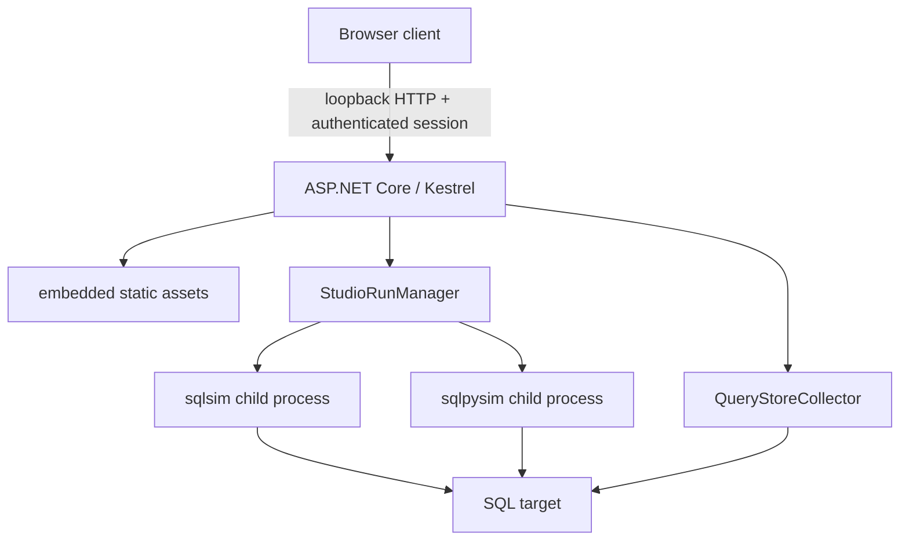

# sqlsim Studio

sqlsim Studio is a local browser interface for configuring, running, monitoring, and comparing sqlsimtools workloads. It is under active development.

> **Version 1.0 preview status:** Windows x64 is **Public Preview**. Ubuntu x64,
> Windows ARM64, and macOS ARM64 are **Private Preview** for invited testers
> while platform validation and packaging are completed. Private Preview builds
> are not attached to the public GitHub Release.

| Platform | Architecture | Stage | Distribution |
| --- | --- | --- | --- |
| Windows | x64 | Public Preview | Public release asset |
| Ubuntu 24.04/26.04 LTS | x64 | Private Preview | Invited testers; platform validation required |
| Windows | ARM64 | Private Preview | Invited testers; native validation required |
| macOS | ARM64 | Private Preview | Invited testers; signing, notarization, and native validation required |

### Invited Ubuntu and Windows ARM64 testing

The [Studio preview workflow](../.github/workflows/studio-private-preview.yml)
builds native Ubuntu x64 and Windows ARM64 tester kits using the existing
publishers and canonical Studio suites. The Ubuntu 24.04-built archive is also
tested unchanged on Ubuntu 26.04. Each kit includes examples, provenance,
offline-default checks, optional explicitly acknowledged live/load suites,
credential-file handling, and JSON/log reports.

These are Actions artifacts, not public release assets or confidential storage.
They remain **Private Preview - testing only**; native offline success does not
establish live SQL correctness, clean-machine installation, signing, or actual
browser behavior. Open a [Private Preview request](https://github.com/microsoft/sqlsimtools/issues/new?template=private-preview.yml)
for participation/testing assistance, and use that issue for sanitized feedback.
The [kit instructions](../release/studio-preview-tester-README.md) describe the
requirements and safety limits.

## Browser Support

Studio targets current stable releases of:

- Microsoft Edge and Google Chrome on Windows
- Microsoft Edge, Google Chrome, and Firefox on Linux
- Safari, Microsoft Edge, Google Chrome, and Firefox on macOS

Internet Explorer and legacy embedded webviews are not supported. Studio uses standard HTML, CSS, JavaScript, Fetch, Canvas, Server-Sent Events, and secure cookies.

Browser compatibility does not imply equal package maturity: Windows x64 is
the Public Preview platform; Ubuntu x64, Windows ARM64, and macOS ARM64 remain
Private Preview for invited testers.

### Tested browsers

Only Windows x64 browsers are tested. The layout sweep checks rendering only;
the live GUI suite and manual acceptance test check that Studio works end to end.

| Platform | Browser | Layout sweep | Live GUI suite and manual test | Status |
| --- | --- | --- | --- | --- |
| Windows x64 | Microsoft Edge | Yes | Yes | Tested |
| Windows x64 | Google Chrome | Yes | Yes | Tested |
| Windows x64 | Firefox | Yes | No | Not supported on Windows; layout only |
| Ubuntu x64 (Private Preview) | Edge, Chrome, Firefox | Approximated by the wide-font pass | No | Not tested |
| macOS ARM64 (Private Preview) | Safari, Edge, Chrome, Firefox | Safari's WebKit engine on Windows only | No | Not tested |
| Windows ARM64 (Private Preview) | Edge, Chrome | No | No | Not tested |

## Architecture

sqlsim Studio is a self-contained local web application, not a remote service.
The packaged .NET executable starts Kestrel on a random loopback port, launches
the user's browser, serves the embedded HTML/CSS/JavaScript client, and exposes
authenticated local APIs. Workloads run in child processes using the packaged
sqlsim binary or optional sqlpysim Python source.



- **Browser client** - Configuration, run monitoring, results, history, comparison, and browser-local non-secret settings
- **Program.cs** - Loopback host, bootstrap/session security, static assets, API endpoints, and browser launch
- **StudioRunManager** - Validates requests, stages bounded private inputs, launches and cancels workload processes, and translates their output into Studio events and results
- **QueryStoreCollector** - Takes optional read-only before/after Query Store snapshots through `Microsoft.Data.SqlClient`
- **Packaged engines** - A native sqlsim binary matching the package runtime, plus sqlpysim source and requirements for users who install Python support

The browser never connects directly to SQL Server. Secrets stay in server
memory and are sent to child processes through redirected standard input, not
URLs, command-line arguments, browser storage, or saved configurations. The
one-time bootstrap token establishes an authenticated cookie session; Host,
Origin, and loopback checks protect the local API boundary.

### Package Architecture

| Operating system | CPU architecture | Preview status |
| --- | --- | --- |
| Windows | x64 | Public Preview |
| Ubuntu 24.04/26.04 LTS | x64 | Private Preview for invited testers |
| Windows | ARM64 | Private Preview for invited testers |
| macOS | ARM64 | Private Preview for invited testers |

## Current Implementation

The production skeleton currently provides:

- Loopback-only Kestrel binding on a random port
- One-time 256-bit bootstrap URL
- `HttpOnly`, `SameSite=Strict` authenticated session cookie
- Host-header and unsafe-method Origin validation
- No CORS and no ASP.NET request logging
- Security headers and no-store responses
- Embedded static Studio UI
- Authenticated `/api/health` runtime endpoint
- Automatic default-browser launch
- Query mode with sqlsim or sqlpysim
- SQL File mode with bounded private staging
- Mixed Workload mode with server-generated workload JSON and per-group settings
- Native sqlsim Replay mode (`fast` and `stress`)
- Live progress with per-query query-statistics charts, or final-results-only telemetry
- Cancellation, sanitized session logs, and canonical JSON Results mapping
- Bounded in-memory history and guarded A/B comparison for compatible final-result runs and imported result files
- App settings with Light, Dark, System, and six color themes, saved per user across restarts
- Versioned local JSON configuration save/load with secrets excluded
- Studio-owned Query Store before/after aggregate deltas with read-only preflight
- Self-contained Windows and Linux packages with embedded browser assets and the matching native sqlsim binary

Studio offers structured JSON telemetry for monitoring and metrics, or bounded
console output for viewing result rows. Console mode omits `-json` and
`-stream-json`; leave `-q` off to display rows from the first execution.

Persistent run history, remaining authentication modes, release automation, and
final accessibility and visual polish are still in progress. Do not treat the
current application as release-ready.

## Connecting to Azure SQL with Microsoft Entra

Select **Microsoft Entra token** and paste an access token for the SQL Server
audience into the credential field. Acquire one with the Azure CLI:

```powershell
az login
az account get-access-token --resource https://database.windows.net --query accessToken -o tsv
```

Studio passes the token to the engine over standard input, never on the command
line, and never writes it to a saved configuration or a log. Tokens are
short-lived, so repeat the command when a run fails to authenticate.

Use **Test connection** after pasting the token to confirm the target, database,
and encryption settings before starting a workload.

Microsoft Entra interactive, managed identity, and service principal are
available through Studio. Interactive authentication is Windows-only; managed
identity and service principal require a suitably configured Azure target.

**Save configuration** downloads the selected mode and its settings as a
versioned `.json` file on the user's computer. SQL scripts and replay content are
included so the configuration can be restored without selecting those files
again. Passwords and tokens are never included, and loading any configuration
clears the current secret field. Treat saved configurations as sensitive when
their query or script text contains environment-specific information.

See [CONFIGURATION.md](CONFIGURATION.md) for the version 1 JSON contract,
mode-specific source objects, validation limits, security rules, and examples.

## Build on Windows

```powershell
cd sqlsimstudio
.\build.ps1
```

The self-contained Windows x64 output is written to `build/win-x64/`.
The package contains the Studio executable, the matching native sqlsim binary,
sqlpysim source, requirements, the released-product Studio skill, notices, and
no separate browser asset folder.
sqlpysim remains optional. To enable it, create `.venv` beside the Studio
executable, or in the folder above it as the sqlsimtools package does, and
install `sqlpysim/requirements.txt`. Studio uses `SQLSIM_STUDIO_PYTHON_PATH`
first, then those two `.venv` locations, then `python` on `PATH`; see
[Install sqlsim Studio](../INSTALL.md#install-sqlsim-studio).

Windows ARM64 is a Private Preview build. Building it from source requires a
matching native ARM64 sqlsim build at `..\sqlsim\build\ARM64\Release\sqlsim.exe`:

```powershell
cd sqlsimstudio
.\build.ps1 -Runtime win-arm64
```

The output is written to `build/win-arm64/`. It must be validated on native
Windows ARM64 hardware before promotion beyond Private Preview.

## Build Linux Locally with WSL2

Cross-publish the self-contained Linux binary from Windows, then execute and
validate that native binary inside WSL2. The WSL distribution does not need a
.NET runtime or SDK.

```powershell
.\build.ps1 -Runtime linux-x64
wsl -d Ubuntu -- bash -lc 'cd /mnt/c/sqlsimtools/sqlsimstudio && bash ./smoke-test-linux.sh'
```

The self-contained Linux x64 output is written to `build/linux-x64/`.

## Run During Development

```powershell
dotnet run --project .\server\SqlsimStudio.csproj
```

Studio binds only to loopback and opens the default browser. For automated testing, `--no-open` requires `--bootstrap-file <path>` so the one-time token is not written to logs. Studio deletes the file after successful bootstrap.

```powershell
.\smoke-test.ps1
```

## Error Handling and Validation Suite

`smoke-test.ps1` proves the happy path works. `full-test-suite.ps1` proves Studio
fails correctly: that bad input is rejected with a specific reason, that the
security boundary holds, and that a failed workload reports why.

```powershell
# Everything, including the live failure-reporting sections
.\full-test-suite.ps1

# Only the sections that need no SQL Server
.\full-test-suite.ps1 -OfflineOnly

# Against a packaged build
.\full-test-suite.ps1 -SkipBuild -StudioExecutable .\build\win-x64\sqlsimstudio.exe
```

| Section | Covers | Needs SQL |
| --- | --- | --- |
| 1. Startup and argument handling | Exit codes, usage output, no leaked stack traces | No |
| 2. Authentication boundary | 404 for unauthenticated, bootstrap replay, Host and Origin | No |
| 3. Request validation - connection | Connection-string injection, credential rules per mode, limits | No |
| 4. Request validation - workload shape | Mode, load shape, file extensions, group limits | No |
| 5. Request validation - engine capability | Every sqlpysim restriction | No |
| 6. Request validation - execution options | Telemetry, statistics, pooling, timeouts | No |
| 7. Payload limits | 1 MB query and file, 10 MB workload, malformed JSON | No |
| 8. App settings | Saved theme file, allow-list validation, origin and session checks, restart persistence, corrupt-file tolerance | No |
| 9. Connection failure reporting | Unreachable port, missing database, complete success fields | Yes |
| 10. Workload failure reporting | SQL error reaches the log, exit code, credential never logged, stop vs fail | Yes |
| 11. Concurrency and lifecycle | Second run refused, test refused during a run, stop with nothing running | Yes |

Every rejection test asserts the specific error text rather than just a 400, so a
change that returns the wrong reason fails the suite.

## Automated GUI Smoke Test

The Playwright suite has two tiers.

`gui-tests/interface.spec.cjs` and `gui-tests/configuration.spec.cjs` load
`client/index.html` directly over `file://`. They need no Studio process, no SQL
target, and finish in seconds, so they are safe to run anywhere:

```powershell
.\node_modules\.bin\playwright.cmd test --config gui-tests/playwright.config.cjs `
    gui-tests/interface.spec.cjs gui-tests/configuration.spec.cjs
```

`gui-tests/responsive.spec.cjs` is a layout sweep over the same `file://` client.
It fills Configure, Monitor, Results, Compare, and the settings dialog with
realistic data, then checks 19 desktop widths from 761 to 2560 pixels for
horizontal page overflow and for text that escapes its box, is clipped, overlaps
other text, or wraps in a label, heading, or button. It runs in Edge (150%
scaling), Chrome (125% scaling), Firefox, WebKit (Safari's engine), and a
wide-font pass that substitutes Verdana for the Windows-only interface fonts,
approximating macOS and Linux fallback fonts:

```powershell
.\node_modules\.bin\playwright.cmd install firefox webkit
.\node_modules\.bin\playwright.cmd test --config gui-tests/responsive.config.cjs
# One engine only
.\node_modules\.bin\playwright.cmd test --config gui-tests/responsive.config.cjs --project firefox
```

Set `SQLSIMSTUDIO_RESPONSIVE_SCREENSHOTS=1` to save full-page screenshots under
`build/responsive-screenshots/<project>/` at common widths and wherever a
defect is found.

`gui-tests/studio.spec.cjs` starts the packaged Studio server with a private
one-time bootstrap file and drives a real browser through connection controls,
workload modes, output modes, cancellation, Results, session history, and A/B
comparison against a live SQL target. It captures screenshots, video, and traces
under `build/` when a test fails.

```powershell
.\gui-smoke-test.ps1
```

Use `-SkipBuild` to reuse the current `win-x64` package, `-Headed` to watch the
browser, `-CaptureScreenshots` to save desktop/mobile Configure views under
`build/gui-screenshots/`, or `-Server` and `-Database` for another
integrated-authentication target. Query Store coverage is optional and
preflighted before browser launch:

```powershell
.\gui-smoke-test.ps1 -SkipBuild -QueryStoreDatabase AdventureWorks
```

The suite defaults to Microsoft Edge. Pass `-BrowserChannel chromium` to use
Playwright's own bundled browser instead, which requires no installed Edge or
Chrome:

```powershell
.\node_modules\.bin\playwright.cmd install chromium
.\gui-smoke-test.ps1 -SkipBuild -BrowserChannel chromium
```

Authentication modes requiring credentials are checked for correct UI state but
are not executed unless a future secure credential fixture is added. The suite
never writes credentials to command lines, logs, screenshots, or traces.

Use [MANUAL-TEST.md](MANUAL-TEST.md) for the corresponding recordable manual
acceptance pass, expected outcomes, evidence fields, and known-gap inventory.
In VS Code chat, invoke `/sqlsimstudio-manual-test start` for a guided,
one-test-at-a-time session that records outcomes and can resume later.

## Browser Security Boundary

The local browser is not trusted merely because it runs on the same machine. Studio requires a one-time bootstrap token and authenticated session cookie, rejects unexpected Host and Origin headers, disables CORS, and returns 404 to unauthenticated requests. Future workload mutation APIs must also require anti-forgery validation.

Secrets must never be persisted or placed in child-process arguments. Studio will invoke sqlsim or sqlpysim with `-P -` or `-T -` and write the credential through redirected stdin.

Query Store collection uses Microsoft.Data.SqlClient only for read-only snapshots
before and after a workload. It requires Query Store in `READ_WRITE` state and
`VIEW DATABASE STATE`, or `VIEW DATABASE PERFORMANCE STATE` on SQL Server 2022
and later. Deltas are aggregated and can include other sessions executing the
same query during the measurement window.

## Third-Party Software

See [THIRD-PARTY-NOTICES.md](THIRD-PARTY-NOTICES.md).
